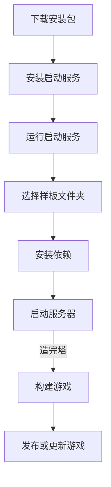
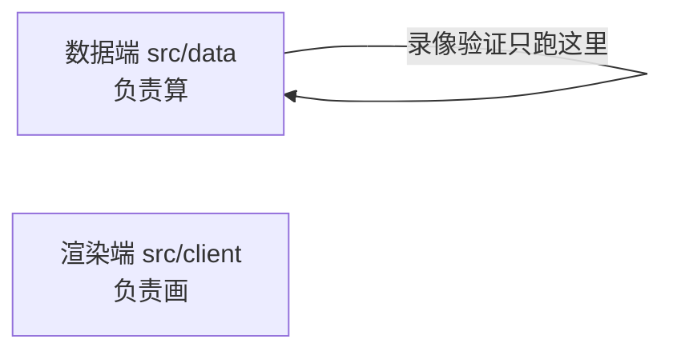
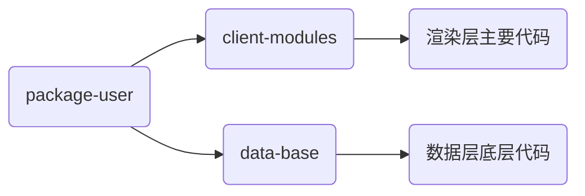

# Phase 10: 文档重构 - Pattern Map

**Mapped:** 2026-10-16
**Files analyzed:** 25（24 篇 `docs/intermediate/*.md` 新增 + `docs/.vitepress/config.ts` 修改）
**Analogs found:** 25 / 25

> 本阶段为**纯文档产出**。这里的「Pattern」指 **markdown 页面骨架 / VitePress 语法 / config 条目形状**，analog 是仓库现存的文档文件与站点配置。所有引用均为 `file:line`，且经 `git ls-files` 核实为**已跟踪源码**（非 gitignore 镜像）。

---

## File Classification

| New/Modified File | Role | Data Flow | Closest Analog | Match Quality |
|-------------------|------|-----------|----------------|---------------|
| `docs/.vitepress/config.ts` | config（站点配置） | navigation（nav + sidebar 静态数组） | 自身（就地编辑）；形状参照同文件 `53-156` | exact（edit-in-place） |
| `docs/intermediate/data-vs-render.md` | doc-page（概念+图） | content/diagram | `docs/guide/system.md:55-71`（渲染端与数据端通信） | exact（同主题） |
| `docs/intermediate/src-tour.md` | doc-page（概念+目录导览） | content/overview+table | `docs/guide/implements/index.md:1-8` + `docs/guide/coding.md:9-21`（目录树 mermaid） | role-match |
| `docs/intermediate/code-basics.md` | doc-page（概念+教程） | content/tutorial | `docs/guide/system.md:160-191`（ES6 模块化） | role-match |
| `docs/intermediate/hooks.md` | doc-page（概念+对照表） | content/reference+codesample | `docs/guide/system.md:73-86`（钩子示例） | role-match |
| `docs/intermediate/data-state-overview.md` | doc-page（总览+表） | content/overview+table | `docs/guide/implements/index.md:1-42` + `docs/api/index.md:1-31` | role-match |
| `docs/intermediate/hero-attribute.md` | doc-page（how-to+代码） | content/code-heavy | `docs/guide/implements/special.md` | role-match |
| `docs/intermediate/hero-items.md` | doc-page（how-to+代码） | content/code-heavy | `docs/guide/implements/special.md`；主题 `docs/dev/hero/hero-items.md` | role-match |
| `docs/intermediate/hero-equipment.md` | doc-page（how-to+代码） | content/code-heavy | `docs/guide/implements/special.md`；主题 `docs/dev/hero/hero-equipment.md` | role-match |
| `docs/intermediate/hero-location.md` | doc-page（how-to+代码） | content/code-heavy | `docs/guide/implements/special.md` | role-match |
| `docs/intermediate/map-structure.md` | doc-page（结构说明+表） | content/overview+table | `docs/guide/implements/index.md` | role-match |
| `docs/intermediate/map-tiles.md` | doc-page（how-to+代码） | content/code-heavy | `docs/guide/implements/special.md`；主题 `docs/dev/store/tile-store.md` | role-match |
| `docs/intermediate/flags.md` | doc-page（how-to+代码） | content/code-heavy | `docs/guide/implements/special.md` | role-match |
| `docs/intermediate/combat-overview.md` | doc-page（流程+图+对照表） | content/diagram+table | `docs/guide/coding.md:9-21`（mermaid）+ `docs/dev/enemy/enemy-combat-flow.md:1-27` | role-match |
| `docs/intermediate/enemy-specials.md` | doc-page（how-to+代码） | content/code-heavy | `docs/guide/implements/special.md`（**同主题**） | exact |
| `docs/intermediate/enemy-aura.md` | doc-page（how-to+代码） | content/code-heavy | `docs/guide/implements/special.md:163-265`（拓展-光环属性，**同主题**） | exact |
| `docs/intermediate/enemy-query.md` | doc-page（how-to+代码） | content/code-heavy | `docs/guide/implements/special.md`（骨架） | no-subject-analog（新功能） |
| `docs/intermediate/enemy-final.md` | doc-page（how-to+代码） | content/code-heavy | `docs/guide/implements/special.md`（骨架） | no-subject-analog |
| `docs/intermediate/enemy-calculator.md` | doc-page（how-to+代码） | content/code-heavy | `docs/guide/implements/special.md:27-119`（伤害计算，**同主题**） | exact |
| `docs/intermediate/enemy-map-damage.md` | doc-page（how-to+代码） | content/code-heavy | `docs/guide/implements/special.md:121-161`（地图伤害，**同主题**） | exact |
| `docs/intermediate/enemy-combat-script.md` | doc-page（how-to+代码） | content/code-heavy | `docs/dev/enemy/enemy-combat-flow.md` + `special.md` 骨架 | role-match |
| `docs/intermediate/enemy-status-hooks.md` | doc-page（how-to+代码） | content/code-heavy | `docs/dev/enemy/enemy-combat-flow.md` + `special.md` 骨架 | role-match |
| `docs/intermediate/events.md` | doc-page（how-to+代码） | content/code-heavy | `docs/guide/implements/special.md`（骨架） | role-match |
| `docs/intermediate/replay-commands.md` | doc-page（原则+说明） | content/reference | `docs/dev/replay/replay-system.md:1-40`（概念定义结构） | role-match |
| `docs/intermediate/data-plugins.md` | doc-page（how-to+代码） | content/code-heavy | `docs/guide/implements/special.md`（骨架） | role-match |

**说明：** `enemy-specials` / `enemy-aura` / `enemy-calculator` / `enemy-map-damage` 与既有 `docs/guide/implements/special.md` 是**同一主题**（特殊属性 / 光环 / 伤害计算 / 地图伤害），是最强 analog；但该旧文档对应**旧接口**，本批要重写为新接口，故**只借结构、不抄接口名**。

---

## Pattern Assignments

### 通用页面骨架（24 篇全部适用）

**Analog A：`docs/guide/quick-start.md`（简洁页 + 相对链接 + mermaid + `:::info`）**

**页面开头**（`docs/guide/quick-start.md:1-7`）——单 `#` 一级标题 + 引言 + `##` 小节 + 相对链接：
```md
# 快速开始

本章节主要帮助你快速上手 2.B 样板。

## 常见需求实现指南

参考[此文档](./implements/index.md)
```

**相对链接写法**（`docs/guide/quick-start.md:7`、`docs/guide/system.md:46`）：
- 同目录：`[此文档](./implements/index.md)`
- 带锚点：`[系统说明](./system.md#渲染端与数据端通信)`（`docs/guide/coding.md:46` 亦同）
- D-17 要求「适当链接、不要过多」——每篇 2–5 处即可。

**mermaid 代码块**（`docs/guide/quick-start.md:27-31`）：
````md

````

**提示容器**（`docs/guide/quick-start.md:42-44`；`docs/guide/system.md:152-154` 为 `::: warning`）：
```md
:::info
由于 `opus` 格式的音频……
:::
```

**Analog B：`docs/guide/system.md`（front matter + 警示容器 + 外链）**

**front matter（可选）**（`docs/guide/system.md:1-3`、`docs/api/index.md:1-3`）：
```md
---
lang: zh-CN
---

# 系统说明
```
> 现有多数 `docs/guide/*` 无 front matter，仅首页（`docs/index.md:1-27`，`layout: home`）与部分页有。新增 24 篇**不强制**加 front matter；如需中文显式声明可照 `system.md:1-3`。

**警示容器**（`docs/guide/system.md:152-154`）：
```md
::: warning
**注意**，在渲染端重写的函数在录像验证中将无效，因为录像验证不会执行任何渲染端内容！
:::
```

**外链**（`docs/guide/system.md:189`、`docs/guide/coding.md:42`）：
```md
更多模块化语法内容请查看[这个文档](https://h5mota.com/bbs/thread/?tid=1018&p=3#p33)
```
> D-23 指定 `code-basics` 结尾须给 `https://h5mota.com/bbs/thread/?tid=1018&p=3#p41`（同 `coding.md:42` 的链接）。

**Analog C：`docs/guide/implements/special.md`（代码重型 how-to：`// [!code ++]` 高亮、行号高亮、`拓展-x` 小节）**

**代码行高亮**（`docs/guide/implements/special.md:13-25`，`// [!code ++]` 逐行标记新增行）：
```ts
export const specials: SpecialDeclaration[] = [
    // ... 原有属性定义

    // 自定义属性
    {
        code: 30, // 特殊属性代码，用于 hasSpecial 判断 // [!code ++]
        name: '自定义特殊属性', // 特殊属性名称 // [!code ++]
        desc: '勇士对该怪物造成的伤害减少 10%', // 特殊属性描述 // [!code ++]
        color: '#ffd' // 特殊属性显示的颜色 // [!code ++]
    }
];
```

**区块行号高亮**（`special.md:54` 的 ```` ```js {4-10} ````；`special.md:250` 的 ```` ```ts {2-9} ````）：
````md
```js {4-10}
"enemys": {
    ...
}
```
````

**「打开文件→在最后/搜索某函数→添加代码」的 how-to 叙述**（`special.md:11`、`:29`、`:123`）：
> 打开 `packages-user/data-state/src/enemy/special.ts`，在最后添加一个属性定义：
> ……直接 `ctrl+F` 搜索 `calMapDamage` 即可找到……

**代码块语言标注**：TS 用 ```` ```ts ````（`special.md:13`）、JSONC 用 ```` ```js ````（`special.md:54`）、shell 用 ```` ```bash ````。

**❌ 不要照搬的：** `special.md:46,121,163` 的 `## 拓展-xxx` 小节命名是旧文档遗留风格；新文档按各自 D-2x 内容组织标题即可。**禁用**任何「渲染端教程后续再讲 / 留到高级教程」式元叙述（D-16，RESEARCH Pitfall 4）。

---

### `docs/.vitepress/config.ts`（config, navigation）

**Analog：** 自身（edit-in-place），形状参照同文件既有 `nav`/`sidebar`。

**现有 `nav`（待新增一条，不改旧条目）**（`docs/.vitepress/config.ts:53-58`）：
```ts
nav: [
    { text: '主页', link: '/' },
    { text: '指南', link: '/guide/quick-start' },
    { text: 'API', link: '/api/' },
    { text: '错误代码', link: '/logger/' }
],
```

**现有 `sidebar` 顶层结构（按路径前缀分键）**（`docs/.vitepress/config.ts:59-156`）：
- `'/guide/'`（`60-127`）
- `'/logger/'`（`128-149`）
- `'/api/'`（`150-155`，`items: api`，`api` 来自 `import api from './apiSidebar'`，`config.ts:3`）

**嵌套分组写法（本批新键照此形状）**（`docs/.vitepress/config.ts:70-86`）：
```ts
{
    text: 'UI 系统',
    collapsed: false,
    items: [
        { text: '快速浏览', link: '/guide/ui/' },
        { text: '编写 UI', link: '/guide/ui/ui' },
        ...
    ]
},
```

**必须新增的形状（示意；`text` 显示名须先经用户批准，D-13）**（参照 `config.ts:59-156` 结构；链接写法与 `config.ts:64-124` 一致，用绝对路径且不带 `.md`）：
```ts
sidebar: {
    '/intermediate/': [
        {
            text: '中级教程',
            collapsed: false,
            items: [
                {
                    text: '概念与导航',
                    collapsed: false,
                    items: [
                        { text: '数据端与渲染端', link: '/intermediate/data-vs-render' }
                        // …按 D-20 的 4 组顺序
                    ]
                }
            ]
        }
    ],
    '/guide/': [ /* 原样保留，禁止改动 */ ],
    '/logger/': [ /* 原样保留，禁止改动 */ ],
    '/api/': [{ text: 'API 列表', items: api }]
}
```

**硬约束：**
- 只**新增** `nav` 一条 + `sidebar['/intermediate/']` 键；**禁止**改动/删除 `'/guide/'`、`'/logger/'`、`'/api/'` 及既有 `nav` 条目（D-14 / RESEARCH Pitfall 3）。
- **不要**触碰 `docs/.vitepress/api.ts`、`init.ts`、`apiSidebar.ts`（后者 gitignored 且会被覆盖，`api.ts:71`）。
- 24 条链接必须全部挂上，否则页面「写了但看不见」（RESEARCH Pitfall 1 / D-09 人工审阅）。

---

### 概念与导航组（4 篇）

#### `data-vs-render.md`（doc-page, content/diagram）

**Analog（结构与主题）：** `docs/guide/system.md:55-71`（「渲染端与数据端通信」——同主题，讲数据端不能引渲染端、录像只跑数据端）；`docs/guide/quick-start.md:67-73`（构建分两次打包、录像验证只跑数据端）。

**可复用图示素材**（`docs/guide/system.md:88-121` 是加载流程图，本页应改为「双端分离」mermaid 图；mermaid 语法照 `quick-start.md:27-31`）：
````md

````
> D-21：提两者分别在 `src/data`、`src/client`；重点讲录像验证；**不提**「渲染端不能反向推送」（留高级）；禁止「后续再讲」。

#### `src-tour.md`（doc-page, content/overview+table）

**Analog：** `docs/guide/coding.md:9-21`（`packages-user` 目录树 mermaid `graph LR`）+ `docs/guide/implements/index.md:1-8`（「只在某些文件夹写代码」的清单）。

**目录树 mermaid 照抄形状**（`docs/guide/coding.md:9-21`）：
````md

````
**「该不该改」表**：用 markdown 表格（参照 `docs/api/index.md:7-31` 的清单式表格/列表）。
> D-22：详讲 `src/data`/`src/client`/`src/content`/`src/constant.ts`；一句带过 `bootstrap.ts`/`data.ts`/`package.json`/`styles.less`；**不讲** `main.ts`/`App.vue`/`types/`（已弃用）。主题素材见 RESEARCH「24 篇文档的源码入口 · 概念与导航」。

#### `code-basics.md`（doc-page, content/tutorial）

**Analog：** `docs/guide/system.md:160-191`（ES6 模块化语法：`import`/`export` 代码块 + 外链）。

**语法小节代码形状**（`docs/guide/system.md:164-170`）：
```ts
import { Patch } from '@motajs/legacy-common'; // 从样板库中引入接口
import { patchMyFunctions } from './override';
```
**外链**（照 `docs/guide/system.md:189`/`coding.md:42`）：
```md
更多模块化语法内容请查看[这个文档](https://h5mota.com/bbs/thread/?tid=1018&p=3#p33)
```
> D-23：顺序 ①简明语法 ②模块与引入 ③类型入门；泛型比喻「类型的函数」；`interface` → `implements` 建议但非强制；结尾链接必须是 `https://h5mota.com/bbs/thread/?tid=1018&p=3#p41`。**无源码依赖**（唯一一篇）。

#### `hooks.md`（doc-page, content/reference+codesample）

**Analog：** `docs/guide/system.md:73-86`（钩子 `hook.on('afterBattle', ...)` 示例）。

**钩子示例代码形状**（`docs/guide/system.md:75-85`）：
```ts
import { hook } from '@user/data-base';
hook.on('afterBattle', enemy => {
    console.log('与怪物战斗：', enemy.id);
});
```
**「需求 → 钩子」对照表**：markdown 表格（列 `需求` / `钩子`），照 `data-state-overview` 的表格风格。
> D-24：`addHook`/`removeHook`；`hook/initialize.ts` 一笔带过；async 钩子只提哪些是。钩子族清单（`IHeroAttributeHooks` 等）的 `file:line` 见 RESEARCH「概念与导航 · hooks」。**注意**：RESEARCH 给的是**接口定义**（`packages/common/src/hook.ts`、`types.ts`），文中用 `addHook`/`removeHook` 的**顶层接口名**（D-15：只讲顶层常用接口）。

---

### 基础接口组（8 篇）

> 组内 8 篇均为「how-to + 代码」型，统一套用 Analog C（`docs/guide/implements/special.md`）的骨架：`# 标题` → 引言 → `## 小节` → ```` ```ts ```` 代码块 → `// [!code ++]` 标新增行。**代码块内每一处接口名/字段名必须按 RESEARCH 源码入口逐字核对**（RESEARCH Pitfall 5）。

#### `data-state-overview.md`（doc-page, content/overview+table）

**Analog：** `docs/guide/implements/index.md:1-8`（「只在这些文件夹写」清单）+ `docs/api/index.md:7-31`（表格/列表总览）。
**核心风格：** 一张表列「对象 / 获取方式」，列如 `对象` / `获取方式` / `分层(L0–L3)`。
> D-25 给出完整对象清单与 L0–L3 分组；字段来源 `file:line` 见 RESEARCH「基础接口 · data-state-overview」。放在基础接口组最前。

#### `hero-attribute.md`（doc-page, content/code-heavy）

**Analog：** `docs/guide/implements/special.md`（how-to 骨架）。
**主题素材：** `packages-user/data-base/src/hero/types.ts:104-283`、`.../hero/modifier.ts:42-78`（RESEARCH）。
**要点示范代码：** `getModifiableAttribute().add(...)`、`ValueModifier`/`PercentageModifier`、`addModifier(name, modifier, save?)`。
> D-26：基础 vs 最终属性、修饰器、`save` 参数语义、「不进存档时由外部系统分配」的提示用 `:::warning` 表达。

#### `hero-items.md`（doc-page, content/code-heavy）

**Analog（结构）：** `docs/guide/implements/special.md`。**主题（旧设计）：** `docs/dev/hero/hero-items.md:1-24`（四类道具 Constant/Consumable/Equipment/Pick 的划分——**只取分类语义**，接口名以新源码为准）。
**要点示范代码：** `addItem`、`getItemState`、`iterateItems`、`useItem`、`itemCount`。
> D-27：四种类别区分；`Pick` 即捡即用；道具效果属内容层（可调用 `state`、道具数据）。示例：发黄钥匙 / 减道具 / 使用道具。

#### `hero-equipment.md`（doc-page, content/code-heavy）

**Analog（结构）：** `docs/guide/implements/special.md`。**主题（旧设计）：** `docs/dev/hero/hero-equipment.md`。
**要点示范代码：** `equip`（含 `autoUnload`）、`unequip`、`getEquipped`、`getEquips`；`IHeroEquipsStore` 的 `add`/`get`/`instancesOf`/`count`。
> D-28：以「会用常用接口」为界；`compareEquip` 简单讲；**排序器不讲**（高级）。

#### `hero-location.md`（doc-page, content/code-heavy）

**Analog：** `docs/guide/implements/special.md` 骨架。
**要点示范代码：** `hero.location.x / .y / .direction`、`hero.getLocation()`、`floorId` / `map`。
> D-29：**只讲获取**位置与楼层；移动/切层留高级。

#### `map-structure.md`（doc-page, content/overview+table）

**Analog：** `docs/guide/implements/index.md`（结构说明 + 清单）。
**要点示范代码：** `maps.getMap(id)` / `getActiveMap()` / `iterateAllMaps()`；`IGameMap.layerList` / `eventLayer` / `tileStore`。
> D-30：事件层本质就是个图层，归本篇。接口 `file:line` 见 RESEARCH「基础接口 · map-structure」。

#### `map-tiles.md`（doc-page, content/code-heavy）

**Analog（结构）：** `docs/guide/implements/special.md`。**主题（旧设计）：** `docs/dev/store/tile-store.md`。
**要点示范代码：** `getBlock` / `setBlock` / `removeBlock` / `putMapData` / `getMapData` / `iterateBlocks`。
> D-31：`getLocationData` **留高级**。示例按 how-to 叙述（「打开 X 文件，在 Y 处调用 Z」）。

#### `flags.md`（doc-page, content/code-heavy）

**Analog：** `docs/guide/implements/special.md` 骨架（仓库无同主题旧文档）。
**要点示范代码：** `setField` / `getField` / `getOrInsert` / `getFieldValue` / `addFieldValue`。
> D-32：全局可存档变量；**所有接口都讲（含 `occupied`）**；建议不滥用、及时 `deleteField`。示例：记录开关 / 计数。

---

### 战斗组（9 篇）

> 组内 9 篇多为「how-to + 代码」型，统一套用 Analog C 骨架。**本组是重点，且多项「尚未可用」（N-1/N-2/N-3/N-7），写作以当时代码为准、留余地**（D-18 / RESEARCH「尚未可用」）。
> 组内各篇的**详细主题对照**（接口 `file:line`）见 `10-RESEARCH.md`「24 篇文档的源码入口 · 战斗」表。

| 文档 | 结构 analog | 主题素材（现有文档 / 源码） |
|------|-------------|---------------------------|
| `combat-overview.md` | mermaid 图照 `docs/guide/coding.md:9-21`；末尾「流程→文档」对照表 | `docs/dev/enemy/enemy-combat-flow.md:1-27`（三阶段：战前/战斗/战后）；`combat/types.ts:747-755`（buildup 四阶段） |
| `enemy-specials.md` | `docs/guide/implements/special.md`（**同主题**） | `special.md:1-119`（属性定义 / 函数声明属性 / 编辑器表格）；`src/data/enemy/special.ts` |
| `enemy-aura.md` | `special.md:163-265`（**同主题**，光环） | `docs/guide/implements/special.md:163-265`；`src/data/enemy/aura.ts` |
| `enemy-query.md` | `special.md` 骨架 | 无同主题旧文档；`combat/types.ts:193-227`（**引擎未内置**，N-1） |
| `enemy-final.md` | `special.md` 骨架 | 无同主题旧文档；`src/data/enemy/final.ts:4-27` |
| `enemy-calculator.md` | `special.md:27-119`（**同主题**，伤害计算） | `docs/guide/implements/special.md:27-119`；`src/data/enemy/calculator.ts:10-179` |
| `enemy-map-damage.md` | `special.md:121-161`（**同主题**，地图伤害） | `docs/guide/implements/special.md:121-161`；`src/data/enemy/mapDamage.ts`（**code↔视图不一致，N-2/N-3**） |
| `enemy-combat-script.md` | `special.md` 骨架 + `enemy-combat-flow.md` | `docs/dev/enemy/enemy-combat-flow.md`；`src/data/enemy/script.ts:8-62` |
| `enemy-status-hooks.md` | `special.md` 骨架 + `enemy-combat-flow.md` | `docs/dev/enemy/enemy-combat-flow.md`；`src/data/enemy/hook.ts:38-321` |

**`combat-overview.md` 的 mermaid 流程示意（照 `docs/guide/quick-start.md:27-31` 写法；D-33 流程）：**
````md

````
> D-33：末尾加「流程步骤 → 对应文档」对照表；临界值不在本篇提。

**`enemy-calculator.md` 的临界叙事**（D-38）：只讲定义与「伤害值单调递减」约定，**不讲二分过程**；支援怪写「实在理解不了可暂时跳过」。

**`enemy-map-damage.md` 的「内置五类表」**（D-39）：`code` / 实现位置**写文档时核对源码**（N-2 提示 code↔视图映射可能不一致，须向用户确认/核对当时代码）。

**`enemy-status-hooks.md`**：强调「一个状态可能要用多个钩子」（如中毒 = `onStepEnd` + `onAfterTeleportTo`），示例「下次战斗伤害乘二」串起 `enemy-calculator`。

---

### 其他组（3 篇）

#### `events.md`（doc-page, content/code-heavy）

**Analog：** `docs/guide/implements/special.md` 骨架（仓库无同主题旧文档）。
**要点示范代码：** `BuiltInFunction`（`name` + `func(param, env)`）、`createEventRegistrations()` 注册、`IBlockEventEnv` 常用字段。
> D-42：只讲**如何自定义新事件**（内建函数），不讲原理、不列内建全量；自定义示例「设置 flag」「勇士回血」。编辑器识别方式未设计完（N-6）→ **文档留余地**。

#### `replay-commands.md`（doc-page, content/reference）

**Analog（结构）：** `docs/dev/replay/replay-system.md:1-40`（概念定义小节：需求综述 → 需求理解 → 核心概念定义）。
**可借的结构**（`docs/dev/replay/replay-system.md:29-40` 的「核心概念定义」分节写法）：
```md
# 核心概念定义

## 录像步

一段游戏流程中不可再分的最小操作单元。……
```
> D-43：核心原则「玩家直接产生、会影响最终成绩的行为必须计入录像」+ 解释；主动/被动录像（`ReplayCommandType.Active`/`Passive`）；`@shouldReplay`/`@ignoreReplay` 的 `begin`/`end` 区间检测；**不给示例**，后续教程链接过来即可。
> **注意：** `dev/*` 的 `# 一级标题分节` 风格**不沿用**（新页用单 `#` 主标题 + `##` 小节）；此处仅借其「概念定义」的组织方式。

#### `data-plugins.md`（doc-page, content/code-heavy）

**Analog：** `docs/guide/implements/special.md` 骨架。
**要点示范代码：** `IDataPluginDefine`（`id`/`dependencies`/`awake`/`initialize`/`afterLoad`）、注册在 `src/data/plugin/list.ts` 的 `dataPlugins`、`state.addSaveableContent`。
> D-44：时机次序 `awake`（装配）→ `initialize`（加载前）→ `afterLoad`（加载后）；示例**占位 / 待提供**（N-4，不用商店插件），并写明「是否纳入本中级篇取决于示例难度」。

---

## Shared Patterns

### 文件命名（kebab-case）
**Source:** `dev.md:68`（RESEARCH 已核实）
**Apply to:** 全部 24 个新 `.md` 文件名 + `docs/intermediate/` 目录名。
> 目录/文件名一律**连字符英文**（D-02）。24 个文件名已由 D-20 锁定，不得自创。

### 换行符（CRLF）
**Source:** `dev.md:116`、`.prettierrc:12`
**Apply to:** 全部 24 个新 `.md` 文件。
> markdown **无 lint/prettier 门禁**（RESEARCH 已核实），但仓库约定 CRLF；执行时须确保写入为 CRLF，否则 git diff 会整文件变红（RESEARCH Pitfall 6）。

### 单 H1 + H2/H3 层级
**Source:** `docs/guide/quick-start.md:1`、`docs/guide/system.md:5`
**Apply to:** 全部 24 篇。
> 每页**仅一个** `#` 主标题（照 `quick-start.md:1`/`system.md:5`），其后用 `##`/`###`。**不要**照抄 `docs/dev/*` 的「每个小节都是 `#`」风格（`docs/dev/template.md:3,7,24` 等）。

### 链接
**Source:** `docs/guide/quick-start.md:7`、`docs/guide/coding.md:46`
**Apply to:** 全部 24 篇的站内互引。
> 同目录用 `./x.md`，跨目录用相对当前文件的路径；带锚点用 `./x.md#锚点`。D-17「适当、不过多」。

### 提示容器
**Source:** `docs/guide/quick-start.md:42-44`（`:::info`）、`docs/guide/system.md:152-154`（`::: warning`）
**Apply to:** 需要提示 / 警示 / 注意事项处。
> 用 VitePress 容器（D-01 明确 `:::info`、mermaid 可用）。

### 代码块高亮
**Source:** `docs/guide/implements/special.md:19-23`（`// [!code ++]`）、`:54`（`{4-10}`）
**Apply to:** 全部含「在既有文件上增改」示例的 how-to（基础接口组 + 战斗组 + `events`/`data-plugins`）。
> 标出**新增行**用 `// [!code ++]`；标出**改动区块**用 ```` ```ts {起-止} ````。

### 禁止元叙述
**Source:** D-16（CONTEXT）
**Apply to:** 全部 24 篇。
> 不得出现「渲染端教程后续再讲」「留到高级教程再说」「届时」等（RESEARCH Pitfall 4）。指向渲染端内容时，当作指向一个**已存在的平行部分**。

### 越界红线
**Source:** D-14（CONTEXT）、RESEARCH Pitfall 3
**Apply to:** 本批**全部**改动。
> 本批**只**做 `docs/intermediate/*` + `config.ts` 的 intermediate 注册。**禁止**删除/修改 `docs/guide/*`、`docs/dev/*`、`docs/logger/*`，也**禁止**改动 `nav`/`sidebar` 的既有 guide/logger/api 键与 `api.ts`/`init.ts`。越界项只记录、不实施。

---

## No Analog Found

> 本批「无同主题旧文档」但**仍有结构 analog**（`special.md` 骨架）的页面。下方列出**主题素材**来源，供写作时按 RESEARCH 逐字核对：

| File | Role | Data Flow | 缺什么 | 主题素材来源 |
|------|------|-----------|--------|-------------|
| `docs/intermediate/enemy-query.md` | doc-page | content/code-heavy | 无同主题旧文档；且引擎**未内置**查询效果（N-1） | `packages-user/data-system/src/combat/types.ts:193-227,660,677`（RESEARCH） |
| `docs/intermediate/enemy-final.md` | doc-page | content/code-heavy | 无同主题旧文档 | `src/data/enemy/final.ts:4-27`；`combat/types.ts:229-237,696`（RESEARCH） |
| `docs/intermediate/flags.md` | doc-page | content/code-heavy | 无同主题旧文档 | `packages-user/data-base/src/flag/types.ts:47-136`（RESEARCH） |
| `docs/intermediate/code-basics.md` | doc-page | content/tutorial | 无任何源码依赖（纯语法教学） | 外链 `h5mota.com/bbs/thread/?tid=1018&p=3#p41`（D-23） |
| `docs/intermediate/data-plugins.md` | doc-page | content/code-heavy | 示例**占位待提供**（N-4） | `data-state/src/types.ts:10-81`；`src/data/plugin/*`（RESEARCH） |

> `enemy-map-damage` 虽有同主题旧文档（`special.md:121-161`），但存在 **N-2/N-3 的 code↔视图不一致**与「实际结算待用户补」（D-18/D-39），计划须在写作前核对当时代码并留余地。

---

## Metadata

**Analog search scope:** `docs/guide/**`、`docs/dev/**`、`docs/api/index.md`、`docs/index.md`、`docs/.vitepress/config.ts`（全部经 `git ls-files` 核实为已跟踪；无 gitignore 镜像路径）
**Files scanned:** 既有文档约 10 篇（`quick-start.md`、`system.md`、`coding.md`、`implements/index.md`、`implements/special.md`、`index.md`、`api/index.md`、`dev/template.md`、`dev/hero/hero-items.md`、`dev/enemy/enemy-combat-flow.md`、`dev/replay/replay-system.md`）+ `config.ts`
**Pattern extraction date:** 2026-10-16
**下游注意：** 本阶段「pattern」为文档结构而非生产代码；`10-RESEARCH.md` 的「24 篇文档的源码入口」表提供每篇应读的**接口 `file:line`**，与本文档的**结构 analog**配合使用。
