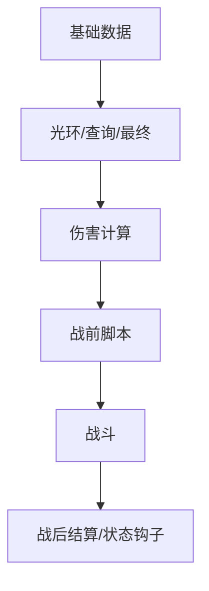

# Phase 10: 文档重构 - Research

**Researched:** 2026-10-16
**Domain:** VitePress 文档编写与站点配置（文档重构，纯文档产出，无生产代码改动）
**Confidence:** HIGH（全部结论基于本仓库源码 / 配置的直接阅读）

## Summary

本阶段是**纯文档产出**阶段。第一批范围 = 24 篇中文中级教程 markdown，落在 `docs/intermediate/`，外加把它们注册进 VitePress 站点（`docs/.vitepress/config.ts` 的 `nav` 与 `sidebar`）。验收标准（CONTEXT D-09）= **用户人工审阅 + 链接全部有效 + 构建通过**。

站点现状已核实：VitePress 站点在 `docs/`，配置在 `docs/.vitepress/config.ts`；`nav` 与 `sidebar` 均为**手写静态配置**（[VERIFIED: docs/.vitepress/config.ts:53-156]），`sidebar` 按路径前缀分键（`'/guide/'`、`'/logger/'`、`'/api/'`）。`docs/api/` 的**侧边栏**由 `docs/.vitepress/api.ts` 的 `generateSidebar()` 扫描目录自动生成（写入 gitignore 的 `apiSidebar.ts`），但 `docs/api/` 下的 markdown 正文本身是**已检入仓库的静态文件**，仓库脚本**不重新生成它们**（D-03 的 API 参考"按包生成"指的是这套既有文件树 + 扫描侧边栏机制）。因此本批任务的配置改动量很小：新增 `'/intermediate/'` 侧边栏键 + 一个 `nav` 入口即可，新增 markdown 文件本身不需要为构建做其它注册。

**Primary recommendation:** 计划拆为「配置任务（改 `config.ts` 注册 intermediate 侧边栏/nav）」+「按阅读顺序分组的 24 篇写作任务（4 组：概念与导航 4 篇 / 基础接口 8 篇 / 战斗 9 篇 / 其他 3 篇）」，写作前先按下方"24 篇文档源码入口"表逐篇锁定要读的 `file:line`，并对标注为"尚未可用"的接口（战斗查询、地图伤害实际结算、`data-plugins` 示例、部分事件）保留余地、以当时代码为准。

## 关键验收前提（先读）

- **链接有效性**：VitePress 站点的相对链接形如 `./x.md` 或绝对路径 `/intermediate/x`。跨目录链接需写成相对当前文件的路径。没有自动化死链检查脚本——验收靠用户人工审阅 + 构建时的 VitePress 警告（VitePress 对无法解析的 markdown 链接会报错/警告）。
- **构建通过**：`pnpm docs:build` = `vitepress build docs`（[VERIFIED: package.json:27]）。注意 `docs/.vitepress/config.ts` 顶部静态 import 了 `./apiSidebar`（[VERIFIED: docs/.vitepress/config.ts:3]），而该文件由 `docs/.vitepress/init.ts` → `generateSidebar()` 生成（[VERIFIED: docs/.vitepress/init.ts:3-5]），且被 `.gitignore` 忽略（[VERIFIED: .gitignore:54]）。**当前工作区 `docs/.vitepress/apiSidebar.ts` 不存在**（本会话实测 `Test-Path` = False）。因此只跑 `docs:build` 会因该 import 失败；需先跑 `pnpm docs:dev`（它内部先执行 `tsx docs/.vitepress/init.ts`，见 [VERIFIED: package.json:26]），或手动 `tsx docs/.vitepress/init.ts`，生成后再构建。此为事实陈述，供计划选择验收命令时参考，不判定为问题。

<user_constraints>
## User Constraints (from CONTEXT.md)

### Locked Decisions

（以下逐字复制自 `10-CONTEXT.md` 的 `## Implementation Decisions`）

#### 载体与整体形式

- **D-01:** 文档载体沿用现有 **VitePress** 站点（`docs/.vitepress/`）；**不要求**脱离 VitePress 的纯 markdown 兼容，按 VitePress 语法书写即可（`:::info`、`mermaid` 等可用，mermaid 插件已安装）。
- **D-02:** 六大块各建**独立文件夹**，命名已获用户批准：
  - `docs/overview`（总览）
  - `docs/beginner`（初级文档）
  - `docs/intermediate`（中级教程）
  - `docs/advanced`（高级教程）
  - `docs/api`（API 参考，已存在）
  - `docs/agent`（Agent 参考）
  - 按 `dev.md`，目录 / 文件名一律使用连字符英文命名。

#### API 参考（第 5 部分）

- **D-03:** 继续按包生成 API 列表（保留 `docs/api/` 现有生成机制），但**正文讲解由人手写**，不是自动生成；对**重点接口额外详细讲解**。

#### 旧内容处置

- **D-04:** 现有旧文档内容**全部删除、重写**，不保留——旧接口设计与当前实现差距较大。范围包括 `docs/guide/*`、`docs/dev/*`、`docs/logger/*` 等既有旧内容。

#### 范围界定

- **D-05:** API 参考**不含 legacy 包**（`@motajs/legacy-*`、`@user/legacy-*`、`@user/data-fallback`）——这部分尚未重构完。
- **D-06:** **初级文档**暂缓——待**编辑器实装后**由用户再派发；具体范围届时另行说明。
- **D-07:** **高级教程**暂缓——待**引擎整体完工后**由用户再派发。
- **D-08:** **Agent 参考**放 `docs/agent`，具体内容后续再讨论。

#### 验收与流程

- **D-09:** 验收标准 = **用户人工审阅** + **链接全部有效** + **构建通过**。
- **D-10:** 本阶段采用**增量派发**：用户每次派发一个具体小任务，AI 只针对该任务在 Phase 10 下创建独立计划；不得预先把整个阶段规划到底。可先行部分先做，未完工部分挂起待派发。

#### 执行方式（本阶段特有，优先级最高）

- **D-11:** 阶段计划随任务累积，可反复追加/重规划；新任务到来时可新增计划而不必重排既有计划。
- **D-12:** 每个计划执行前，第一个 block 点必须**先向用户汇报计划内容**（要做什么、为什么、大致怎么做、影响范围）并等待用户明确回复「可以执行」；未收到「可以执行」前不得开始该计划的任何一步，也不得派发执行子代理。
- **D-13:** 新增或修改任何公共、受保护、私有方法/字段等命名，以及文档目录/文件名，均**必须先向用户反馈并获批准**后方可使用。
- **D-14:** 每个任务的范围由用户界定；AI 不擅自扩大范围。发现的越界内容只记录、不实施。

#### 中级教程（第一批派发内容：`docs/intermediate`，24 篇）

**总原则**

- **D-15:** 本批只写**中级教程**；面向「读完初级 / 只懂一点代码的作者」。只讲**必须用代码完成**的内容与**顶层常用接口**，不深挖底层原理；**底层 / 不常用接口不讲**（留高级教程）。
- **D-16:** **不写**「渲染端教程后续再讲」这类元叙述；**假设渲染端教程已存在**，指向渲染端内容时如指向一个平行部分。
- **D-17:** 全文**适当加跳转链接**，但不要过多。
- **D-18:** 部分特殊属性与**地图伤害实际结算**尚未内置，用户会在编写文档前补齐；写作以当时代码为准。
- **D-19:** 标注「占位 / 待提供」的示例，待用户提供后再写。
- **D-20:** 阅读顺序（4 + 8 + 9 + 3 = 24 篇）：
  - 概念与导航：`data-vs-render`、`src-tour`、`code-basics`、`hooks`
  - 基础接口：`data-state-overview`、`hero-attribute`、`hero-items`、`hero-equipment`、`hero-location`、`map-structure`、`map-tiles`、`flags`
  - 战斗：`combat-overview`、`enemy-specials`、`enemy-aura`、`enemy-query`、`enemy-final`、`enemy-calculator`、`enemy-map-damage`、`enemy-combat-script`、`enemy-status-hooks`
  - 其他：`events`、`replay-commands`、`data-plugins`

**逐篇内容**

- **D-21（概念·`data-vs-render`）** 数据端负责「算」、渲染端负责「画」；比喻「棋局 / 账本」对「棋盘 / 摄像机」；两者分别在 `src/data`、`src/client`；只讲好处，重点**录像验证**（只跑数据端）；附 mermaid 图；**不提**「渲染端不能反向推送」（留高级）；不提「后续再讲」。
- **D-22（概念·`src-tour`）** 详讲 `src/data`、`src/client`、`src/content`、`src/constant.ts`；**一句带过** `src/bootstrap.ts`、`src/data.ts`（数据端入口、需外部 bootstrap）、`src/package.json`、`src/styles.less`（一般不需要动）；**不讲** `src/main.ts`、`src/App.vue`、`src/types/`（均已弃用）；含一张「该不该改」表。
- **D-23（概念·`code-basics`）** 顺序 ①简明语法 ②模块与引入 ③类型入门；类型把**泛型比喻成「类型的函数」**；讲 `interface` → `implements` 约定（**建议但非强制**，不遵循也不会出问题）；三者都大概讲；结尾给 JS/TS 教程链接 `https://h5mota.com/bbs/thread/?tid=1018&p=3#p41`（该教程针对本引擎设计、更适合本引擎作者）。
- **D-24（概念·`hooks`）** 钩子是什么；常用钩子族一览；**需求 → 钩子对照表**（核心）；`addHook` / `removeHook`；`hook/initialize.ts` 一笔带过；async 钩子只提哪些是；「钩子可能被非本对象触发」简说一句（多主对象时才需要判断，一般不会串）。
- **D-25（基础·`data-state-overview`）** 数据端主对象 `state` 是访问一切入口；一张表列常用对象与获取方式：`hero` / `maps` / `flags` / `enemyManager` / `enemyContext` / `combat` / `eventSystem` / `pathfinding` / `tileStore` / `itemStore` / `mapStore` / `eventStore` / `faceManager` / `roleFace` / `replaySystem` / `loader` / `loadManager` / `getDataPlugin(id)` / `emitTip(...)`；按 L0–L3 **轻量分组标注**（分层不影响接口使用，细讲留高级）。放在基础接口组最前。
- **D-26（基础·`hero-attribute`）** 属性列表；基础 vs 最终属性（`getBaseAttribute` / `getFinalAttribute`）；改基础属性 `set` / `add` / `mul` / `div`（经 `getModifiableAttribute()`）；**修饰器**：内置 `ValueModifier`（数值加减，`@system/value`）与 `PercentageModifier`（**按基础值算百分比**，`@system/percentage`）；`addModifier` / `deleteModifier`；提 `save` 参数——**不进存档时，应由外部其它系统负责分配该修饰器，避免读档后不一致**；`getAttribute()` 只读、`getIsolatedAttribute()` 试算；示例：攻击 +N 永久、防御 −X% 临时；指回 hooks 篇。
- **D-27（基础·`hero-items`）** `IHeroItems`（`addItem` 可传负数、`Pick` 立刻生效、`getItemState`、`iterateItems`、`useItem` 仅 `Constant` / `Consumable`、`itemCount`）；**四种类别区分**：`Constant`（永久）/ `Consumable`（消耗）/ `Pick`（即捡即用）/ `Equipment`（装备，虽是道具但属单独系统）；道具效果提一句属**内容层**，并说明道具效果可调用哪些内容（`state`、道具数据）；示例：发黄钥匙 / 减道具 / 使用道具。
- **D-28（基础·`hero-equipment`）** `IHeroEquipment`（`slots` / `canEquipTo` / `equip` 含 `autoUnload` / `unequip` / `equipped` / `getEquipped` / `getEquips`）；`IHeroEquipsStore`（`add` / `delete` / `get` / `instancesOf` / `instances` / `count`）；`IEquipmentState` 的 `value` / `percentage`（本质是修饰器）；`compareEquip` **简单讲**；**排序器不讲**（高级）；以「会用常用接口」为界。
- **D-29（基础·`hero-location`）** 只讲**获取位置**（`hero.location` 的 `x` / `y` / `direction`、`hero.getLocation()`）与**获取楼层**（`floorId` / `map`）；移动位置、切换楼层留高级。
- **D-30（基础·`map-structure`）** `IMapState` 楼层集合（`maps` / `getMap` / `getActiveMap` / `iterateAllMaps`）与**楼层激活**（active）；`IGameMap`（`layerList` / `eventLayer` / `tileStore` / 宽高）；`IMapLayer`（`alias` 别名、宽高）；**事件层本质就是个图层，归本篇**。
- **D-31（基础·`map-tiles`）** 只讲 `getBlock` / `setBlock` / `removeBlock` / `putMapData` / `getMapData` / `iterateBlocks`；`getLocationData` 属低级需求，**留高级**。
- **D-32（基础·`flags`）** 全局**可存档**变量系统；**所有接口都讲（含 `occupied`）**：`setField` / `getField` / `getOrInsert` / `getOrInsertComputed` / `deleteField` / `setFieldValue` / `addFieldValue` / `getFieldValue` / `getFieldValueDefaults`；会进存档；**建议**不滥用、不用的变量及时 `deleteField`；示例：记录开关 / 计数。
- **D-33（战斗·`combat-overview`）** 伤害大致怎么算；流程（基础数据 → 光环 / 查询 / 最终 → 伤害计算 → 战前脚本 → 战斗 → 战后结算 + 状态钩子）；mermaid 图；末尾「流程步骤 → 对应文档」对照表；临界值不在本篇提。
- **D-34（战斗·`enemy-specials`）** 特殊属性是什么、在数据里的样子、两类定义（无参 `defineNonePropertySpecial` / 有参 `defineCommonSerializableSpecial`）；`src/data/enemy/special.ts` 注册；**如何自定义新特殊属性**（步骤）；**「属性实现位置」对照表**（内置属性各自实现在哪）；**多个示例**（有参 / 无参、`name` / `desc` 用字符串与函数）；编辑器识别约定（`// {code} - {name}`、`/** {code} - {name} */`、`ISpecial{code}Value`、`#region` 不能删）；**怪物比较**简单说、一般不改、真要改参考高级教程。
- **D-35（战斗·`enemy-aura`）** **先讲优先级**（高优先级可影响低优先级、反之不行；与查询效果共用优先级）；内置光环（普通 23 / 支援 24 / 特殊光环 26）；运作方式（写「转换器 + 视图」并注册，**不深讲为何**）；四种内置范围只列名（`FullRange` / `RectRange` / `ManhattanRange` / `RayRange`）；**多个自定义示例**：基础光环（减少周围怪物金币与经验）+ 高级特殊光环（给周围怪物上光环、优先级高于特殊光环）；借示例讲清基础光环 vs 特殊光环差距；`apply` 与 `applySpecial` 差别讲清。
- **D-36（战斗·`enemy-query`）** **新增内容（引擎未内置）**；解决「特殊属性查询外部状态」；常规查询 `CommonQuery`（`registerCommonQueryEffect(code, effect)`，`apply(handler, special, query)`）与特殊查询 `SpecialQuery`（`registerSpecialQueryEffect(effect)`，`for(ctx)` → 修饰器 `shouldQuery` / `add` / `delete` / `modify`）；与光环共用优先级；**三个示例**：抱团（范围内每有一个带该属性的怪物就给自身加成）、同化（把范围内怪物特殊属性同化到自身，数值型加算叠加、否则取位置索引最小者）、号角（场上每有一只怪物就给自身加成）；说明三者能干什么即可；用**抱团**对比「用光环实现复杂度更高」；设计原因留高级。
- **D-37（战斗·`enemy-final`）** 最终属性效果：**只影响自身、不依赖也不影响外部环境**的一段收尾调整；内置坚固(3)、模仿(8)；接口 `IEnemyFinalEffect`（`priority` + `apply`）、`registerFinalEffect`；**三方对比**（光环：不依赖外部但影响外部；查询：依赖外部仅影响自身；最终：两者皆无）；示例：**仿攻**（怪物攻击 = 玩家攻击）；`priority` 一句带过；回指 `combat-overview` 流程。
- **D-38（战斗·`enemy-calculator`）** `IDamageCalculator`（`calculate` → `{ damage, turn }`、`getCriticalLimit`）；注册 `useCalculator`；**逐段导读**内置伤害公式并指明「加自己的属性加在哪一步」；**支援怪**较难 → 写「实在理解不了可暂时跳过」；示例：**等差数列属性**（怪物攻击每回合按固定值递增，等差公式）等；核心讲明调整的是 `f(enemy, hero)` 里的 **`f`**；**临界**：定义 + 现有约定（伤害值单调递减；不单调也可、但临界不准）+ 临界值唯一依赖「最后的伤害值」，**不讲二分过程**。
- **D-39（战斗·`enemy-map-damage`）** 概念（领域 / 夹击 / 阻击 / 激光 / 伏击）；三部分（伤害视图 / 转换器 / 合并器，浅讲）；注册 `useConverter` / `useReducer`；内置五类表（`code` / 实现位置**写文档时核对源码**）；自定义示例：**受地形遮挡的激光**；合并器简单讲（决定一个点受多个地图伤害时取什么伤害类型，深入留高级）；**实际结算用户届时补**。
- **D-40（战斗·`enemy-combat-script`）** 战斗脚本（战前 `before` 返回 `bool` 拦截、战后 `after` 结算，按 `priority`）；内置 `MainCombatScript`；注册 `addCombatScript`；**「脚本 vs 钩子」选型表**；战前示例「怪物拥有某特殊属性时无法与其战斗」、战后示例「战后玩家回复固定量生命值」；`priority` 一句。
- **D-41（战斗·`enemy-status-hooks`）** 状态类属性（中毒 / 衰弱 / 重生）必须挂钩子；三类内置（中毒：`onStepEnd` + `onAfterTeleportTo` **两个钩子**；衰弱：`onAfterCombat` + 修饰器；重生：`onAfterCombat` + `onSetFloor` **跨钩子协同**）；注册在 `initialize.ts`；**强调一个状态可能要用多个钩子**；自定义示例「下次战斗伤害乘二」（并说明还要改伤害计算器，串起 `enemy-calculator`）；修饰器概念见 `hero-attribute`。
- **D-42（其他·`events`）** 只讲**如何自定义新事件**（内建函数），不讲原理、不列内建全量；`BuiltInFunction`（`name` + `func(param, env)`）；`IBlockEventEnv` 常用字段（其余指向 API）；参数接口在 `types.ts`；注册在 `createEventRegistrations()`；内置示例导读；**自定义示例：设置 flag、勇士回血**；编辑器识别方式未设计完 → 文档留余地。
- **D-43（其他·`replay-commands`）** 录像系统用途 + **核心原则**「玩家直接产生、会影响最终成绩的行为必须计入录像」并解释其含义；**如何新增自定义录像需改 `packages-user` 下的引擎内容**；主动录像 vs 被动录像（`ReplayCommandType.Active` / `Passive`）；`@shouldReplay` / `@ignoreReplay` 的功能与检测（`begin` / `end` 区间）；**不给示例**，后续其他教程引入自定义录像时直接链接过去。
- **D-44（其他·`data-plugins`）** 插件是强拓展系统，中级只讲基础、**高级教程详解其工作原理**；`IDataPluginDefine`（`id` / `dependencies` / `awake` / `initialize` / `afterLoad`）；时机次序 `awake`（装配）→ `initialize`（**加载前**）→ `afterLoad`（加载后）；注册在 `src/data/plugin/list.ts` 的 `dataPlugins`；`state.addSaveableContent`；示例**占位**（待用户提供**较简单**插件，**不用商店插件**）；写明「是否纳入本中级篇取决于示例难度」。

### the agent's Discretion

CONTEXT.md 中**没有**显式的 `## the agent's Discretion` 小节。可据 D-10/D-14 推断：具体计划的切分方式、每篇的详略排布、示例的组织形式属执行自由度，但**范围**（哪些篇、哪些接口）由 D-15..D-44 锁定，AI 不得擅自扩大。

### Deferred Ideas (OUT OF SCOPE)

（逐字复制自 `10-CONTEXT.md` 的 `## Deferred Ideas`）

- **初级文档**（第 2 部分）完整范围与内容 —— 待编辑器实装后再规划。
- **高级教程**（第 4 部分）完整范围与内容 —— 待引擎整体完工后再规划；中级教材中明确「留高级」的项包括：渲染端结构性内容、地图通行性/移动/踩踏触发、静态与动态图块设计、光环/查询的设计原理、插件系统工作原理、`map-tiles.getLocationData`、装备排序器、修饰器的底层原理、数据端分层原理、位置移动与切换楼层。
- **总览**（第 1 部分）—— 待文档整体做完后最后写。
- **Agent 参考**（第 6 部分）——「游戏数值设计、游戏地图设计」的具体内涵与内容来源。
- 中级教程中标注「占位 / 待提供」的示例（`data-plugins` 的简单插件示例）。
- 旧内容删除的具体时机与清单核对。

</user_constraints>

<phase_requirements>
## Phase Requirements

Phase 10 在 `.planning/REQUIREMENTS.md` 中**没有专属需求 ID**（REQUIREMENTS.md 的 v1 需求均映射到 Phase 1–9，见 [VERIFIED: .planning/REQUIREMENTS.md:58-72]）。本阶段以 CONTEXT.md 的决策 D-01..D-44 为需求基线，验收锚在 D-09（人工审阅 + 链接有效 + 构建通过）。

| ID | Description | Research Support |
|----|-------------|------------------|
| （无） | Phase 10 无专属需求 ID；以 10-CONTEXT.md D-01..D-44 为准 | 见本文件「用户约束」与「24 篇文档源码入口」两节 |

</phase_requirements>

## Architectural Responsibility Map

本阶段无运行时架构，能力均落在「文档站点」这一层。映射如下：

| Capability | Primary Tier | Secondary Tier | Rationale |
|------------|-------------|----------------|-----------|
| 24 篇中级教程正文 | `docs/intermediate/*.md`（内容层） | — | 纯静态 markdown，构建期由 VitePress 渲染 |
| 站点导航（顶栏 `nav`） | `docs/.vitepress/config.ts`（站点配置层） | — | `nav` 是手写静态数组，见 config.ts:53-58 |
| 中栏侧边栏（`sidebar['/intermediate/']`） | `docs/.vitepress/config.ts`（站点配置层） | — | `sidebar` 按路径前缀手写，见 config.ts:59-156 |
| API 参考侧边栏自动扫描 | `docs/.vitepress/api.ts` + `apiSidebar.ts`（构建期脚本层） | `init.ts`（dev 时触发） | `generateSidebar()` 扫描 `docs/api/` 目录生成侧边栏条目，见 api.ts:13-72 |
| API 参考正文 | `docs/api/**/*.md`（已检入的静态文件） | — | 仓库脚本不重生成正文；D-03 的"生成"指既有文件树 + 扫描侧边栏 |
| 跨页链接 | 各 markdown 文件内部（内容层） | — | VitePress 解析相对/绝对链接，无外置死链检查 |

## Standard Stack

本阶段**不安装任何新的运行时/构建依赖**，只使用仓库既有的文档工具链。

### Core

| Library | Version (package.json range) | Purpose | Why Standard |
|---------|------------------------------|---------|--------------|
| `vitepress` | `^1.6.4` | 文档站点静态生成器 | 仓库既有站点载体（D-01）；导航/侧边栏/搜索均由其提供 |
| `vitepress-plugin-mermaid` | `^2.0.17` | 在 markdown 中渲染 mermaid 图 | 已安装并在 config.ts 启用（config.ts:2,46,192），D-21/D-33 需画图 |
| `mermaid` | `^11.12.3` | mermaid 运行时 | 插件依赖；`optimizeDeps.include` / `ssr.noExternal` 已配置（config.ts:193-198） |

（版本来源：[VERIFIED: package.json:92-104]）

### Supporting

| Library | Version | Purpose | When to Use |
|---------|---------|---------|-------------|
| 内置 VitePress 容器 | 随 VitePress | `:::info` / `:::tip` / `:::warning` 等提示框 | 提示、注意事项（既有文档已在用，例 `docs/guide/quick-start.md:42-44`） |
| `tsx` | `^4.21.0` | 运行 `docs/.vitepress/init.ts` 生成 `apiSidebar.ts` | `docs:dev` 已内置；构建前亦可手动执行 |

**Installation:**
```bash
# 本阶段不需要安装任何东西；工具链已在 devDependencies 中
# 若需校验：
node --version            # 需 ^24.0.0（dev.md:14）
```

**Version verification:** 本会话以 `package.json` 为准（站点依赖已在 `node_modules` 中存在，实测 `node_modules/vitepress`、`node_modules/vitepress-plugin-mermaid`、`node_modules/mermaid` 均存在）。外部 registry 版本核对因本机环境限制未逐项执行（`package-legitimacy` 结果见下）。

## Package Legitimacy Audit

本阶段**不安装任何外部包**（纯文档 + 站点配置修改），因此无需安装前门禁。为完整起见，对本阶段用到的既有文档工具链做了 registry 校验：

| Package | Registry | Age (latest publish) | Downloads | Source Repo | Verdict | Disposition |
|---------|----------|----------------------|-----------|-------------|---------|-------------|
| `vitepress` | npm | 2025-08-05 | 1,369,027/wk | github.com/vuejs/vitepress | [OK] | 既有依赖，沿用 |
| `vitepress-plugin-mermaid` | npm | 2024-09-24 | 399,394/wk | github.com/emersonbottero/vitepress-plugin-mermaid | [OK] | 既有依赖，沿用 |
| `mermaid` | npm | 2026-10-13 | 18,782,236/wk | github.com/mermaid-js/mermaid | [SUS]（`too-new`） | 既有依赖，本阶段不安装；仓库锁定 `^11.12.3`，非最新版 |

**Packages removed due to [SLOP] verdict:** none
**Packages flagged as suspicious [SUS]:** `mermaid`（仅因"最新发布过新"被 seam 标记；本阶段不安装、不升级，无动作。`[ASSUMED]`：该 verdict 不影响本阶段，因为不触发任何 install。）

*来源：`gsd-tools query package-legitimacy check --ecosystem npm`，2026-10-16。*

## Architecture Patterns

### System Architecture Diagram

```
作者/AI 编写
   │
   ├─► docs/intermediate/*.md  (24 篇正文，新增)
   │        │  (相对/绝对链接互引)
   │        ▼
   └─► docs/.vitepress/config.ts   (手写 nav + sidebar，本批需编辑)
            │  nav: 53-58   sidebar: 59-156
            │  import api from './apiSidebar'  (line 3)
            ▼
   ┌────────────────────────── 构建期 (vitepress build docs) ──────────────────────────┐
   │  config.ts 加载                                                                   │
   │    ├─ 静态 import './apiSidebar'  ← 由 docs/.vitepress/init.ts 的 generateSidebar │
   │    │    生成（api.ts:13-72 扫描 docs/api/**/ 目录）→ 写入 docs/.vitepress/         │
   │    │    apiSidebar.ts（gitignored）                                                │
   │    └─ 处理 markdown：mermaid(MermaidMarkdown)、math、容器、链接解析                 │
   │                        ▼                                                           │
   │                  outDir = public/_docs  (config.ts:49)                             │
   └────────────────────────────────────────────────────────────────────────────────────┘
```

关键点：**正文文件不会被任何脚本生成或扫描注册**——`sidebar` 是手写数组，`nav` 是手写数组。新增 markdown 只需（a）写文件、（b）若要在侧边栏出现则手工加 `sidebar['/intermediate/']` 条目、（c）若要顶栏出现则手工加 `nav` 条目。

### 新增 24 篇文档需要在 config.ts 改什么（精确到行）

现状（[VERIFIED: docs/.vitepress/config.ts:53-58]）：

```ts
nav: [
    { text: '主页', link: '/' },
    { text: '指南', link: '/guide/quick-start' },
    { text: 'API', link: '/api/' },
    { text: '错误代码', link: '/logger/' }
],
```

现状侧边栏分三个路径键（[VERIFIED: docs/.vitepress/config.ts:59-156]）：`'/guide/'`（line 60）、`'/logger/'`（line 128）、`'/api/'`（line 150，`items: api`，其中 `api` 来自 `import api from './apiSidebar'`，[VERIFIED: docs/.vitepress/config.ts:3]）。

**必须新增：**

1. **顶栏入口**（可选但建议，D-09 未强制）：在 `nav`（config.ts:53-58）加入一条，例如 `{ text: '中级教程', link: '/intermediate/data-vs-render' }`。
2. **侧边栏分组**（必需，否则 24 篇无侧边栏导航）：在 `sidebar` 对象（config.ts:59-156）新增 `'/intermediate/'` 键，值为一个 `{ text: '中级教程', collapsed: false, items: [...] }` 分组。`items` 依 D-20 的 4 组顺序组织，可嵌套子分组（参考 `'/guide/'` 的嵌套写法，config.ts:70-124）：
   - 概念与导航：`data-vs-render`、`src-tour`、`code-basics`、`hooks`
   - 基础接口：`data-state-overview`、`hero-attribute`、`hero-items`、`hero-equipment`、`hero-location`、`map-structure`、`map-tiles`、`flags`
   - 战斗：`combat-overview`、`enemy-specials`、`enemy-aura`、`enemy-query`、`enemy-final`、`enemy-calculator`、`enemy-map-damage`、`enemy-combat-script`、`enemy-status-hooks`
   - 其他：`events`、`replay-commands`、`data-plugins`

   链接写法：`{ text: '数据端与渲染端', link: '/intermediate/data-vs-render' }`（与既有 `'/guide/'` 写法一致，用绝对路径、不带 `.md`）。

**需要小改 / 不需改的：** `docs/.vitepress/init.ts` 不需改（其 `generateSidebar` **只**扫描 `docs/api/`，[VERIFIED: docs/.vitepress/api.ts:5,19]）；`docs/.vitepress/api.ts` 需按 `10-01` 追加「`docs/api/` 缺失即跳过」守卫（扫描逻辑不变）。

**注意（D-04 与本批的关系，已更新）：** D-04 的旧内容删除**已并入本批**：`10-01`（Wave 0）会删除 `docs/guide/*`、`docs/dev/*`、`docs/logger/*`、`docs/api/*` 与首页 `docs/index.md`，并清理 `config.ts` 中指向这些内容的旧 `nav` 条目（主页 / 指南 / API / 错误代码）与旧 `sidebar` 键（guide / logger / api 三个路径前缀）。删除后本批 dead-link 数应为 0（原 `docs/dev/store/tile-store.md` 的 3 处死链随删除消失）。本文件下方若仍见「本批不得删除旧文档 / 不得改旧键」之类的旧版表述，均已作废，以本段与 `10-01-PLAN.md` 为准。

### API 参考生成机制（回答 research question 2）

- `docs/api/` 下是**按包分目录**的静态 markdown 文件树（如 `docs/api/motajs-common/index.md`、`docs/api/user-data-base/index.md`），外加 `docs/api/index.md` 手写列表（[VERIFIED: docs/api/index.md:1-31]）。
- `docs/.vitepress/api.ts` 的 `generateSidebar()`（api.ts:13-72）**只做一件事**：遍历 `docs/api/` 下的一级目录，把每个目录内的 `.md` 文件名作为侧边栏条目，写进 `docs/.vitepress/apiSidebar.ts`（api.ts:64-72）。它**不生成也不改写任何 API 正文 markdown**。
- 触发方式：仅通过 `docs/.vitepress/init.ts`（init.ts:3-5）在 `docs:dev` 时执行（package.json:26）；并有一个 vite dev 插件 `listenSidebar()` 在文件增删/重命名时重新生成（config.ts:7-36,192）。
- 没有 `typedoc` / `api-extractor` 的仓库内脚本或配置（`package.json` scripts 无相关命令；`.github/`、`script/` 下无相关配置）。`pnpm-lock.yaml` 里存在 `@microsoft/api-extractor@7.57.6`（作为某依赖的传递依赖），但**仓库没有任何脚本调用它**。

**结论（供 D-03 计划）：** 「API 参考按包生成」的现有机制 = 已检入的 `docs/api/**/*.md` 文件树 + `generateSidebar()` 扫描。本批**不做** API 参考的**内容重建**（注：`docs/api/` 目录本体会随 D-04 并入本批的 `10-01` 一并删除，此处「不涉及改动」仅指不重建其正文）；且 `docs/api/` 当前**已含 legacy 包条目**（`docs/api/index.md:10-13,25,30-31` 列出 `@motajs/legacy-*`、`@user/legacy-plugin-*`、`@user/data-fallback`），与 D-05「排除 legacy」冲突——但 D-05 属第 5 部分（API 参考）任务，**不在本批范围**，仅记录备用。

### 写作 / 验收工作流（回答 research question 3）

1. 写 markdown 到 `docs/intermediate/<kebab-case>.md`。
2. 编辑 `docs/.vitepress/config.ts` 注册 `nav`/`sidebar`。
3. 本地预览：`pnpm docs:dev`（= `tsx docs/.vitepress/init.ts && vitepress dev docs`，[VERIFIED: package.json:26]）——先跑会**确保 `apiSidebar.ts` 被生成**，避免 config.ts:3 的 import 失败。
4. 构建验收：`pnpm docs:build`（= `vitepress build docs`，[VERIFIED: package.json:27]），输出到 `public/_docs`（[VERIFIED: docs/.vitepress/config.ts:49]）。
5. 预览产物：`pnpm docs:preview`（[VERIFIED: package.json:28]）。
6. **链接有效性**：无独立死链脚本；靠用户人工审阅 + 构建期 VitePress 的链接解析警告/报错（`docs/.vitepress/config.ts:160-182` 启用了本地搜索 `provider: 'local'`）。

*环境提示：本机 PowerShell 执行策略禁止运行 `pnpm.ps1`/`npx.ps1`（本会话实测被 `PSSecurityException` 拦截）；如需跑脚本用 `pnpm.cmd` 或在 `cmd.exe` 下执行，或直接 `node node_modules/vitepress/bin/vitepress.js build docs`。*

### Recommended Project Structure（本批）

```
docs/
├── intermediate/                 # 本批新增：24 篇
│   ├── data-vs-render.md
│   ├── src-tour.md
│   ├── code-basics.md
│   ├── hooks.md
│   ├── data-state-overview.md
│   ├── hero-attribute.md
│   ├── hero-items.md
│   ├── hero-equipment.md
│   ├── hero-location.md
│   ├── map-structure.md
│   ├── map-tiles.md
│   ├── flags.md
│   ├── combat-overview.md
│   ├── enemy-specials.md
│   ├── enemy-aura.md
│   ├── enemy-query.md
│   ├── enemy-final.md
│   ├── enemy-calculator.md
│   ├── enemy-map-damage.md
│   ├── enemy-combat-script.md
│   ├── enemy-status-hooks.md
│   ├── events.md
│   ├── replay-commands.md
│   └── data-plugins.md
└── .vitepress/
    └── config.ts                 # 本批编辑：nav + sidebar['/intermediate/']
```

### Pattern 1: VitePress 页面 + 相对链接

**What:** 每个文件是纯 markdown，首行一级标题；链接用相对路径（同目录 `./x.md`）或站点绝对路径（`/intermediate/x`）。
**When to use:** 所有 24 篇。
**Example（参照既有 `docs/guide/quick-start.md:1-7`）：**
```md
# 快速开始

本章节主要帮助你快速上手 2.B 样板。

## 常见需求实现指南

参考[此文档](./implements/index.md)
```
（来源：仓库既有文档 [CITED: docs/guide/quick-start.md:1-7]；D-17 要求"适当加跳转链接，不要过多"）

### Pattern 2: mermaid 图（D-21、D-33 需要）

**What:** 直接写 ```mermaid 代码块，插件已在 config.ts 启用。
**Example（参照既有 `docs/guide/quick-start.md:27-31`）：**
````md

````

### Pattern 3: 提示容器（`:::info` 等）

**What:** VitePress 默认主题容器，既有文档已在用。
**Example（[CITED: docs/guide/quick-start.md:42-44]）：**
```md
:::info
提示内容
:::
```

### Anti-Patterns to Avoid

- **手改 `docs/.vitepress/apiSidebar.ts`：** 它被 `.gitignore` 忽略（.gitignore:54）、被 `.prettierignore` 忽略（.prettierignore:17）、且每次 `generateSidebar()` 运行会被覆盖（api.ts:71）。改它无效。
- **（旧范围界定，已作废）把旧文档删除当作本批外任务：** D-04 已更新——旧内容删除（`docs/guide/*`、`docs/dev/*`、`docs/logger/*`、`docs/api/*` 与首页 `docs/index.md`）连同旧 `nav`/`sidebar` 键清理**已并入本批 `10-01`（Wave 0）**，与中级教程同期进行。
- **新增文档却忘了注册 sidebar：** 不会导致构建失败，但页面在导航中不可见——D-09 的人工审阅会因此不通过。
- **在文档里写"渲染端教程后续再讲"之类元叙述：** D-16 明令禁止。

## 仓库文档约定（回答 research question 4）

| 约定 | 内容 | 来源 |
|------|------|------|
| 文件命名 | Markdown 文档文件名用**连字符命名法**（kebab-case） | [VERIFIED: dev.md:68] "Markdown 文档文件名 \| 连字符命名法" |
| 目录/文件名 | 按 dev.md 一律连字符英文命名 | D-02（CONTEXT） |
| 换行符 | **CRLF** | [VERIFIED: dev.md:116] "换行使用 `CRLF` 格式" |
| Prettier | `printWidth 80`、`tabWidth 4`、`singleQuote true`、`endOfLine crlf` | [VERIFIED: .prettierrc:1-13] |
| Prettier 忽略 | `docs/.vitepress/apiSidebar.ts` 被忽略（不影响本批） | [VERIFIED: .prettierignore:17] |
| ESLint 范围 | 配置只解析 `**/*.{js,mjs,cjs,vue}` 与 `**/*.{ts,tsx,vue}`；**没有** eslint-plugin-markdown，**markdown 文件不被 lint** | [VERIFIED: eslint.config.js:18,33,53] |
| Markdown 格式门禁 | `package.json` scripts **没有** `prettier --check`/`format` 脚本；markdown 无自动化格式门禁 | [VERIFIED: package.json:11-32] |
| 测试文件规则 | 不适用（本批无测试文件） | — |

**结论：** 新增 markdown 只需遵守 kebab-case 命名与 CRLF；无 lint/prettier 门禁会拦截 markdown。若计划希望保持与仓库一致，可按 `.prettierrc` 手动格式化（4 空格缩进、单引号、CRLF）——但注意 `.prettierrc` 的 markdown 排版规则会重排表格/换行，非强制。

## Don't Hand-Roll

| Problem | Don't Build | Use Instead | Why |
|---------|-------------|-------------|-----|
| 文档站点/导航/搜索 | 自建静态站或纯 markdown 渲染 | 既有 VitePress 站点（D-01） | 站点、搜索、mermaid、容器均已就绪 |
| API 参考侧边栏 | 手写 `docs/api/` 的每一条侧边栏 | `generateSidebar()`（api.ts） | 该机制已自动扫描 `docs/api/` 目录并写文件 |
| API 正文生成 | 写脚本从源码抽取并生成 API 正文 | 手工编写正文（D-03） | D-03 明确正文人工写，重点接口额外详讲 |
| mermaid 图渲染 | 直接内嵌 SVG/图片 | ```mermaid 代码块 | 插件已安装并启用（config.ts:2,46,192） |
| 死链检查 | 自建链接校验脚本 | 用户人工审阅 + 构建期 VitePress 链接解析 | D-09 验收即人工审阅 + 构建通过；仓库无死链脚本 |

**Key insight:** 本阶段所有"可生成"的东西（站点、侧边栏扫描、图渲染）都已存在；本批唯一要"造"的就是**内容**与**两处手写配置**。

## 24 篇文档的源码入口（回答 research question 5）

> 下表把每篇文档应读的**当前**源码入口（文件 + 行区间）列出，供计划逐篇限定阅读范围。所有 `[VERIFIED: …]` 均来自本会话对源码的直接阅读。命中 CONTEXT `canonical_refs` 的项已在"备注"注明；补充的项即 CONTEXT 未点名、由本次核对补齐的。

### 概念与导航（4 篇）

| 文档 | 源码入口（file:line） | 备注 |
|------|----------------------|------|
| `data-vs-render` | `dev.md:125-158`（双端分离章节）；`src/data/`（数据端目录）；`src/client/`（渲染端目录，含 `client/entry.ts`、`client/initialize.ts`、`client/plugin/`、`client/ui/`）；`src/data.ts:1-5`（数据端入口，仅录像验证时运行）；`dev.md:132`（`Mota.r()` 门控） | CONTEXT 只给概念；此处补齐目录与入口 file:line |
| `src-tour` | `src/data/`（`entry.ts:1-32`、`initialize.ts:1-85`、`types.ts:1-7`、`enemy/*`、`event/*`、`hero/*`、`hook/*`、`loader/*`、`plugin/*`、`replay/*`）；`src/client/`；`src/content/`（`item.ts:1-24`、`core.jsonc`、`enemy.jsonc`、`item.jsonc`、`maps/*`）；`src/constant.ts:1-51`；一句带过：`src/bootstrap.ts:1-16`、`src/data.ts:1-5`、`src/package.json:1-9`、`src/styles.less:1-7`；弃用项：`src/main.ts`、`src/App.vue`、`src/types/` | 补齐 `entry.ts`/`initialize.ts`/`content/item.ts` 等 file:line |
| `code-basics` | 无源码依赖（纯 JS/TS 语法教学）；外链 `https://h5mota.com/bbs/thread/?tid=1018&p=3#p41` | 外链与 D-23 一致；`dev.md:88-101`（类型规范）可作"约定"参考 |
| `hooks` | `packages/common/src/hook.ts:23-52`（`addHook`/`removeHook`/`removeHookByController`）、`packages/common/src/types.ts:62-104`（`IHookBase`/`IHookable`/`IHookController`）；`src/data/hook/initialize.ts:17-26`（注册点）；`src/data/hook/index.ts:1-6`；钩子族：`IHeroAttributeHooks`（`packages-user/data-base/src/hero/types.ts:95-102`）、`IHeroLocationHooks`（同文件:289-302）、`IHeroStateHooks`（:900-914）、`IEquipmentStateHooks`（:669-677）、`IHeroFollowersControllerHooks`（:498-518）、`IHeroRenderingHooks`（:440-446）、`IObjectMoverHooks`（`packages-user/data-common/src/common/mover.ts:166-233`）、`ICombatFlowHooks`（`packages-user/data-system/src/combat/types.ts:799-811`）、`IPathfindingSystemHooks`（`.../path/types.ts:164-182`）、`IGameEventExecutorHooks`（`.../event/types.ts:108-130`）、`IMapLayerHooks`（`packages-user/data-base/src/map/types.ts:225-282`）、`IGameMapHooks`（同文件:622-642）、`IReplaySystemHooks`（`.../replay/types.ts:342-360`）、`IReplaySandboxHooks`（:80-112）、`IDataCommonHooks`（`packages-user/data-common/src/types.ts:51-58`） | 补齐全部钩子族的 file:line |

### 基础接口（8 篇）

| 文档 | 源码入口（file:line） | 备注 |
|------|----------------------|------|
| `data-state-overview` | L0 `IDataCommon`：`packages-user/data-common/src/types.ts:60-82`；L1 `IStateBase`：`packages-user/data-base/src/types.ts:17-41`；L2 `IStateSystem`：`packages-user/data-system/src/types.ts:7-16`；L3 `ICoreState`：`packages-user/data-state/src/types.ts:92-122`；实现与分层注释：`packages-user/data-state/src/core.ts:60-88`；`getDataPlugin`：data-state/types.ts:103-105；`emitTip`：data-common/types.ts:81 | CONTEXT 已给分层；补齐逐字段 file:line，与 D-25 列表逐项对上 |
| `hero-attribute` | `IHeroAttribute`/`IReadonlyHeroAttribute`：`packages-user/data-base/src/hero/types.ts:104-283`；`ValueModifier`/`PercentageModifier`：`packages-user/data-base/src/hero/modifier.ts:42-78`（`@system/value` line 43；`@system/percentage` line 62）；`getModifiableAttribute`/`getAttribute`/`getIsolatedAttribute`：`.../hero/types.ts:964-977` | 修饰器 type 字符串与 `save` 参数（`addModifier(name, modifier, save?)`，类型定义在 hero/types.ts:224-228）逐条对上 D-26 |
| `hero-items` | `IHeroItems`/`IHeroItemState`：`packages-user/data-base/src/hero/types.ts:585-647`；实现 `HeroItems`：`packages-user/data-base/src/hero/items.ts:18-176`（`addItem` 的 `Pick` 分支:62-67、`Equipment` 分支:69-74；`useItem` 的 Constant/Consumable 限制:94-99）；`ItemCategory`：`packages-user/data-common/src/store/types.ts:125-136`；道具效果内容层：`src/content/item.ts:1-24` + `IItemEffect`（data-common/store/types.ts:138-159） | 补齐 item.ts 与 IItemEffect file:line |
| `hero-equipment` | `IHeroEquipment`/`IHeroEquipsStore`/`IEquipmentState`/`EquipStatus`：`packages-user/data-base/src/hero/types.ts:651-883`；实现 `HeroEquipment`：`packages-user/data-base/src/hero/equipment.ts:13-361`（`equip` 含 `autoUnload`:153-199；`compareEquip`:257-335）；`HeroEquipsStore`：`packages-user/data-base/src/hero/equipStore.ts:251-381`；`value`/`percentage`→修饰器：equipStore.ts:83-104,123-128 | 补齐 `EquipStatus` 与实现 file:line |
| `hero-location` | `IHeroLocation`/`IHeroLocationSave`：`packages-user/data-base/src/hero/types.ts:287-333`；实现 `HeroLocation`：`packages-user/data-base/src/hero/location.ts:22-87`（`x`/`y` 字段:26-27、`floorId`:28、`map`:29）；`hero.getLocation()`：`.../hero/types.ts:959-962` | 补齐字段 file:line |
| `map-structure` | `IMapState`：`packages-user/data-base/src/map/types.ts:760-861`；`IGameMap`：同文件:651-740；`IMapLayer`：:478-600（`alias`:505-506）；`layerList`:659、`eventLayer`:669、`active`:662-663；`tileStore`:661 | 补齐 `IMapLayer` file:line |
| `map-tiles` | `ILayerStatic`（`getBlock`/`setBlock`/`removeBlock`/`putMapData`/`getMapData`/`iterateBlocks`）：`packages-user/data-base/src/map/types.ts:294-378`；`getLocationData`（留高级）：同文件:527-532 | 与 D-31 逐接口对上 |
| `flags` | `IFlagSystem`（含 `occupied`）：`packages-user/data-base/src/flag/types.ts:47-136`；字段对象 `IFlagCommonField`：:5-36；实现 `FlagSystem`：`packages-user/data-base/src/flag/system.ts`（存在，本会话未逐行读）；`field.ts` | CONTEXT 已给全部接口名；此处给出 interface file:line |

### 战斗（9 篇）

| 文档 | 源码入口（file:line） | 备注 |
|------|----------------------|------|
| `combat-overview` | `ICombatFlow`：`packages-user/data-system/src/combat/types.ts:847-901`；`IEnemyContext.buildup()` 四阶段文档：同文件:747-755（① 光环/查询构建 ② 普通光环改基础属性 ③ 常规查询 ④ 最终效果）；注册与装配全流程：`src/data/enemy/initialize.ts:27-70`；L2 装配：`packages-user/data-state/src/core.ts:79-83,123-127` | 补齐 `buildup()` 四阶段 file:line，正好对应 D-33 流程 |
| `enemy-specials` | `ISpecial`/`IReadonlyEnemy`/`IEnemyManager`/`SpecialCreation`：`packages-user/data-base/src/enemy/types.ts:31-75,164-248`；`defineNonePropertySpecial`/`defineCommonSerializableSpecial`：`packages-user/data-base/src/enemy/special.ts:136-150`；内置注册与"实现位置一览"：`src/data/enemy/special.ts:1-477`（注释清单:72-84；编辑器识别注释:8-14,98,100,473）；怪物比较 `MainEnemyComparer`：`src/data/enemy/comparer.ts:1-31` | 与 D-34 全部要素对上（含 `ISpecial{code}Value`、`#region` 约定） |
| `enemy-aura` | 内置光环转换器/视图：`src/data/enemy/aura.ts:1-301`（`CommonAura` code 23:29-119；`GuardAura` code 24:125-184；`SpecialAura` code 26:190-299；`SpecialAuraModifier`:206-242）；接口 `IAuraView`/`IEnemyAuraView`/`IAuraConverter`/`IEnemySpecialModifier`：`packages-user/data-system/src/combat/types.ts:99-191`；注册 `registerAuraConverter`：同文件:638；全局光环 `addAura`：:727；范围类 `FullRange`/`RectRange`/`ManhattanRange`/`RayRange` 由 `@motajs/common` 提供（aura.ts:1-9 导入） | 与 D-35 对上；注意 `priority` 实际值（CommonAura=10、GuardAura=5、SpecialAura=20，见 aura.ts:50,147,249） |
| `enemy-query` | 接口：`IEnemySpecialQueryModifier`（`.../combat/types.ts:193-201`）、`IEnemySpecialQueryEffect`（:203-213）、`IEnemyCommonQueryEffect`（:215-227）；注册：`registerSpecialQueryEffect`（:660）、`registerCommonQueryEffect`（:677）。**`src/` 未注册任何查询效果**（`src/data/enemy/initialize.ts:27-70` 只注册光环/最终/脚本/钩子） | 与 D-36「引擎未内置」一致 |
| `enemy-final` | 内置最终效果 `MainEnemyFinalEffect`（坚固=3、模仿=8）：`src/data/enemy/final.ts:4-27`；接口 `IEnemyFinalEffect`：`.../combat/types.ts:229-237`；注册 `registerFinalEffect`：:696；装配处：`src/data/enemy/initialize.ts:57` | 与 D-37 对上 |
| `enemy-calculator` | 内置 `MainDamageCalculator`：`src/data/enemy/calculator.ts:10-179`（`calculate`:17-160；`getCriticalLimit`:162-178）；接口 `IDamageCalculator`:408-426；`useCalculator`:491；临界 `calculateEnemyCritical`:472、`calculateViewCritical`:459；`CriticalableHeroStatus`:404-406；装配处：`src/data/enemy/initialize.ts:44` | 与 D-38 对上（`{damage, turn}` 见 types.ts:377-382） |
| `enemy-map-damage` | 视图/转换器/合并器：`src/data/enemy/mapDamage.ts:1-359`（`ZoneDamageView`:84-119、`RepulseDamageView`:121-153、`LaserDamageView`:155-184、`BetweenDamageView`:186-255、`AmbushDamageView`:257-282、`MainMapDamageConverter`:288-325、`MainMapDamageReducer`:331-357）；接口 `IMapDamageView`/`IMapDamageConverter`/`IMapDamageReducer`/`IMapDamageInfo`/`IMapDamage`:241-371；注册 `useConverter`:313、`useReducer`:319；`MapDamageType`: `src/data/enemy/types.ts:1-12`；触发结算：`src/data/enemy/hook.ts:74-133` | 与 D-39 对上；**但 code↔视图映射与 `special.ts` 注册码不一致，见下节"尚未可用"** |
| `enemy-combat-script` | 内置 `MainCombatScript`：`src/data/enemy/script.ts:8-62`（`before` 返回 bool:11-23；`after` 结算:25-61）；接口 `ICombatScript`:813-836、`ICombatFlowHandler`:784-797；注册 `addCombatScript`:897；装配处：`src/data/enemy/initialize.ts:60`；钩子对照 `ICombatFlowHooks`:799-811 | 与 D-40 对上 |
| `enemy-status-hooks` | `EnemyMoveHooks`（中毒 `onStepEnd` 走 `handlePoison`+`handleMapDamage`）：`src/data/enemy/hook.ts:38-151`；`EnemyPathfindingHooks`（中毒 `onAfterTeleportTo`）：:153-186；`EnemyCombatHooks`（中毒/衰弱/退化/重生等 `onAfterCombat`）：:188-281；`EnemyChangeFloorHooks`（重生 `onSetFloor`）：:283-321；注册：`src/data/enemy/initialize.ts:62-67` | 与 D-41 对上 |

### 其他（3 篇）

| 文档 | 源码入口（file:line） | 备注 |
|------|----------------------|------|
| `events` | 内建函数实现：`src/data/event/map.ts:1-78`、`hero.ts:1-41`、`event.ts:1-54`；参数接口：`src/data/event/types.ts:1-66`；注册：`src/data/event/registrations.ts:9-24`（**共 7 个**：setBlock/moveBlock/removeBlock/moveHero/stepHero/insertEvents/insertEvent）；工具：`src/data/event/utils.ts:1-30`；`BuiltInFunction`（`name`+`func`）：`packages/anon-tokyo/src/interpreter.ts:11-18`；`IBlockEventEnv`/`IBlockEventParam`：`packages-user/data-system/src/event/types.ts:25-49` | 与 D-42 对上（"不列内建全量"但可作示例导读） |
| `replay-commands` | 命令实现：`src/data/replay/commands.ts:14-225`；注册：`src/data/replay/initialize.ts:15-35`；`ReplayCode`: `packages-user/data-common/src/replay/types.ts:5-22`；`ReplayCommandType`（Active/Passive）:24-29；`ReplayCommandResult`:31-38；`IReplayCommand`:62-78；`IReplayStepHandler`:42-49；`@shouldReplay`/`@ignoreReplay` 与检测区间：`packages-user/data-common/src/replay/func.ts:62-111`（`beginReplaySafetyCollection`/`endReplaySafetyCollection`）、:149-194（装饰器本体） | 与 D-43 对上 |
| `data-plugins` | `IDataPluginDefine`/`IDataPlugin`/`PluginStatus`/`ICoreStateConfig.dataPlugins`：`packages-user/data-state/src/types.ts:10-81`；生命周期实现（`awake`/`initialize`/`afterLoad` 次序）：`packages-user/data-state/src/core.ts:160-225`、`:231-235`（`load()`）；`addSaveableContent`：:241-248；依赖排序 `orderPlugins`：`packages-user/data-state/src/plugin.ts:32-121`；注册列表：`src/data/plugin/list.ts:1-5`；参考实现 `DataShopPlugin`：`src/data/plugin/shop/plugin.ts:7-32`（+ `state.ts`）；主插件示例 `MainDataPlugin`：`src/data/initialize.ts:17-85` | 与 D-44 对上；D-19 示例**占位** |

## 尚未可用 / 会变动的项（回答 research question 6）

> 下列各项**不是缺陷判定**，而是"写作时可能不成立、需以当时代码为准或需用户补齐"的**事实记录**（D-18/D-19 已预设这类情形）。计划应据此为相关文档留余地、或在写作前与用户确认状态。

| # | 项 | 事实（本会话核对） | 影响的文档 | 建议 |
|---|----|-------------------|-----------|------|
| N-1 | **战斗查询效果未内置** | `registerSpecialQueryEffect` / `registerCommonQueryEffect` 在 `packages-user/data-system/src/combat/types.ts:660,677` 有接口，但 `src/` **无任何注册调用**（`src/data/enemy/initialize.ts:27-70` 未注册） | `enemy-query`（D-36 已注明"新增内容（引擎未内置）"） | 文档按接口 + 示例讲，不假设引擎已内置 |
| N-2 | **地图伤害 code↔视图映射与 `special.ts` 注册码不一致** | `src/data/enemy/mapDamage.ts` 转换器按 `getSpecial(15)`→领域视图(:299)、`hasSpecial(16)`→夹击视图(:304)、`getSpecial(18)`→阻击视图(:308)、`getSpecial(24)`→激光视图(:313)、`hasSpecial(27)`→伏击视图(:319)；而 `special.ts` 注册的是 13=领域、14=夹击、16=阻击、22=激光、且**没有 27**（`src/data/enemy/special.ts:252-367,439-471`）。另 `BetweenDamageView` 读全局 `core.flags.betweenAttackMax`（mapDamage.ts:238） | `enemy-map-damage`（D-39 已注明"实际结算用户届时补"） | 写作前向用户确认；按当时代码逐码核对，D-39 已要求"内置五类表 code/实现位置写文档时核对源码" |
| N-3 | **`MapDamageType` 枚举无"伏击"** | `MapDamageType = Unknown/Zone/Layer/Repulse/Between`（`src/data/enemy/types.ts:1-12`），无 Ambush；`AmbushDamageView` 返回 `type: MapDamageType.Unknown`（mapDamage.ts:278） | `enemy-map-damage` | 说明"伏击"当前以 Unknown 类型表现 |
| N-4 | **`data-plugins` 示例待用户提供** | 现有唯一数据端插件是商店插件 `DataShopPlugin`（`src/data/plugin/shop/plugin.ts:7-32`），但 D-44 明确不用商店插件作示例、待提供更简单的插件 | `data-plugins`（D-19） | 例子章节先写「占位 / 待提供」，其余按 `IDataPluginDefine` 讲 |
| N-5 | **内建事件仅 7 个** | `createEventRegistrations()` 仅返回 setBlock/moveBlock/removeBlock/moveHero/stepHero/insertEvents/insertEvent（`src/data/event/registrations.ts:9-24`） | `events`（D-42"D-42 不讲原理、不列内建全量"） | 只导读少量内置示例；自定义示例（设 flag、回血）需自写 |
| N-6 | **事件编辑器识别方式未设计完** | D-42 明示；源码中亦无编辑器识别注释约定（对比 `special.ts` 有明确的识别注释） | `events` | 文档留余地，不写死编辑器识别规则 |
| N-7 | **部分特殊属性/结算待补齐** | D-18 明示"部分特殊属性与地图伤害实际结算尚未内置，用户会在编写文档前补齐"；`special.ts:71` 有 `// TODO: 注释需要更新` | 战斗组全部 | 写作前确认补齐状态；以当时代码为准 |
| N-8 | **API 参考现状与 D-05 不一致（不属本批）** | `docs/api/index.md:10-13,25,30-31` 仍列出 legacy 包；且缺 `user-data-common`/`user-data-system` 目录、含不存在的 `@user/data-utils`（`docs/api/` 目录树实测：有 `user-data-utils` 目录但 `packages-user/` 下无 `data-utils`） | 非本批（第 5 部分） | 仅记录，供 D-05 任务使用；本批不动 |

## Common Pitfalls

### Pitfall 1: 忘记注册 sidebar，页面"写了但看不见"
**What goes wrong:** 24 篇写了、构建也过，但侧边栏没有入口，用户审阅（D-09）判定不合格。
**Why it happens:**  `sidebar` 是手写数组（config.ts:59-156），没有自动扫描 `docs/intermediate/`。
**How to avoid:** 计划里必须有一步编辑 `config.ts`，新增 `sidebar['/intermediate/']` 键并逐条挂 24 个链接。
**Warning signs:** 预览站点的"中级教程"分组不出现或条目缺失。

### Pitfall 2: 直接跑 `docs:build` 因缺 `apiSidebar.ts` 失败
**What goes wrong:** `docs:build` 静态 import `./apiSidebar`（config.ts:3），而该文件当前不存在、且仅在 `docs:dev`（=先跑 `init.ts`）时生成。
**Why it happens:** `docs:build` 脚本未前置运行 `init.ts`（package.json:27）。
**How to avoid:** 先 `pnpm docs:dev` 或 `tsx docs/.vitepress/init.ts` 生成后再构建；或把构建命令写成先 init 再 build。
**Warning signs:** 构建报 `Failed to resolve import "./apiSidebar"`。

### Pitfall 3: 越界删除 / 改旧文档（范围已随 D-04 更新）
**What goes wrong:** 越过 `10-01` 的白名单去删除或修改内容——白名单仅为 `docs/guide/*`、`docs/dev/*`、`docs/logger/*`、`docs/api/*` 与首页 `docs/index.md`；此外误改 `src/`、`packages/`、`packages-user/` 或 `docs/intermediate/` 也属越界。
**Why it happens:** D-04 已把「旧内容全删重写」并入本批 `10-01`（Wave 0），删除本身**现在是本批内**的合法动作；越界风险已从「不该删」转为「删多了 / 删错对象 / 误改生产代码」。
**How to avoid:** 严守 `10-01` 的五个路径白名单并保持站点可构建；删除对象受 git 跟踪，误删可 `git restore` 回滚。
**Warning signs:** 计划 diff 触及 `src/**`、`packages*/**` 或 `docs/intermediate/**`。

### Pitfall 4: 写出被禁止的元叙述
**What goes wrong:** 出现"渲染端教程后续再讲""这块留到高级教程再说"之类。
**Why it happens:** 写作时的自然冲动。
**How to avoid:** D-16 —— 指向渲染端内容时，当作指向一个**已存在的平行部分**来写。
**Warning signs:** 文中出现"后续""届时""以后再讲"。

### Pitfall 5: 文档里的接口名/字段/路径与源码不符
**What goes wrong:** 新手照抄出错。
**Why it happens:** 凭记忆写 `getFinalAttribute`/`addItem` 之类。
**How to avoid:** 每篇写作前按"24 篇文档源码入口"表打开对应 `file:line` 核对；接口定义以 `types.ts` 为准。
**Warning signs:** 文档中的成员名在对应 `interface` 里搜不到。

### Pitfall 6: 行尾 / 命名不合规
**What goes wrong:** 文件用 LF、文件名用 camelCase 或中文。
**Why it happens:** 编辑器默认。
**How to avoid:** 文件名 kebab-case（dev.md:68），文件内容 CRLF（dev.md:116；.prettierrc:12）。
**Warning signs:** git diff 显示整文件行尾变化；文件名含大写或非连字符。

## Code Examples

### 在 config.ts 里注册 intermediate 侧边栏（本批配置改动之一；旧键清理见 `10-01`）

```ts
// 依据现有写法：docs/.vitepress/config.ts:59-156 的 sidebar 为按路径前缀分键的手写对象
// 在 sidebar 对象中新增一个键（示意；具体分组文字由计划定，但 D-13 要求命名先经用户批准）
sidebar: {
    '/intermediate/': [
        {
            text: '中级教程',
            collapsed: false,
            items: [
                {
                    text: '概念与导航',
                    collapsed: false,
                    items: [
                        { text: '数据端与渲染端', link: '/intermediate/data-vs-render' },
                        { text: 'src 导览', link: '/intermediate/src-tour' },
                        { text: '代码基础', link: '/intermediate/code-basics' },
                        { text: '钩子', link: '/intermediate/hooks' }
                    ]
                }
                // …基础接口 8 篇 / 战斗 9 篇 / 其他 3 篇，按 D-20 顺序
            ]
        }
    ],
    // '/guide/'、'/logger/'、'/api/' 三个旧键已随 D-04 并入本批（10-01）随旧内容一并移除
}
```
（来源：结构参照仓库现行 `docs/.vitepress/config.ts:59-156`；`link` 写法与 config.ts:64-124 一致）

### VitePress 页面骨架（每篇起始）

```md
# 文档标题

（引言一段）

## 小节

正文…

:::info
可选提示
:::
```
（来源：仓库现行文档 [CITED: docs/guide/quick-start.md:1-7,42-44]）

## State of the Art

| Old Approach | Current Approach | When Changed | Impact |
|--------------|------------------|--------------|--------|
| `docs/guide/*`、`docs/dev/*`、`docs/logger/*` 旧文档结构 | `docs/overview · beginner · intermediate · advanced · api · agent` 六块 | 2026-10-14（D-02） | 本批先落地 intermediate；其余块待派发 |
| `docs/api/index.md` 含 legacy 包 | 计划排除 legacy（D-05） | 2026-10-14 | 非本批 |

**Deprecated/outdated:**
- 详细介绍引擎接口设计的旧"开发文档"（`docs/dev/*`，含 `template.md` 的「需求综述 → 需求理解 → 接口设计分析 → 实现思路」方法论）——D-04 已并入本批 Wave 0（`10-01`）删除重写。

## Assumptions Log

| # | Claim | Section | Risk if Wrong |
|---|-------|---------|---------------|
| A1 | `pnpm docs:build` 因为 `docs/.vitepress/apiSidebar.ts` 缺失而直接构建会失败（仅在未先跑 `init.ts` 的情况下） | 关键验收前提 / Pitfall 2 | 若实际能构建，则计划的"先 init"步骤冗余，无实质风险 |
| A2 | mermaid / vitepress 的 registry 校验与本阶段无关（本阶段不安装依赖） | Package Legitimacy Audit | 无（不安装） |
| A3 | VitePress 对无法解析的 markdown 链接会在构建时产生警告/报错，因此"构建通过"与"链接有效"部分重叠 | 写作 / 验收工作流 | 若 VitePress 仅警告不报错，则"链接有效"更依赖人工审阅（D-09 已含人工审阅，风险低） |
| A4 | `docs/intermediate/` 目录当前不存在，需新建 | Recommended Project Structure | 若已存在则跳过建目录；风险可忽略 |
| A5 | `IFlagSystem` 的实现文件为 `packages-user/data-base/src/flag/system.ts`（本会话只读了 interface，未逐行读实现） | flags 源码入口 | 若实现文件名不同，计划按 interface 文件即可 |

**若上表非空：** A1、A3 建议由用户在计划前的汇报中被确认（涉及验收命令）；A4 可在执行时直接观察。

## Open Questions (RESOLVED)

1. **验收命令的确切形态**
   - What we know: `docs:dev` 会生成 `apiSidebar.ts`；`docs:build` 不会；当前工作区无该文件。
   - What's unclear: 用户验收时是否要求规范化 `docs:build` 前置步骤，还是以 `docs:dev` 预览为准。
   - Recommendation: 计划里把"先生成 `apiSidebar.ts` 再 `docs:build`"写成验收命令；不擅自改动 `package.json` scripts（改脚本属范围外，需用户批准）。

2. **中间文档分组的中文标题与文件名之外的显示名**
   - What we know: 文件名为 kebab-case（D-02、dev.md:68 已定）。sidebar 的 `text` 显示名需中文。
   - What's unclear: 24 条的显示名措辞（D-13 要求命名先经用户批准）。
   - Recommendation: 计划汇报阶段把 24 个显示名一并呈请用户批准。

3. **N-1 / N-2 / N-7 的补齐时点**
   - What we know: D-18 说"用户会在编写文档前补齐"。
   - What's unclear: 本批执行时这些是否已补齐。
   - Recommendation: 执行 `enemy-query`、`enemy-map-damage` 两篇前，先核对当时代码；如未补齐则按接口讲概念、明确标注"待实现/待补"。

4. **示例代码的落点**
   - What we know: D-15 只讲顶层常用接口；D-19 的插件示例待提供。
   - What's unclear: 示例代码是内嵌代码块，还是指向 `src/` 中的实际文件改动。
   - Recommendation: 默认内嵌 markdown 代码块（本批为纯文档，不改生产代码）；若用户希望示例落在 `src/`，需另行派发。

## Environment Availability

| Dependency | Required By | Available | Version | Fallback |
|------------|------------|-----------|---------|----------|
| Node.js | 运行 vitepress / init.ts | ✓ | v24.21.0 | — |
| `vitepress` | 站点 dev/build | ✓ | 已安装于 `node_modules/vitepress`（package.json `^1.6.4`） | — |
| `vitepress-plugin-mermaid` / `mermaid` | mermaid 图 | ✓ | 已安装（package.json `^2.0.17` / `^11.12.3`） | 若图渲染异常，退化为普通代码块/文字 |
| `tsx` | 运行 `docs/.vitepress/init.ts` | ✓ | `^4.21.0`（devDependencies） | 直接 `node` 亦可运行该 TS（依 tsx） |
| `pnpm` CLI 可执行性 | 跑 `pnpm docs:*` | ⚠ | — | 本机 PowerShell 执行策略禁止 `pnpm.ps1`/`npx.ps1`；改用 `pnpm.cmd` / `cmd.exe` / 直接 `node node_modules/vitepress/...` |

**Missing dependencies with no fallback:** 无
**Missing dependencies with fallback:** `pnpm` 脚本在本机 shell 的直呼受限（用 `pnpm.cmd` 或 cmd 替代）。

## Validation Architecture

`workflow.nyquist_validation` 为 `true`（[VERIFIED: .planning/config.json]），故含本节。

### Test Framework

| Property | Value |
|----------|-------|
| Framework | 无单元测试框架适用于纯文档（仓库用 `vitest`，但本批不写测试） |
| Config file | none — 见 Wave 0 |
| Quick run command | `pnpm docs:dev`（起本地预览，人工检查导航与链接） |
| Full suite command | `pnpm docs:build`（构建通过 = D-09 的"构建通过"） |

### Phase Requirements → Test Map

| Req ID | Behavior | Test Type | Automated Command | File Exists? |
|--------|----------|-----------|-------------------|-------------|
| D-09（人工审阅） | 24 篇内容正确、可读、无元叙述 | manual-only | 无（用户人工审阅） | — |
| D-09（链接有效） | 站内链接均可解析 | integration | `pnpm docs:build`（VitePress 链接解析；如仅警告则辅以人工） | ❌ 依赖构建 |
| D-09（构建通过） | 站点可构建 | smoke | 先 `tsx docs/.vitepress/init.ts`，再 `pnpm docs:build` | ❌ 需先生成 `apiSidebar.ts` |
| D-20（阅读顺序） | 侧边栏分组与顺序符合 4/8/9/3 | manual-only（构建后可肉眼核对） | 无 | — |

*说明：本批无可自动化的"行为断言"——产物是 markdown。Nyquist 意义上的"自动化验证"退化为构建 smoke + 人工审阅，这正与 D-09 的验收标准一致。*

### Sampling Rate
- **Per task commit:** 每篇/每组写完后 `pnpm docs:dev` 预览（或至少构建一次）
- **Per wave merge:** `pnpm docs:build` 全量构建
- **Phase gate:** 构建通过 + 用户人工审阅通过（D-09）

### Wave 0 Gaps
- [ ] 前置：生成 `docs/.vitepress/apiSidebar.ts`（`tsx docs/.vitepress/init.ts`）——否则构建起步即失败
- [ ] 新建目录 `docs/intermediate/`
- [ ] `docs/.vitepress/config.ts` 增加 `nav` + `sidebar['/intermediate/']`
- [ ] （如决定自动化）无既存死链检查工具——若需，属新增工具，需用户批准

*(无单元测试框架缺口：本批无测试需求。)*

## Security Domain

`security_enforcement` 为 `true`、`security_asvs_level` 为 `1`（[VERIFIED: .planning/config.json]），故含本节。

### Applicable ASVS Categories

| ASVS Category | Applies | Standard Control |
|---------------|---------|-----------------|
| V2 Authentication | no | 本批为静态文档，无认证面 |
| V3 Session Management | no | 无会话 |
| V4 Access Control | no | 无访问控制面 |
| V5 Input Validation | no | 文档由构建期静态处理，无运行时用户输入 |
| V6 Cryptography | no | 无加密 |

### Known Threat Patterns for {VitePress 静态文档}

| Pattern | STRIDE | Standard Mitigation |
|---------|--------|---------------------|
| 文档内嵌入恶意/不可信 HTML 或脚本 | Tampering / XSS | VitePress 默认转义 markdown 中的 HTML；本批只写文本、代码块、mermaid，不引入原始 `<script>` |
| 外链指向钓鱼/不安全站点 | Spoofing | 仅使用 D-23 指定的唯一外链（`h5mota.com` 论坛）；不新增未经验证的外链 |
| 文档泄露密钥/内部路径 | Information Disclosure | 示例只用源码中已公开的接口与路径，不写真实密钥/账号 |

**结论：** 本阶段无运行时攻击面；安全风险仅为"文档内容注入/外链"类，按上表控制即可。无阻塞项。

## Sources

### Primary (HIGH confidence)
- `docs/.vitepress/config.ts`、`docs/.vitepress/api.ts`、`docs/.vitepress/init.ts` — 站点配置、侧边栏生成、入口（本会话逐行读取）
- `package.json`、`.prettierrc`、`.prettierignore`、`.gitignore`、`eslint.config.js`、`dev.md` — 脚本/约定（逐行读取）
- `src/data/**`、`src/content/item.ts`、`src/constant.ts`、`src/bootstrap.ts`、`src/data.ts`、`src/package.json`、`src/styles.less` — 数据端入口与 24 篇写作素材（逐行读取）
- `packages-user/{data-common,data-base,data-system,data-state}/src/**/types.ts` 及相关实现 — 全部接口定义（逐行读取）
- `packages/anon-tokyo/src/interpreter.ts`、`packages/common/src/{hook.ts,types.ts}` — `BuiltInFunction` 与钩子机制（逐行读取）
- `.planning/REQUIREMENTS.md`、`.planning/PROJECT.md`、`.planning/config.json` — 需求与配置（逐行读取）
- `gsd-tools query package-legitimacy check` / `graphify status` — 包校验与图谱状态（本会话执行）

### Secondary (MEDIUM confidence)
- `docs/guide/quick-start.md` — 既有文档的写法/容器样例（仅前 60 行）

### Tertiary (LOW confidence)
- 无（本会话未做外部 web 检索；项目 config 中 `brave_search`/`exa`/`tavily`/`perplexity`/`ref`/`jina` 均为 `false`，无外部 provider 可用；本阶段亦不需要外部资料）

**图谱状态提示：** `.planning/graphs/graph.json` 存在但 `stale: true`（`last_build` 2026-09-18，`age_hours` ≈ 672，较当前落后 783 commit）。本文件的结论**全部来自直接读源码**，未依赖图谱关系；凡涉及图谱的推断均视为近似。

## Metadata

**Confidence breakdown:**
- Standard Stack: HIGH — 工具链版本与启用方式直接读自 `package.json`/`config.ts`
- Architecture: HIGH — 站点结构、侧边栏机制、构建脚本均逐行核实
- Pitfalls: HIGH — 基于确证的配置事实（如 `apiSidebar.ts` 缺失、手写 sidebar）推导
- 24 篇源码入口: HIGH（接口定义均逐行读取）；个位数项为 MEDIUM（见 Assumptions A5）

**Research date:** 2026-10-16
**Valid until:** 2026-11-15（约 30 天；但注意 N-1/N-2/N-7 等"待补齐"项可能在用户补齐后立即变化——写作前须重新核对当时代码）

## RESEARCH COMPLETE

**Phase:** 10 - 文档重构
**Confidence:** HIGH

**要点回顾：**
1. 本批 = 24 篇中文中级教程（`docs/intermediate/`）+ 在 `docs/.vitepress/config.ts` 新增 `nav` 与 `sidebar['/intermediate/']`；旧文档删除与旧 `nav`/`sidebar` 键清理**已并入本批 Wave 0（`10-01`）**；API 参考的按包生成机制保留、正文重建另行安排。
2. 站点 `nav`/`sidebar` 为手写（config.ts:53-156）；`docs/api/` 侧边栏由 `generateSidebar()` 扫描生成，正文为已检入静态文件，仓库无 typedoc/api-extractor 脚本。
3. 验收命令：先 `tsx docs/.vitepress/init.ts`（生成 gitignored 的 `apiSidebar.ts`，当前工作区缺失），再 `pnpm docs:build`；预览用 `pnpm docs:dev`。
4. 24 篇的源码入口已逐篇核实到 `file:line`（见「24 篇文档的源码入口」表）。
5. 8 项「尚未可用/会变动」项（N-1..N-8）已列出，其中 N-1（查询未内置）、N-2/N-3（地图伤害 code 与视图不一致）、N-4（插件示例待提供）、N-7（结算待补齐）直接影响战斗组与 `data-plugins` 的写作，须以当时代码为准或先与用户确认。


