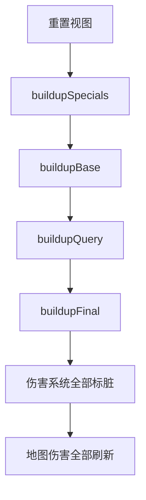

# 怪物上下文与战斗深入

中级教程分别讲过光环、查询、最终效果与伤害计算，但它们并不是各算各的。所有结果都由同一个怪物上下文按固定顺序拼装出来；伤害系统再缓存这份结果，地图伤害也读同一份计算后怪物。理解这条装配线，才能回答「为什么我改了属性，伤害却没变」这类问题。

本篇是高级 II 数据端的收束：先看上下文与三种怪物对象，再走一遍 `buildup()` 的顺序、优先级边界与局部刷新，最后把伤害缓存和光环、查询、最终的交互串起来。各机制的接口细节不在这里重复，只讲时序与边界。

## 上下文是什么

`IEnemyContext` 是当前楼层所有怪物视图的容器。它持有宽高、楼层、坐标索引，以及绑定到它上面的伤害系统与地图伤害：

- `width` / `height`：上下文尺寸，由 `resize` 维护；
- `floor`：当前楼层，由 `setFloor` 设置；
- `indexer`：坐标与索引的换算工具；
- `scanRange(range, param)` / `iterateEnemy()`：按范围扫描或遍历全部怪物；
- `getEnemyByLoc(x, y)` / `getEnemyByLocator(locator)` / `getEnemyLocatorByView(view)`：按位置或视图互查；
- `getDamageSystem()` / `getMapDamage()`：取绑定到上下文的伤害系统与地图伤害。

上下文本身不进入存档。切楼层时由外部调用 `setFloor`；地图尺寸变化时调用 `resize`，它会清空当前上下文中的所有怪物与运行状态。`clear()` 只清空怪物与运行状态，`destroy()` 还会解绑伤害系统、地图伤害并清空所有注册项。

`resize` 与 `setFloor` 都会把上下文标记为需要更新，下一次读取计算后怪物时会重新构建。不要把它们当成普通的字段赋值。

## 三种怪物对象

每个怪物视图都同时持有两份怪物对象，并对外暴露三种取法：

- `getBaseEnemy()`：原始模板，只读。它来自怪物数据，是所有计算的起点。
- `getComputedEnemy()`：计算后怪物，只读。光环、查询、最终效果的结果都写在这份副本上；伤害与地图伤害读的也是它。
- `getModifiableEnemy()`：可修改的原始怪物。它返回的其实是 `getBaseEnemy()` 的可写版本，修改后不会自动同步，必须手动 `markDirty()`。

视图内部还有一份「正在计算中的怪物」（`getComputingEnemy()`），只供上下文在构建过程中使用，外部不应调用。

`getComputedEnemy()` 并不是单纯返回一个字段：它会先调用 `context.requestRefresh(this)`，再返回计算后对象。也就是说，读取计算后怪物本身就是一次「按需刷新」的时机。`reset()` 则把计算后怪物退回原始模板的状态，全量重建开始时会统一调用它：

```ts
import { IEnemyAttr } from '@user/data-common';
import { IEnemyView } from '@user/data-system';

/** 对比同一只怪物的原始属性与计算后属性。 */
function compareEnemy(view: IEnemyView<IEnemyAttr>): void {
    // 原始模板：不会因为光环或最终效果而改变
    const base = view.getBaseEnemy();
    // 计算后怪物：读取时会按需触发局部刷新
    const computed = view.getComputedEnemy();

    console.log('模板攻击', base.getAttribute('atk'));
    console.log('计算后攻击', computed.getAttribute('atk'));

    // 把计算后怪物退回模板状态；下一次读取会重新构建
    view.reset();
}
```

## buildup 的五段

`buildup()` 是全量重建入口。它先检查是否需要更新：`needUpdate` 为假时直接返回；没有绑定勇士时会告警并返回，因为光环与最终效果都可能读取勇士属性。真正开始时，它清空上一轮的排序表、转换表与脏标记，然后按下面的顺序执行：

1. **重置视图**：对每个视图调用 `reset()`，把计算后怪物退回原始模板。若不先重置，重复构建会在上一轮数值上继续累加。
2. **`buildupSpecials`**：把无来源的全局光环加入排序表；把每只怪物身上的特殊属性转换成光环视图；再按优先级从高到低，交替执行「修改特殊属性的光环」与「特殊查询」。这一阶段决定每只怪物最终拥有哪些特殊属性。
3. **`buildupBase`**：按优先级从高到低执行所有基础光环的 `apply`，修改计算后怪物的基础属性。
4. **`buildupQuery`**：执行常规查询。它允许读取上下文（周围怪物、位置等），并修改怪物自身的基础属性。
5. **`buildupFinal`**：执行最终效果。它不再查询上下文，只对自身基础属性做收尾。



五个阶段结束后，`buildup()` 会调用 `damageSystem.markAllDirty()` 清空伤害缓存，并调用 `mapDamage.refreshAll()` 重建地图伤害。也就是说，构建结果变了，缓存一定跟着失效；你不需要在光环或最终效果里自己标脏。

实现上，第二、三段只在注册过光环转换器或特殊查询时执行；第四段只在注册过常规查询时执行；第五段只在注册过最终效果时执行。空阶段会被跳过，不会产生额外开销。

## 优先级的边界

光环、特殊查询与常规查询共用同一套优先级：数值越大越先执行。高优先级留下的结果，低优先级能看到；反过来不行。

由效果新增的特殊属性会立刻被转换成光环，但这条新光环只能影响之后的阶段：

- 新光环的优先级**高于**当前阶段时，开发环境会告警并跳过这条新增属性；
- 当前阶段不能删除同优先级或更高优先级的已生效光环，删除会被拒绝并告警；
- 同一优先级内部不保证先后顺序，不要把有依赖关系的两条效果放在同一优先级。

举个例子：优先级 20 的特殊光环给周围怪物加上一条优先级 10 的普通光环，这是成立的——20 先执行，10 在之后的基础光环阶段生效。反过来，优先级 10 的光环想给目标加上优先级 20 的光环则不成立：20 比当前阶段高，开发环境会告警并跳过。设计效果时，先想清楚「它应该在谁之后生效」，再决定优先级。

开发环境的优先级告警不是致命错误，但通常说明效果之间存在循环或倒置的依赖，值得回头调整设计。

## 局部刷新与全量重建

全量 `buildup()` 会重算所有怪物。日常更常见的是只改了一只怪物，这时走局部刷新：

- `view.markDirty()` 把视图加入 `dirtyEnemy`，同时让伤害系统删掉这只怪物的缓存；
- `context.requestRefresh(view)` 决定怎么刷新：若 `needTotallyRefresh` 命中该视图，或上下文本身已标记为需要更新，就回到全量 `buildup()`；否则调用 `refreshEnemy(view)`，只重算命中该怪物的光环与查询。

`refreshEnemy` 会先 `reset()` 该视图，然后按优先级重新判断「哪些光环命中这个位置」「哪些特殊查询作用于这只怪物」，再执行基础光环、常规查询与最终效果。它不会重建光环拓扑，因此比全量构建便宜。

`requestedCommonContext` 记录的是「查询过上下文」的怪物：常规查询调用 `query()` 时会登记。局部刷新某只怪物时，上下文会把这些依赖外部状态的怪物一并重算，避免它们读到过期的周围环境。这也是[怪物查询](../../intermediate/enemy-query.md)强调「必须用 `query()` 而不是 `handler.context`」的原因：绕过 `query()` 就不会被登记，周围变化后它不会重算。

不能只改字段不刷新。计算后怪物是一份独立副本，伤害系统还会缓存计算结果；改了原始怪物却既不标脏也不申请刷新，后续读到的仍然是旧副本与旧伤害。

```ts
import { IEnemyAttr } from '@user/data-common';
import { ICoreState } from '@user/data-state';
import { IEnemyView } from '@user/data-system';

/** 修改原始怪物后，按正确顺序刷新并重新取伤害。 */
function modifyAndRefresh(
    state: ICoreState,
    view: IEnemyView<IEnemyAttr>
): void {
    // 1. 改原始怪物（getModifiableEnemy 返回的是模板，不会自动同步）
    view.getModifiableEnemy().setAttribute('armor', 20);

    // 2. 标脏：加入待刷新集合，并清掉这只怪物的伤害缓存
    view.markDirty();

    // 3. 申请刷新：没有拓扑变化时只重算这一只
    state.enemyContext.requestRefresh(view);

    // 4. 重新取伤害；此时读到的是新结果
    const info = state.enemyContext.getDamageSystem()?.getDamageInfo(view);
    console.log('伤害', info?.damage, '回合', info?.turn);
}
```

## 伤害系统与缓存

`IDamageSystem` 在 `DamageContext` 的基础上加了一层缓存。`getDamageInfo(view)` 的行为是：

1. 先查缓存，命中就直接返回；
2. 未命中时调用 `view.getComputedEnemy()` 取计算后怪物；
3. 把只读的怪物、位置与勇士属性交给 `IDamageCalculator.calculate(handler)`；
4. 把 `{ damage, turn }` 连同 `handler` 存回缓存。

`markDirty(view)` 只删除这一只怪物的缓存，`markAllDirty()` 清空全部缓存。`getCriticalLimit` 只用于临界计算的上界，不参与普通伤害结算；它不会被缓存，也不负责刷新。

「改了怪物属性，但伤害没变」通常有两个原因：要么改的是原始怪物而没标脏，查询仍在读旧的计算后副本；要么伤害缓存没有被清掉。按上一节的顺序 `markDirty` → `requestRefresh` → `getDamageInfo` 就能排除这两种情况。

光环、查询与最终效果在构建过程中改的是计算后怪物，`buildup()` 结束时已经统一清空缓存，所以它们不需要额外标脏。需要手动标脏的只有「绕过构建流程、直接改原始怪物」的场景。

## 与光环、查询、最终的交互

四个阶段的分工可以压成一张表：

| 阶段     | 改谁                 | 是否读取外部环境       | 是否需要手动标脏             |
| -------- | -------------------- | ---------------------- | ---------------------------- |
| 基础光环 | 其他怪物的基础属性   | 否，只按范围命中       | 否，`buildup` 结束时统一处理 |
| 特殊光环 | 其他怪物的特殊属性   | 否，只按范围命中       | 否，拓扑变化会触发全量重建   |
| 查询     | 自身的基础或特殊属性 | 是，必须通过 `query()` | 否，但会被登记进局部刷新     |
| 最终效果 | 自身的基础属性       | 否                     | 否                           |
| 伤害系统 | 只读计算后怪物       | 否                     | 直接改原始怪物时需要         |

地图伤害同样按计算后怪物计算。因此光环新增的特殊属性会真实进入地图伤害判定，例如光环给怪物加上「领域」，这只怪物就确实拥有领域效果。这也是「光环改的是计算后怪物」的直接后果。

三条构建阶段的共同约束是：**不要直接改 `getBaseEnemy()`**。原始模板是所有重建的起点，改它等于改数据源；需要影响计算结果时，改 `handler.enemy`，让下一次重建从模板重新算出结果。

## 一个完整的收束示例

下面的例子注册一个最终效果（给所有怪物 +5 护甲）与一个全局基础光环（给范围内怪物 +10 攻速），执行 `buildup()` 后读取某只怪物的计算后属性与伤害；然后修改原始护甲并走一遍局部刷新，确认结果更新。注册只做一次，实际应放在初始化阶段：

```ts
import { FullRange, IRange } from '@motajs/common';
import { IEnemyAttr, IHeroAttr } from '@user/data-common';
import { ICoreState } from '@user/data-state';
import {
    IEnemyAuraView,
    IEnemyFinalEffect,
    IEnemyHandler,
    IEnemySpecialModifier,
    IEnemyView
} from '@user/data-system';

/** 收尾：所有怪物 +5 护甲。 */
class GlobalArmorFinal implements IEnemyFinalEffect<IEnemyAttr, IHeroAttr> {
    readonly priority = 0;

    apply(handler: IEnemyHandler<IEnemyAttr, IHeroAttr>): void {
        handler.enemy.addAttribute('armor', 5);
    }
}

/** 全局基础光环：全场怪物 +10 攻速。 */
class SpeedAura implements IEnemyAuraView<IEnemyAttr, void, void> {
    readonly priority = 10;
    readonly couldApplyBase = true;
    readonly couldApplySpecial = false;
    readonly range: IRange<void> = new FullRange();

    getRangeParam(): void {
        return undefined;
    }

    apply(handler: IEnemyHandler<IEnemyAttr, IHeroAttr>): void {
        handler.enemy.addAttribute('atkSpeed', 10);
    }

    applySpecial(): IEnemySpecialModifier<IEnemyAttr> | null {
        return null;
    }
}

// 初始化阶段执行一次：最终效果与无来源全局光环
state.enemyContext.registerFinalEffect(new GlobalArmorFinal());
state.enemyContext.addAura(new SpeedAura());

/** 构建后对比模板与计算后结果，再验证局部刷新。 */
function inspectAfterBuildup(
    state: ICoreState,
    view: IEnemyView<IEnemyAttr>
): void {
    const ctx = state.enemyContext;

    // 全量构建：光环与最终效果写入计算后怪物
    ctx.buildup();

    const computed = view.getComputedEnemy();
    console.log('计算后护甲', computed.getAttribute('armor')); // 模板护甲 + 5
    console.log('计算后攻速', computed.getAttribute('atkSpeed')); // 模板攻速 + 10

    // 模板本身不应被光环或最终效果改写
    console.log('模板护甲', view.getBaseEnemy().getAttribute('armor'));

    const before = ctx.getDamageSystem()?.getDamageInfo(view);
    console.log('构建后伤害', before?.damage, '回合', before?.turn);

    // 直接改模板，再走局部刷新
    view.getModifiableEnemy().setAttribute('armor', 20);
    view.markDirty();
    ctx.requestRefresh(view);

    const after = ctx.getDamageSystem()?.getDamageInfo(view);
    console.log('刷新后伤害', after?.damage, '回合', after?.turn);
}
```

`addAura` 添加的是无来源全局光环，不需要转换器。实际游戏里 `initializeEnemy` 已经注册了三个光环转换器，因此基础光环阶段一定会执行；如果你在测试里手建了一个空上下文，记得先注册至少一个转换器或特殊查询，否则这一段会被跳过。

## 怎么验证

固定一只怪物与一套勇士属性，记录构建前后的数值：

```ts
import { IEnemyAttr } from '@user/data-common';
import { ICoreState } from '@user/data-state';
import { IEnemyView } from '@user/data-system';

/** 检查构建只改计算后怪物，并且伤害缓存会随标脏刷新。 */
function verifyBuildup(state: ICoreState, view: IEnemyView<IEnemyAttr>): void {
    const ctx = state.enemyContext;
    const baseArmor = view.getBaseEnemy().getAttribute('armor');

    ctx.buildup();
    const computedArmor = view.getComputedEnemy().getAttribute('armor');

    // 期望：模板护甲不变；计算后护甲 = 模板 + 最终效果（+5）
    console.log({ baseArmor, computedArmor });

    const damageSystem = ctx.getDamageSystem();
    const first = damageSystem?.getDamageInfo(view);
    console.log('第一次伤害', first?.damage);

    // 修改模板护甲并标脏，缓存应失效
    view.getModifiableEnemy().setAttribute('armor', 50);
    view.markDirty();
    ctx.requestRefresh(view);

    const second = damageSystem?.getDamageInfo(view);
    console.log('修改后伤害', second?.damage);
}
```

预期现象：

- `baseArmor` 始终等于内容里的原始值，光环与最终效果不会写回去；
- `computedArmor` 比模板多 5（最终效果），若还挂了加护甲的光环则会继续增加；
- 第一次伤害与修改后的伤害不同；若不变，先确认 `markDirty` 是否在 `getDamageInfo` 之前调用；
- 只改模板、不标脏时，第二次读到的仍是第一次的缓存值。

## 边界与注意

- **未绑定勇士时 `buildup()` 会告警并返回**：光环与最终效果可能读取勇士属性，构建前必须 `bindHero`。`initializeEnemy` 已经绑定过。
- **`needUpdate` 为假时 `buildup()` 直接返回**：没有变化就不会重算。注册效果、放置怪物、绑定勇士都会把它置为真。
- **`getModifiableEnemy()` 的修改不会自动同步**：它返回原始模板，改完必须 `markDirty()`。
- **`needTotallyRefresh` 表示拓扑变化**：特殊属性增删导致光环集合变化时，局部刷新会升级为全量构建。不要在这种情况下强行只改一只。
- **不要在高频循环里反复全量 `buildup()`**：全量构建会重置并重算所有怪物，开销随怪物数量增长；单只变化优先用 `markDirty` + `requestRefresh`。
- **`getComputingEnemy()` 是内部接口**：它暴露正在构建中的可写怪物，外部调用会绕过刷新与脏标记。
- **查询效果不是内置内容**：`initializeEnemy` 只注册光环转换器、最终效果、战斗脚本与钩子，没有注册任何查询。查询需要自己注册后才会参与构建。
- **开发环境的优先级告警不是致命错误**：它会跳过不合法的增删，但通常说明阶段依赖设计有问题，应该调整优先级而不是忽略告警。
- **`clear()` 与 `destroy()` 的时机不同**：`clear()` 清空怪物与运行状态，保留注册项；`destroy()` 会连伤害系统、地图伤害与所有注册项一起清掉。销毁后不应继续使用该上下文。
