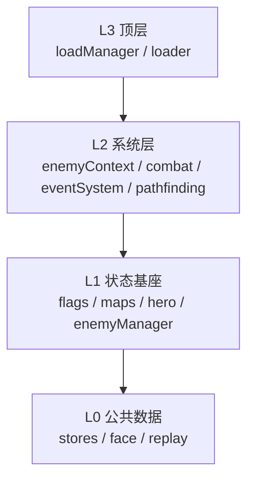

# CoreState 组装与初始化

新增一个子系统时，最先遇到的问题通常不是「类写在哪」，而是「它应该拿谁、由谁创建、什么时候创建」。`CoreState` 是数据端的组合根：它先把跨系统共用的对象按依赖顺序建好，再让插件在这套对象上继续装配。装配顺序错了，代码不一定立刻报错，但会在第一次访问某个字段时拿到 `undefined`。

本篇只讲四层为什么存在、每层放什么、构造器实际按什么顺序建对象，以及 `MainDataPlugin` 在插件阶段补了哪些默认装配。加载如何推进见[加载系统](./loading-system.md)，可存档对象与执行器见[可存档内容](../i/saveable-content.md)，插件排序与阶段推进见[插件内部机制](./plugin-internals.md)。

## 系统模型

| 层          | 职责                                                 |
| ----------- | ---------------------------------------------------- |
| L0 公共数据 | 工具、仓库与跨系统共用的运行期对象，不依赖其它子系统 |
| L1 状态基座 | 保存需要进存档的运行时状态，并允许系统层操作这些状态 |
| L2 系统层   | 在状态之上执行游戏逻辑，自身不作为存档内容           |
| L3 顶层     | 面向启动流程，把前面的对象接成加载入口               |

箭头表示依赖：L3 依赖 L2，L2 依赖 L1，L1 依赖 L0。构造顺序则相反，从 L0 开始逐层向上。`CoreState` 同时实现四层叠加后的接口，所以运行时是同一个对象；但每个子系统只接收它需要的那一层接口。

## 层不是目录

L0–L3 是构造依赖的分组，不是源码目录。一个包可以同时包含 L0 的仓库与 L1 的状态类；一个文件也可以定义多个层的接口。判断一个对象属于哪一层，看它「构造时依赖谁、是否进存档、是否只服务启动」，而不是看它放在哪个文件夹。

这也意味着不能用 import 路径推断分层：`data-base` 里有 L1 的地图与勇士，也有 L0 的图块与朝向工具；`data-system` 整体偏 L2，但它的接口仍然只依赖 L1。真正决定依赖方向的是构造参数与类型，而不是包名。

新增子系统时，默认通过插件实现，不先问「它属于哪一层」。只有必须改变引擎默认能力的极少数情况，才需要判断它落在 L0、L1 还是 L2：看它构造时依赖谁、是否进存档、是否只服务启动。插件与渲染端不需要挤进四层。

## 一条依赖链在运行时怎么走

以「勇士走一步」为例，四层在同一条链上各做一件事，但没有一层反向持有更高层：

1. 输入层让勇士位置对象的移动器排一步。移动器属于 L1 的 `hero`，它只管理坐标、朝向与步骤队列。
2. 移动器把这一步交给 `DefaultHeroMoveTopImpl`。顶层实现由插件安装，不属于 CoreState 的四层构造；它持有 L1 的地图、L2 的事件执行器与一个依赖 L0/L1 的通行谓词。
3. 谓词读取 L0 的 `faceManager` 与 L1 地图上的图块通行位，回答「能不能进、会不会撞」。
4. 每一步进入结算阶段时，移动器都会调用事件系统；坐标改变时是旧格到新格，失败步则是同一格的前后两次。L2 的事件系统从 L1 的地图收集候选，从 L0 的 `eventStore` 取事件，再由解释器执行脚本；脚本可以写 L1 的 Flag、勇士或地图。
5. 寻路是另一条链：L2 的 `pathfinding` 读取 L1 的图层，反复调用同一个谓词构图与搜索，最后把方向步骤交回 L1 的移动器。

这条链说明分层不是「调用顺序从上到下」，而是「每一层只依赖更低的接口」。顶层实现、谓词与插件可以同时接触多层，但它们是把能力注入低层，而不是让低层反过来 import 高层。

## L0：公共数据

| 对象           | 负责什么                         | 为什么在 L0                    | 依赖        |
| -------------- | -------------------------------- | ------------------------------ | ----------- |
| `roleFace`     | 图块数字到朝向图的绑定           | 只处理图块标识，不认识游戏进度 | 无          |
| `faceManager`  | 按组与字符串 id 注册方向处理器   | 移动、构图、图块转换共用       | 无          |
| `tileStore`    | 图块原始定义：通行位、事件、类型 | 只读定义，所有层都可能查询     | 无          |
| `itemStore`    | 道具原始定义                     | 只读定义，不依赖地图或勇士     | `tileStore` |
| `mapStore`     | 地图原始数据                     | 只读定义，供地图状态按需创建   | 无          |
| `eventStore`   | 事件 id 到事件对象的映射         | 事件对象不依赖地图状态         | 无          |
| `enemyStore`   | 怪物原始定义                     | 只读定义，供敌人管理器创建实例 | `tileStore` |
| `replaySystem` | 录像数组、指令注册表与播放沙箱   | 每个系统都可能用到它           | 无          |

L0 的共同点是「构造时不需要 L1/L2/L3」。录像系统放在 L0 的唯一理由是每个系统都可能用到它；可存档与否不是分层依据，关键是它不依赖更高层。

`tileStore` 必须早于 `itemStore` 与 `enemyStore`，因为后两者在构造时就要拿图块定义。`faceManager` 在 L0 只是建表，真正的 Dir4 / Dir8 处理器由 `MainDataPlugin` 注册；这保证默认玩法策略不写死在对象图里。

L0 的仓库大多是只读定义：`tileStore`、`itemStore`、`mapStore`、`enemyStore` 保存的是「内容是什么」，不是「这一局进行到哪」。把它们放在 L0，读档时不需要恢复，也不会因为一局的状态变化而改写定义。`roleFace` 与 `faceManager` 是工具性的查找表；`replaySystem` 放在 L0，只因为每个系统都可能用到它。

L0 的边界是「可以被任何层使用，但不主动使用任何层」。如果某个对象需要知道当前楼层、勇士位置或 Flag，它就不属于 L0；如果它只需要图块定义或方向处理器，放在 L0 可以避免在 L1/L2 里重复建一份。

## L1：状态基座

| 对象           | 负责什么                           | 为什么在 L1                          | 依赖                                 |
| -------------- | ---------------------------------- | ------------------------------------ | ------------------------------------ |
| `flags`        | 全局 Flag 字段与值                 | 需要进存档，系统层只读写             | 无                                   |
| `maps`         | 楼层、图层、图块与事件的运行时状态 | 地图改动要进存档，且被寻路与事件读取 | `CoreState`（以 `IDataCommon` 回指） |
| `hero`         | 勇士属性、位置、道具、装备与跟随者 | 勇士状态是存档主体，系统层只操作它   | `CoreState`（以 `IDataCommon` 回指） |
| `enemyManager` | 怪物实例、原始定义与特殊属性       | 敌人状态需要进存档，且依赖图块定义   | `tileStore`                          |

L1 的共同点是「保存游戏进度」。它们可以被 L2 读写，也可以被 L3 的读档流程恢复，但自身不决定战斗、事件或寻路的执行策略。`maps` 与 `hero` 在构造时接收 `CoreState`，但类型是 `IDataCommon`，只看得到 L0；这是向下依赖，不是反向依赖。

L1 的对象可以互相引用，但要通过主对象或公开接口，而不是在构造时抓取彼此的私有字段。`enemyManager` 只拿 `tileStore`，不拿 `maps` 或 `hero`，所以它可以在没有地图的环境里独立创建。

L1 的边界是「保存重建所需的状态，不保存可以重算的中间结果」。战斗中的临时伤害、寻路得到的路径、事件收集出的候选列表都不属于 L1；它们是 L2 在某一刻算出来的派生数据。把派生数据塞进 L1，会让存档体积膨胀，也会在读档后留下与新状态不一致的缓存。

L1 也不负责「什么时候写」。它只提供可读写的状态与存档能力；触发写入的是 L2 的系统或插件。这样同一份状态可以被不同玩法复用，而不必把玩法写进状态对象。

## L2：系统层

| 对象           | 负责什么                                 | 为什么在 L2                              | 依赖                                  |
| -------------- | ---------------------------------------- | ---------------------------------------- | ------------------------------------- |
| `enemyContext` | 怪物上下文：战斗前后的属性修正与特殊逻辑 | 需要读 L1 状态，但自身不保存进度         | `CoreState`（以 `IStateSystem` 回指） |
| `combat`       | 战斗流程：伤害、夹击、死亡与掉落         | 在状态之上执行，读档后可按需重建         | `CoreState`                           |
| `eventSystem`  | 事件仓库、解释器、收集器与执行器         | 需要事件对象与地图状态，但不作为存档内容 | `CoreState`、`config.events`          |
| `pathfinding`  | 构图、搜索与把路径交给移动器             | 需要图层、谓词与移动器，但不保存地图数据 | `CoreState`                           |

L2 的共同点是「执行逻辑」。它们会修改 L1 的状态，但不自己保存一份副本；读档后，L1 被恢复，L2 继续按新状态工作。`eventSystem` 在构造时接收入口提供的内建函数表，并创建解释器；`pathfinding` 只创建求解器与系统对象，谓词、图层与移动器由 `MainDataPlugin` 在 `awake` 中注入。

L2 不能依赖 L3。比如事件系统不应该在构造时读取 `loader`，寻路也不应该依赖加载进度；需要加载结果时，由插件在加载后把值注入 L2，或由 L2 的调用方传入。

L2 的边界是「执行策略，不是内容定义」。事件系统知道怎么收集与执行，但不知道某个事件 id 对应哪段脚本；寻路知道怎么构图与搜索，但不知道当前楼层长什么样；战斗知道怎么结算，但不知道怪物原始定义从哪来。内容定义在 L0，状态在 L1，L2 只把两者接起来。

L2 也不是「所有逻辑都必须放这里」。默认玩法策略（用哪个谓词、给移动器装哪个顶层实现、注册哪些加载钩子）属于插件，不属于 `CoreState` 的构造。把它们放进 L2，会让系统对象在构造时就需要知道具体玩法，失去替换空间。

## L3：顶层

| 对象          | 负责什么                                 | 为什么在 L3                                     | 依赖                   |
| ------------- | ---------------------------------------- | ----------------------------------------------- | ---------------------- |
| `loadManager` | 汇总加载任务、推进任务并累计进度         | 只服务加载流程，不参与日常结算                  | 无                     |
| `loader`      | 按阶段加载核心配置、额外配置与自定义内容 | 需要 `loadManager` 与 starter，且只在启动期使用 | `loadManager`、starter |

L3 的共同点是「启动入口」。它们不持有游戏进度，也不执行战斗或事件；它们把外部资源读进来，供插件在加载后使用。`CoreState` 在构造器里调用 `loader.addCoreConfig('core', config.coreURL)`，把核心配置登记为第一个加载任务；真正的加载由 `state.load()` 推进，不在本篇展开。

L3 是四层里最容易被低层误用的层。低层如果为了拿一个配置而保存 `state.loader`，就把「对象图」和「启动流程」绑死了；正确做法是让插件在加载后读取配置，再把结果注入低层。

L3 的边界是「只在启动期有用」。`loadManager` 与 `loader` 不参与日常战斗、事件或寻路；它们读取外部资源，供插件在加载后创建对象。把运行期逻辑写进 L3，会让「加载完成」与「游戏运行」两条时间线纠缠在一起，读档时也很难判断哪些对象应该重建。

## 构造器的实际顺序

前面按层说明职责；落到代码上，四层由构造器按固定顺序建出来。`CoreState` 的构造器按下面的顺序执行，顺序本身就是依赖声明：

1. L0：`roleFace`、`faceManager`、`tileStore`、`itemStore`、`mapStore`、`eventStore`、`enemyStore`、`replaySystem`。`itemStore` 与 `enemyStore` 在 `tileStore` 之后。
2. L1：`flags`、`maps`、`hero`、`enemyManager`。`maps` 与 `hero` 接收主对象，`enemyManager` 接收 `tileStore`。
3. L2：`enemyContext`、`combat`、`eventSystem`、`pathfinding`。它们都接收主对象；`eventSystem` 还接收 `config.events`。
4. L3：`loadManager`，再用它和 `config.loadStarter` 创建 `loader`；随后登记核心配置。
5. 插件表：遍历 `config.dataPlugins`，按 `id` 建表；重复 id 告警 78 并保留第一个。
6. 依赖表：把每个插件的 `dataDeps` 交给 `orderPlugins`，在构造期计算一次拓扑序。
7. `awake()`：按拓扑序对处于 `NotAwakened` 的插件执行同步装配。

第 5 到第 7 步发生在四层全部构造完成之后。原因是 `awake` 可能访问任意一层：主插件要注册朝向、注入寻路谓词、给勇士移动器装顶层实现、注册加载钩子与可存档内容。任何一层还没建好，插件拿到的就是 `undefined`。

`config.dataPlugins` 里 `MainDataPlugin` 排在最前，只是入口的列表顺序；真正的执行顺序仍由 `dataDeps` 决定。它没有隐式前置地位，依赖它注册的默认装配或存档 id 时，必须在 `dataDeps` 中显式写 `'main-data-plugin'`。

## MainDataPlugin 实际装配

`CoreState` 只负责建对象与排序，默认玩法策略放在 `MainDataPlugin.awake`。它按下面的顺序补装配：

1. 创建 `Dir4FaceHandler` 与 `Dir8FaceHandler`，按 `FaceGroup` 和字符串 id 注册到 `faceManager`。之后移动与构图才能取到方向处理器。
2. 创建 `DefaultPassPredicateImpl`，注入 `pathfinding.finder`；把图层先设为 `null`，因为此时勇士还不在任何楼层；把勇士的移动器绑定给寻路系统。
3. 创建 `DefaultHeroMoveTopImpl`，装到 `state.hero.location.mover`。它负责边界、通行谓词与 `enter` / `leave` / `hit` 的事件派发。
4. 给加载器注册默认加载钩子，让加载阶段能按核心配置追加内容。
5. 初始化敌人、录像指令与钩子；这些初始化需要主对象与已注册的仓库。
6. 注册默认可存档对象：勇士、Flag、地图、敌人管理器与录像。注册决定存档里出现哪些 key；不要用注册顺序推断读档先后。
7. 保存敌人初始化返回的弱引用处理器，供后续战斗逻辑使用。

这些动作不放进 `CoreState` 构造器，是因为它们属于「默认玩法」而不是「对象图」：换一套玩法可以替换插件，而不需要改四层构造。`MainDataPlugin` 仍然只是一个普通插件，它的 `awake` 与其它插件共享同一套拓扑序与状态机。

`new CoreState(config)` 返回时，四层对象与插件的 `awake` 都已完成，但这不等于「游戏可以开始」：`faceManager` 已注册 Dir4 / Dir8，L0 的仓库可用；L1 的对象存在但还没有被内容填充；寻路已拿到谓词与移动器，图层仍是 `null`；`loader` 已登记核心配置但还没有开始读取；`initialize` 与 `afterLoad` 还没有执行。这个状态适合写单元测试，不适合直接开始游戏。

入口只做三件事：`createCoreStateConfig(starter)` 汇总加载 starter、核心配置路径、插件列表与内建函数表；`createCoreState(starter)` 用这份配置构造实例并返回尚未异步加载的主对象；`MainDataPlugin` 在插件阶段完成上面的默认装配。`src/data.ts` 只 re-export `createCoreState`，不承担装配逻辑。`ICoreStateConfig` 只有这四个字段，业务参数通过插件构造器或配置字段传入，不要扩 `CoreState` 的构造签名。构造器也不发起网络或文件读取，`loadStarter` 只保存引用，I/O 留给加载阶段。

## 新增子系统放哪一层（插件优先）

新增子系统默认全部通过插件实现：在 `awake` 里创建管理器并挂到插件实例上，在 `afterLoad` 里读取加载内容。不要因为「写起来更直接」就往 `CoreState` 的四层里加字段。只有必须改变引擎默认能力、且要被所有项目共享的极少数情况，才动 L0 / L1 / L2。

| 改动类型                       | 落点                     | 原因                                     |
| ------------------------------ | ------------------------ | ---------------------------------------- |
| 新增业务子系统                 | 插件                     | 默认做法，不改变 `CoreState` 的对象图    |
| 新的可存档进度                 | 插件自己持有的可存档对象 | 由插件注册，读档时恢复                   |
| 新的执行逻辑                   | 插件自己的管理器         | 读写 L1，但不作为存档内容                |
| 新的默认玩法装配               | 插件的 `awake`           | 需要主对象与已构造的四层，但不改对象图   |
| 依赖加载内容的初始化           | 插件的 `afterLoad`       | 配置与地图在加载后才可读                 |
| 纯展示、输入或动画             | 渲染端，不在数据端四层   | 数据端只维护状态，不持有画面             |
| 必须改变引擎默认能力（极少数） | 对应的 L0 / L1 / L2      | 插件无法表达、且需要所有项目共享时才考虑 |

新增图块、道具、怪物或地图定义不属于新增子系统，仍然由 L0 的对应 Store 承载；它们是内容，不是运行时逻辑。以任务系统为例：任务进度可存档，任务逻辑是执行逻辑，合适做法是写一个插件，在 `awake` 里创建任务管理器并注册为可存档对象，在 `afterLoad` 里读取任务配置，而不是往 L1 里硬加一个 `quests` 字段。只有任务系统要成为引擎级能力、被所有项目共享时，才考虑放进 L1 / L2，并同时承担构造顺序与接口成本。

再以「新的通行规则」为例：规则是执行策略，不是内容定义。它应该实现为谓词，由插件注入寻路与移动器，而不是写进 `tileStore` 的静态通行位。静态通行位描述「图块本身能不能走」，谓词描述「这一局按什么规则判断」；两者混在一起，换规则就要改内容。

## 边界与注意

四层顺序错了，很少在构造器里立刻抛错，常见的是第一次使用时拿到错误结果：低层保存了高层引用，第一次调用才拿到 `undefined`；朝向处理器还没注册，默认谓词直接返回不通行；进入楼层前 `finder` 的图层是 `null`，`find` 得到 `InvalidInput`；事件内建函数缺失，会在编译阶段抛错；插件依赖写错，被阻断的插件停在 `NotAwakened`，下游看到的是「对象缺失」。

- **依赖只能向下**：L0 不得引用 L1/L2/L3，L1 不得引用 L2/L3，L2 不得引用 L3；跨层能力由上层注入。
- **四层装配顺序固定**：L0 → L1 → L2 → L3，同层内部也按依赖先后；重排会让构造参数拿到未初始化的对象。
- **插件在四层之后**：注册、去重、排序与 `awake` 都发生在子系统装配完成之后，`awake` 可以看到整个数据端。
- **构造不等于加载**：`createCoreState` 只返回实例，异步加载由加载系统推进；两者的时间线不要混在一起。
- **系统层不进存档**：L2 只修改 L1 的状态，读档后继续按新状态工作；可存档对象的注册与执行器见[可存档内容](../i/saveable-content.md)。
- **默认子系统用插件**：需要新能力时新增插件，由主对象注入已有依赖，避免绕过初始化顺序；不要手动构造内部子系统，也不要往四层里加字段。
- **依赖主插件要显式声明**：用到 `main-data-plugin` 注册的默认装配或初始化结果时，在 `dataDeps` 里写 `'main-data-plugin'`。

返回[高级 III 导览](./index.md)。
