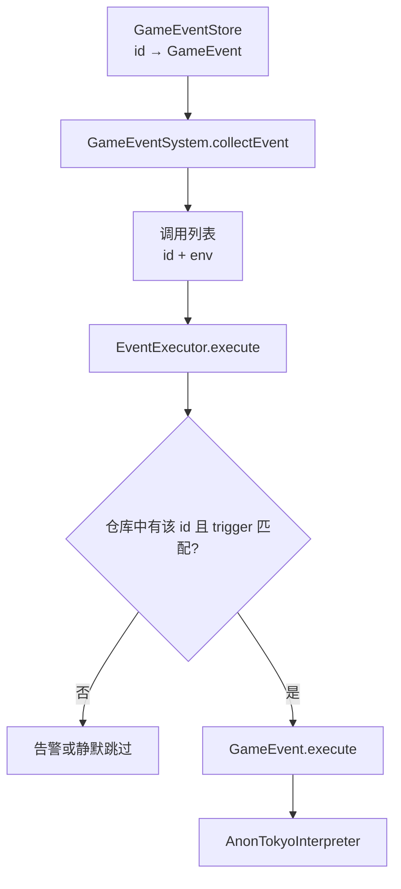

# 事件系统

事件最容易出现的一种误判是「脚本写了，但没跑」。原因通常不在脚本，而在两段完全不同的逻辑：先按坐标与图层收集候选事件，再在执行时按触发器与仓库内容筛选。收集阶段不知道脚本语义，执行阶段才拿到事件对象；把这两步混在一起，就会以为收集器会按 `trigger` 过滤，或者以为点事件与图块事件可以按优先级跨组比较。

本篇讲事件仓库、事件对象、收集器、执行器与解释器这五个角色，以及一个事件从注册到执行的过程。事件内容由编辑器的事件编辑器产出，本篇不讨论编辑器本身；脚本如何编译成程序属于实现细节，不单独展开。

## 系统模型

| 角色                   | 负责什么                                       |
| ---------------------- | ---------------------------------------------- |
| `GameEventStore`       | 按 id 保存事件对象，按 id 取回                 |
| `GameEvent`            | 持有触发器、原始语句与缓存的编译产物           |
| `GameEventSystem`      | 持有仓库、解释器与执行器，按坐标收集候选调用项 |
| `EventExecutor`        | 逐条查仓库、过滤触发器、执行并合并返回值       |
| `AnonTokyoInterpreter` | 把语句编译成可执行程序，或直接执行语句         |

收集结果不是事件实例，而是 `{ id, env }` 形式的调用项。这样收集阶段只关心坐标、图层与顺序，事件对象被替换或仓库被换掉时，候选列表仍然成立。真正的触发器过滤发生在执行器。

## 事件对象与触发器

`GameEvent` 保存触发器、原始语句数组与编译产物。第一次执行时编译，之后复用缓存；`setRaw` 换掉原始语句并清空缓存；`setTrigger` 只改触发器，不影响已经编译好的程序。解释器由构造时传入，通常来自 `state.eventSystem.executor.interpreter`。

`EventTrigger` 共 11 个值。数据端目前只有三个值接到了派发点，其余是枚举保留，挂上去不会自动执行：

| 值                    | 含义                                                 | 数据端派发状态     |
| --------------------- | ---------------------------------------------------- | ------------------ |
| `None`                | 无触发器，事件不由触发器启动                         | 保留值             |
| `OnTouch`             | 玩家撞上目标格时触发；直接走入不触发                 | 勇士移动的撞击     |
| `OnEnter`             | 玩家进入目标格时触发                                 | 勇士移动的进入     |
| `OnLeave`             | 玩家离开目标格时触发                                 | 勇士移动的离开     |
| `OnBeforeBattle`      | 与指定怪物战斗前触发，返回值表示是否进入战斗         | 未派发，待引擎实现 |
| `OnAfterBattle`       | 与指定怪物战斗后触发                                 | 未派发，待引擎实现 |
| `OnBeforeOpenDoor`    | 开启指定门之前触发，返回值表示是否成功开门           | 未派发，待引擎实现 |
| `OnAfterOpenDoor`     | 开启指定门之后触发                                   | 未派发，待引擎实现 |
| `OnAfterGetItem`      | 成功拾取指定道具时触发                               | 未派发，待引擎实现 |
| `OnBeforeChangeFloor` | 使用指定位置或图块切换楼层前触发，返回值表示是否切换 | 未派发，待引擎实现 |
| `OnAfterChangeFloor`  | 使用指定位置或图块切换楼层后触发                     | 未派发，待引擎实现 |

触发器过滤不放在收集器里，是因为同一坐标可能因 `OnEnter`、`OnLeave`、`OnTouch` 被反复收集。收集器只把本次时机写进 `env.trigger`，执行器再决定这个事件是否属于本次时机。把过滤提前到收集器，会让「收集」依赖事件脚本的语义，仓库换一个实现就可能漏掉候选。

## 事件层

`IGameMap.eventLayer` 指向当前楼层的默认事件层，类型是 `IMapLayer | null`。内容加载时，`alias === 'event'` 的图层会被默认指定为事件层；也可以用 `setEventLayer` 显式换一个图层。事件层不是特殊类型，仍然是普通图层，具备图块、点事件、图块事件、存档与钩子。

切换楼层后，使用的是目标楼层自己的事件层。事件对象按 id 存在 `state.eventStore`；点事件与图块事件只保存 id，不保存脚本本身。事件 id 的登记接口是 `eventStore.addEvent`；谁在加载期登记属于内容加载，不在本篇展开。

把事件层做成普通图层，而不是一个专门的事件容器，是为了复用图层的全部能力：它仍然有静态图块、动态图块、点事件、图块事件、存档与钩子。事件系统只需要一个「当前楼层的事件层」指针，不需要为事件单独维护坐标表；换楼层时换指针即可，图层本身的存档与事件视图继续工作。

## 收集：这一次该执行谁

触发器只回答「这次是什么时机」；要把它变成一次执行，还需要收集候选与执行过滤。`collectEvent(layer, trigger, x, y)` 先判断坐标是否在地图内；越界直接返回空数组。它不按事件自身的触发器过滤，而是把该坐标上的候选事件都放进列表，并把本次触发时机写进每个调用项的环境。

候选分两组：

1. 点事件：`layer.getPointEvent(x, y)` 返回「优先级 → 事件 id」的只读映射。
2. 图块事件：当前格的静态图块与每个动态图块各有一份 `tileEvent()` 映射。

两组各自按优先级降序排序，再按「点事件组在前、图块事件组在后」拼接。组间顺序不受优先级数值影响：即使某个图块事件的优先级更高，整组点事件仍然先进入调用列表。这样「这个坐标发生什么」始终先于「这个物体发生什么」，跨组比较不会让物体事件压过坐标语义。排序只发生在收集结果上，不会修改图层的事件视图；同一份视图可以被多个坐标、多次触发反复读取。

同一份事件视图内，一个优先级只保存一个事件 id。对已存在的优先级再次 `set` 会用新 id 覆盖旧 id，并触发重复优先级告警 136；作者看到的结果是后写入的 id 生效。不同来源出现相同优先级时，不再重新排序，而是保留收集顺序：点事件组仍然整体在前；图块事件组内部静态图块在前，多个动态图块按图层顺序排列。调用项只有 `id` 与 `env`，不带优先级，优先级只体现在列表顺序里。

`env` 记录本次触发的完整上下文：

| 字段             | 含义                                     |
| ---------------- | ---------------------------------------- |
| `state`          | 数据端主对象，静态类型是 `IStateBase`    |
| `type`           | 来源类型：点事件或图块事件               |
| `trigger`        | 本次触发时机，来自 `collectEvent` 的参数 |
| `system`         | 事件系统对象，可用来再次收集或执行       |
| `heroLocator`    | 触发时勇士的位置                         |
| `heroFloor`      | 触发时勇士所在楼层 id                    |
| `triggerLocator` | 触发坐标                                 |
| `tile`           | 触发事件的图块；点事件为 `null`          |
| `layer`          | 触发事件的图层；可能为 `null`            |
| `map`            | 触发事件的地图；可能为 `null`            |

`env.state` 的静态类型是 `IStateBase`，拿不到 L3 的 `loader` 等成员。内建函数需要更高层能力时，应从事件系统的持有者或插件依赖取得，而不是假设 `env.state` 具备全部成员；这不是类型疏漏，而是为了让事件环境只暴露数据层能力，避免脚本反向依赖启动层。

`env` 是收集时创建的调用上下文，不是会随游戏状态实时更新的视图。`heroLocator`、`triggerLocator` 与 `tile` 记录的是触发那一刻的值；事件脚本执行期间勇士再移动，这些字段不会跟着变。需要当前状态时读 `env.state.hero`，不要把 `env.heroLocator` 当成实时坐标。

## 执行：候选到结果

`EventExecutor.execute(invocations, param)` 按列表顺序逐条处理：

1. 仓库为空或 `getEvent(id)` 找不到事件：告警 171 并跳过。
2. 事件自身的 `trigger` 与 `invocation.env.trigger` 不一致：静默跳过。
3. 否则 `await event.execute(param, env)`，把结果加入结果列表。

执行模式决定是否提前结束：

| 模式                           | 行为                     |
| ------------------------------ | ------------------------ |
| `EventExecuteMode.Normal`      | 全部执行                 |
| `EventExecuteMode.CutIfFalsy`  | 遇到 falsy 结果立即结束  |
| `EventExecuteMode.CutIfTruthy` | 遇到 truthy 结果立即结束 |

折叠模式决定返回值：

| 模式                        | 返回值                |
| --------------------------- | --------------------- |
| `EventReduceMode.NoReduce`  | 按执行顺序组成数组    |
| `EventReduceMode.OrReduce`  | 从 `false` 起做或运算 |
| `EventReduceMode.AndReduce` | 从 `true` 起做与运算  |

非布尔值在折叠时告警 172，但按正常短路规则继续。`mode` 与 `reduce` 是执行器上的共享状态，不是每次调用的参数；改完要复位，否则会影响后续调用。

把执行策略放在执行器上，而不是每次调用传参数，是为了让「同一批事件按什么策略执行」成为系统级配置：战斗、对话、踩踏可以各自在调用前设置模式，调用后恢复。

`param` 是 `IBlockEventParam`，形状为 `{ custom }`，执行器把它原样交给事件。脚本里它成为顶层 `scope.args`。内建函数的 `func(param, env)` 第一个参数不是它，而是 `Call.parameters` 求值后的对象；两者不会自动传递。

`EventExecutor.execute` 带 `@shouldReplay`，含义是「执行事件这条路径必须产生录像记录」，不是自动写录像。`onBeforeExecuteEvent` 与 `onAfterExecuteEvent` 是同步钩子；任意事件执行拒绝会让 `execute` 拒绝，后续调用项与 `onAfterExecuteEvent` 不再执行。

钩子可以修改传入的调用列表与参数对象，所以它们适合做「执行前裁剪候选、执行后记录结果」。但钩子不是事件脚本的一部分：它们看不到 `scope`，也不参与折叠；需要修改事件结果时，仍然要在脚本或事件对象里做。

## 从注册到执行

事件由编辑器的 Blockly 风格事件编辑器产出，作者拖拽语句块，而不是手写脚本。编辑器输出的是一份事件数据：触发器、语句块与参数。内容加载时，运行时按 id 把这份数据登记到 `state.eventStore`；点事件与图块事件只保存这个 id，不保存脚本本身。

一次触发按四步走：

1. 编辑器产出事件数据，运行时在加载期把它注册到事件仓库，得到一个 id。
2. 触发发生时，`collectEvent(layer, trigger, x, y)` 按坐标与图层收集候选，把本次触发时机写进每个调用项的 `env`，返回 `{ id, env }` 列表。
3. `EventExecutor.execute` 按列表顺序逐条处理：先按 id 从仓库取事件，找不到就告警并跳过；再比较事件自身的 `trigger` 与 `env.trigger`，不一致就静默跳过。
4. 触发器匹配的事件按顺序执行，结果按当前执行模式与折叠模式合并。

执行器只按调用列表顺序逐条执行。列表顺序来自收集阶段：点事件组整体在前，图块事件组在后，组内按优先级降序；同一优先级重复设置时后写入的 id 生效并告警。

编辑器里的 `Expression` 只计算值，不产生副作用；要修改 Flag、勇士或地图，必须调用内建函数。`Expression` 的结果不会自动写回，需要被后续语句读取时由事件数据自行组织。脚本第一次执行时编译，之后复用编译产物；`setRaw` 换掉语句块并清空缓存，`setTrigger` 只改触发器，不影响已经编译好的程序。

移动器在撞击分支用目标格收集 `OnTouch`，在结算阶段用旧格收集 `OnLeave`、新格收集 `OnEnter`。触发器不匹配的事件会在执行器被静默跳过，所以同一个坐标可以参与多次不同时机的收集。

## 自定义一个内建函数

在数据端的标准装配里，事件脚本能调用的动作来自内建函数表。新增一个动作分三步：写类、声明参数接口、加入注册列表。

内建函数类实现 `BuiltInFunction<P, IBlockEventEnv>`：`name` 是编辑器里显示并调用的名字，`func(param, env)` 是执行逻辑。`param` 来自事件里这次调用的参数，不是事件参数；`env` 是本次触发的上下文。

写好类后，把实例放进 `createEventRegistrations()` 返回的数组，由数据端入口放进 `ICoreStateConfig.events`，`GameEventSystem` 构造解释器时把它作为 `builtInFunctions` 传入。注册一次后，编辑器里的调用就能按 `name` 找到它。

`func` 的第二个参数是本次调用的环境。`env.state` 是入口，Flag、勇士、地图、事件仓库与录像系统都从它取；`env.layer` 与 `env.map` 是触发事件的图层与地图，`env.trigger` 是本次触发时机，`env.tile` 是触发图块（点事件为空），`env.triggerLocator` 是触发坐标，`env.heroLocator` 与 `env.heroFloor` 是勇士的位置与楼层。

`env.layer` 与 `env.map` 都可能为空。需要操作地图时，先取 `env.layer`，再取 `env.map`，最后用 `env.heroFloor` 从 `state.maps` 找当前地图，再取它的 `eventLayer`；不要假设事件一定由某个具体图层触发。这条兜底顺序能覆盖「事件由脚本临时执行、没有真实触发坐标」的情况。

分步的内建函数写法与更多示例见[自定义事件](../../intermediate/events.md)；事件仓库本身的用法见 [data-common 的 Store](../i/data-stores.md)。

## 边界与注意

- **只有三个触发器有派发点**：`OnTouch`、`OnEnter`、`OnLeave` 由勇士移动派发；其余枚举值已定义，派发点仍待引擎实现。
- **点事件组整体优先**：无论数值高低，点事件组都先于图块事件组；优先级只在组内比较。
- **同优先级会覆盖并告警**：同一事件视图内再次设置同一优先级，旧 id 被新 id 覆盖并告警 136；跨来源同优先级保留收集顺序。
- **执行前有两道检查**：id 找不到会告警 171 并跳过；触发器与本次时机不一致则静默跳过。
- **两种 param 不是一回事**：事件参数从 `scope.args` 读取，内建函数的 `param` 是脚本 `Call.parameters` 求值后的对象。
- **执行器状态是共享的**：`mode` 与 `reduce` 改完要复位，否则会影响后续调用。
- **事件层不是特殊图层**：它只是被指定为事件层的普通图层；`alias === 'event'` 是内容加载的默认约定，`setEventLayer` 可以改。

返回[高级 III 导览](./index.md)。
