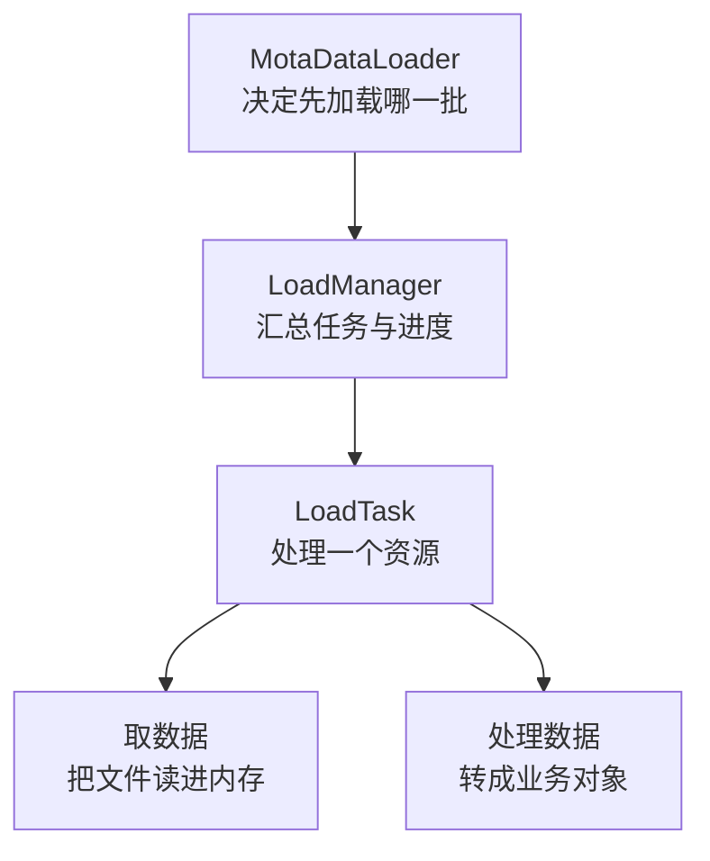
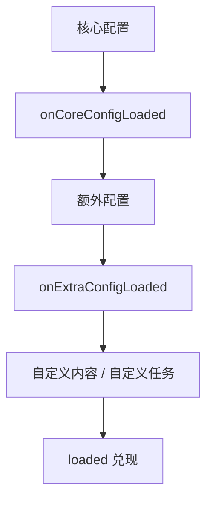

# 加载系统

一次加载把游戏运行所需的外部数据取到内存：核心配置、地图与图块、道具与敌人，以及作者追加的资源。这些数据的来源、大小和用途各不相同，却要放进同一个进度条里等待。数据端因此把加载拆成三层：

- **单个资源**：一个文件、一次请求、一份结果，是最小单位。
- **任务集合**：把若干资源放在一起推进，累计任务数与字节数。
- **阶段编排**：决定先加载哪一批、每批完成后允许追加什么，最后统一收尾。

三层依次向上依赖。本篇先给出整体模型，再解释模型里的每个概念，最后说明配置、钩子与自定义内容。

## 系统模型

| 对象             | 负责什么                                           | 什么时候会用到                     |
| ---------------- | -------------------------------------------------- | ---------------------------------- |
| `LoadTask`       | 代表一个资源：一个地址、一种读取方式、一个处理结果 | 一般由加载器创建，扩展时才直接接触 |
| `LoadManager`    | 收集一批任务，推进它们并累计任务数与字节数         | 读进度、显示进度条                 |
| `MotaDataLoader` | 按阶段登记并加载核心配置、额外配置和自定义内容     | 登记配置、注册钩子、追加自定义内容 |

一个任务只关心自己的地址与结果，管理器只关心这一批还有多少没完成，加载器只关心阶段的先后。



## 核心概念

下面从最底层的「响应」开始，自下而上解释模型里用到的接口与类型。

### `IResponseLike`：响应的最小契约

取数据的结果不是一个裸文件，而是一个响应对象。`IResponseLike` 只要求三样信息：`url`（最终地址）、`headers`（可按名称读取响应头）、`body`（可以为 `null`，不为空时能按块读取）。在此之上，它要求能把响应体转换成五种形式之一：`arrayBuffer()`、`bytes()`、`blob()`、`json()`、`text()`。

浏览器的标准 `Response` 在结构上满足这份契约，所以网页端不需要额外包装。自定义 starter 可以返回自己的对象，但必须完整提供上述成员；只实现实际会用到的读取方法在类型上并不成立。

### `ILoadTaskStarter`：决定去哪里、怎么取

starter 是「取数据」的适配点，只有一个方法：

`start(request: ILoadTaskRequest): Promise<IResponseLike>`

`ILoadTaskRequest` 包含 `url`、可选的 `method`、`body` 和 `headers`。starter 不解析内容，也不决定业务含义，只负责按请求配置拿到响应。网页端的 `WebLoadStarter` 直接调用 `fetch(request.url, { method, body, headers })`，把得到的 `Response` 原样返回。

### `LoadDataType`：原始响应按什么格式读

dataType 告诉任务「把响应体读成什么」。它不影响请求本身，只决定交给处理器的原始值类型。五个取值与产物如下：

| `LoadDataType`             | 产物                      |
| -------------------------- | ------------------------- |
| `LoadDataType.ArrayBuffer` | `ArrayBuffer`             |
| `LoadDataType.Uint8Array`  | `Uint8Array`              |
| `LoadDataType.Blob`        | `Blob`                    |
| `LoadDataType.Text`        | `string`                  |
| `LoadDataType.JSON`        | 解析后的 JSON 值（`any`） |

前三种保留二进制，`Text` 做文本解码，`JSON` 在文本解码后再执行 `JSON.parse`。选错类型不会在请求阶段报错，而是在读取或解析阶段失败，因此它必须和文件的实际内容一致。

### `ILoadTaskProcessor`：把原始值变成业务结果

processor 负责「处理数据」：`process(response, task): Promise<R>`。第一个参数是上一步按 dataType 读出的原始值，第二个参数是任务本身，需要地址、标识符或任务钩子时可以从这里取。返回的 `R` 就是任务最终兑现的结果。

processor 可以做校验、兼容旧格式、补默认值，也可以把文本解析成结构化对象。任务允许不设置 processor，此时原始值会直接作为结果；配置加载总是设置 processor，因为它还要去掉 JSONC 前缀。

### `LoadTask<T, R>`：把一个资源串起来

`LoadTask` 把前面四件事收在一起：`identifier`（任务名）、`url`、`dataType`，以及 starter 与 processor。`T` 是 dataType 的类型参数，`R` 是处理结果类型。

- `start()` 返回异步迭代器，每加载一段就产出一个已加载字节数；它会先向 starter 要响应，再按 dataType 读取，最后交给 processor。
- `loaded()` 返回 `Promise<R>`，处理完成时兑现。
- `getLoadedData()` 读取已完成的结果，未完成时是 `null`。

任务本身不写配置表，也不决定自己何时开始；这两件事分别由加载器和阶段顺序负责。

| 概念                 | 一句话职责         | 关键成员                               |
| -------------------- | ------------------ | -------------------------------------- |
| `IResponseLike`      | 响应的最小契约     | `url`、`headers`、`body`、五种读取方法 |
| `ILoadTaskStarter`   | 决定去哪里取       | `start(request)`                       |
| `LoadDataType`       | 原始值按什么格式读 | 五个枚举值                             |
| `ILoadTaskProcessor` | 原始值转业务结果   | `process(response, task)`              |
| `LoadTask`           | 把一个资源串起来   | `start()`、`loaded()`                  |

## 一次加载的阶段

`MotaDataLoader.start()` 按固定顺序推进，前一段没有完成就不会进入下一段：

1. 加载核心配置（`addCoreConfig` 登记的任务）。
2. 触发 `onCoreConfigLoaded`，此时可以追加额外配置与自定义内容。
3. 加载额外配置（`addExtraConfig` 登记的任务）。
4. 触发 `onExtraConfigLoaded`，此时可以继续追加自定义内容。
5. 加载自定义内容 / 自定义任务（`addCustomContent` / `addCustomTask` 登记的任务）。
6. 全部任务完成，`loaded()` 兑现。



阶段顺序决定了两条最常用的规则：

- `addExtraConfig` 必须在额外配置的收集循环之前调用：加载开始前，或 `onCoreConfigLoaded` 里都可以；放到 `onExtraConfigLoaded` 已经错过本次加载。
- `addCustomContent` 与 `addCustomTask` 必须在自定义内容的收集循环之前调用：加载开始前，或两个加载钩子里都可以；加载结束后再追加不会被读取。优先使用 `addCustomContent`，只有手里已经有现成任务实例时才用低一层的 `addCustomTask`。

`loader.start()` 在一次运行中只会推进一次，第二次调用直接返回，所以错过窗口没有补读机会。

## 配置文件与 getConfig

配置文件是带系统前缀的 JSONC：注释集中在开头，最后一行注释固定为 `// --- SYSTEM PREFIX END --- //`，之后才是 JSON。加载器按这行标记切分，再对后半段做 `JSON.parse`。前缀块只供人阅读，标记之前的内容不会成为字段；完全没有标记时，整个文件按 JSON 解析。

```jsonc
// Type: src/data/types IQuestConfig
// 前缀块可以写任意说明，加载器不会读取这些文字
// --- SYSTEM PREFIX END --- //
{
    "quests": {
        "main-01": {
            "title": "初入魔塔",
            "reward": 100
        }
    }
}
```

两类配置的职责与路径作用域不同：

| 方法                      | 用途                                   | `url` 相对于谁 | 开发环境中的实际路径                                       |
| ------------------------- | -------------------------------------- | -------------- | ---------------------------------------------------------- |
| `addCoreConfig(id, url)`  | 核心配置，决定内容清单与顶层信息       | `src`          | 入口传 `content/core.jsonc`，读 `src/content/core.jsonc`   |
| `addExtraConfig(id, url)` | 额外配置，按核心配置给出的内容目录展开 | `src`          | 入口传 `content/enemy.jsonc`，读 `src/content/enemy.jsonc` |

`addCoreConfig` 与 `addExtraConfig` 的路径都相对于 `src`：默认入口传入的正是 `content/core.jsonc`，额外配置也按 `src` 下的实际位置填写，例如传 `content/quest/quest.jsonc` 得到的是 `src/content/quest/quest.jsonc`。构建后 `src` 前缀会被去掉，`content` 目录仍在游戏根目录下，配置文件路径由加载器统一改写，不需要自己补环境前缀。

默认的 `DefaultDataLoaderHook` 会读取核心配置里的内容目录，追加 `enemy`、`item`、`map-list`、`tile` 等额外配置。

`getConfig<T>(id)` 只有在配置表中存在对应项时才返回值：从未登记、任务尚未完成或加载失败时都返回 `null`。配置文件已经跑过处理器、但标记出现多次或 JSON 解析失败时，处理器会产出空对象并照样存进配置表，所以返回 `{}`。空对象是 truthy，`if (!config)` 拦不住它。判断「没拿到配置」用 `config === null`，判断「拿到了但没有内容」再用字段检查。

## 注册一个加载钩子

钩子接口是 `IMotaDataLoaderHooks`，用 `loader.addHook(hook)` 注册。回调可以是 `async`，加载器会在阶段结束时统一等待；注册返回的控制器可以 `unload()` 注销。

```ts
import {
    ICoreState,
    IMotaDataLoader,
    IMotaDataLoaderHooks
} from '@user/data-state';

/** 在核心配置加载后追加任务配置 */
class QuestConfigHook implements IMotaDataLoaderHooks {
    async onCoreConfigLoaded(loader: IMotaDataLoader): Promise<void> {
        // 额外配置的 url 相对于 src
        loader.addExtraConfig('quest', 'content/quest/quest.jsonc');
    }
}

/** 通常写在插件的 awake 或初始化代码里 */
export function registerQuestConfigHook(state: ICoreState): void {
    // 注册后立即参与本次加载；需要提前移除时调用返回控制器的 unload()
    state.loader.addHook(new QuestConfigHook());
}
```

同一阶段登记的配置并行加载，完成先后不保证。需要读取另一份配置的内容时，把逻辑放到 `onExtraConfigLoaded` 之后，或等插件 `afterLoad`；不要假设先登记的配置先完成。

## 加载自定义内容

`addCustomContent` 用于追加一个 `src` 下的文件，并直接拿到处理后的结果。它替你创建 `LoadTask`、使用加载器自己的 starter，再把任务放进自定义内容这一批，因此不需要手动拼装任务。

```ts
addCustomContent<T, L extends LoadDataType>(
    init: ICustomContentInit<T, L>
): Promise<T>;
```

`ICustomContentInit` 的四个字段：

| 字段         | 含义                                                    |
| ------------ | ------------------------------------------------------- |
| `identifier` | 任务标识，不能与已有加载任务重复                        |
| `url`        | 文件路径，相对于 `src`；文件必须放在 `src` 下，格式不限 |
| `dataType`   | 按什么格式读取响应                                      |
| `processor`  | 把原始值转换成 `T` 的处理器                             |

返回的 `Promise<T>` 在任务处理完成后兑现，结果不会写进 `getConfig` 的配置表。调用时机是加载开始前、`onCoreConfigLoaded` 或 `onExtraConfigLoaded`；加载完成后再调用会被忽略，任务不会执行，返回的 Promise 也不会兑现。

一个完整的用法如下：processor 把按行文本转成任务数据，插件在 `awake` 里登记并保存 Promise，在 `afterLoad` 里等待结果。

```ts
import { ICoreState, IDataPluginDefine } from '@user/data-state';
import { ILoadTask, ILoadTaskProcessor, LoadDataType } from '@motajs/loader';

interface IQuestBook {
    title: string;
    entries: string[];
}

/** 把 UTF-8 文本转成任务数据 */
class QuestBookProcessor implements ILoadTaskProcessor<
    LoadDataType.Text,
    IQuestBook
> {
    process(
        text: string,
        _task: ILoadTask<LoadDataType.Text, IQuestBook>
    ): Promise<IQuestBook> {
        const [title, ...entries] = text.split('\n').filter(Boolean);
        return Promise.resolve({ title, entries });
    }
}

/** 在加载前登记，加载完成后再使用结果 */
export class QuestBookPlugin implements IDataPluginDefine {
    readonly id = 'quest-book';
    readonly dataDeps: readonly string[] = [];
    private book!: Promise<IQuestBook>;

    awake(state: ICoreState): void {
        this.book = state.loader.addCustomContent({
            identifier: 'quest-book',
            url: 'content/quest-book.txt',
            dataType: LoadDataType.Text,
            processor: new QuestBookProcessor()
        });
    }

    async initialize(): Promise<void> {}

    async afterLoad(): Promise<void> {
        const book = await this.book;
        // 在这里使用 book
    }
}
```

`addCustomTask` 是更低一层的逃生口：已经有一个构造好的 `ILoadTask` 实例时，直接把它交给加载器并等待结果。新增一种资源类型如果需要的不止这些，应反馈给引擎维护者，不要按现有任务拼一套旁路流程。

## 自定义 starter

换加载环境只需要实现 `ILoadTaskStarter`：`start(request)` 接收请求配置，返回 `Promise<IResponseLike>`。网页端返回的 `Response` 本身满足 `IResponseLike`，因此自定义 starter 通常只是改请求地址、请求方式或错误处理。

```ts
import {
    ILoadTaskRequest,
    ILoadTaskStarter,
    IResponseLike
} from '@motajs/loader';

/** 把所有请求转发到另一个资源来源 */
export class BaseURLLoadStarter implements ILoadTaskStarter {
    constructor(private readonly baseURL: string) {}

    start(request: ILoadTaskRequest): Promise<IResponseLike> {
        // 请求由任务给出，starter 只负责取响应
        return fetch(new URL(request.url, this.baseURL), {
            method: request.method,
            body: request.body,
            headers: request.headers
        });
    }
}
```

把 starter 实例传给数据端入口即可，例如 `createCoreState(new BaseURLLoadStarter('https://example.com/'))`。任务、处理器与阶段顺序都不需要改。

## 进度

加载由 `state.load()` 驱动。界面要显示进度时，读 `loader.manager` 上的计数即可，不需要接管加载：

| 成员               | 含义                           |
| ------------------ | ------------------------------ |
| `getLoadedTasks()` | 已经加载完成的任务数           |
| `getAddedTasks()`  | 已经加入的任务数               |
| `getTaskRatio()`   | 已完成任务数与已加入任务数之比 |
| `getLoadedByte()`  | 已加载的字节数                 |
| `getByteRatio()`   | 已加载字节与总量之比           |

这些计数只用于展示。需要等待加载结果时，应当读配置、读任务结果或等 `loaded()`，而不是等某个比例。渲染端可以复用同一个加载器：在 `onCoreConfigLoaded` 里追加贴图、音频、动画与字体等渲染侧配置，再从同一个 `loader.manager` 读取计数绘制进度条。

## 边界与注意

- <strong>配置 id 是键</strong>：同一个 id 在配置表中只保留一份，配置完成时若 id 已被占用，后来的任务会告警并被丢弃；需要两份配置时使用不同 id。
- <strong>addExtraConfig 的时机</strong>：只能在加载开始前或 `onCoreConfigLoaded` 中调用；在 `onExtraConfigLoaded` 里追加已经错过本次加载。
- <strong>addCustomContent 的时机与路径</strong>：只能在加载开始前、`onCoreConfigLoaded` 或 `onExtraConfigLoaded` 中调用；`url` 相对于 `src`，文件必须位于 `src` 下，加载完成后再调用会被忽略。
- <strong>解析失败是空对象</strong>：JSONC 标记出现多次或 JSON 非法时，加载器告警并把该配置存成 `{}`，整次加载继续；`getConfig` 对未登记 id 返回 `null`，对解析失败返回 `{}`。
- <strong>自定义 starter 的返回契约</strong>：`start` 必须返回满足 `IResponseLike` 的对象，标准 `Response` 可以直接使用。

返回[高级 III 导览](./index.md)。
