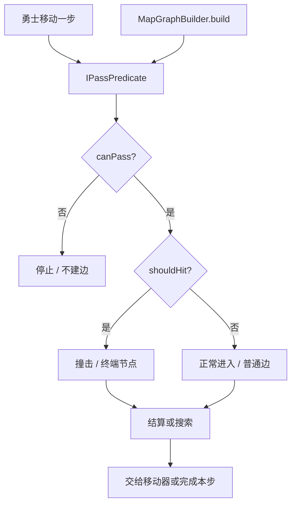

# 通行性谓词与寻路原理

「寻路能走，但勇士走不过去」通常不是寻路算错了，而是两侧看到的通行规则或绑定的图层不同。勇士移动在每一步开始时问一次通行谓词，寻路在构图时对每个邻格问同一个契约；只要有一侧换了谓词、换了事件层，或者把「能走但会撞」当成了「不能走」，结果就会分叉。

本篇讲通行谓词契约、默认实现怎么判断、勇士移动的三种结果，以及寻路如何构图、搜索并把步骤交给移动器。损失函数与瞬移策略的用法属于[自动寻路](../ii/pathfinding.md)，本篇不重复。

## 系统模型

| 对象                       | 负责什么                                               |
| -------------------------- | ------------------------------------------------------ |
| `IPassCheckHandler`        | 一次判断的输入：当前格、目标格、方向与地图             |
| `IPassPredicate`           | 通行性契约：`canPass` 与 `shouldHit`                   |
| `DefaultPassPredicateImpl` | 默认实现：按事件层与图块的通行位判断                   |
| `MapGraphBuilder`          | 从起点构图，只保留可达节点，并标记终端                 |
| `PathFinder`               | 在图上搜索最小损失路径                                 |
| `PathfindingSystem`        | 绑定移动器、图层、谓词与方向处理器，并把步骤交给移动器 |



关键分工：寻路本身不判断通行，它只是反复调用谓词，把结果翻译成图的边与终端；移动器也不判断通行，它只负责把算出的落点写回对象。谓词是两侧共同的语言，但它不持有「当前是哪个对象」。

## 通行谓词契约

`canPass` 与 `shouldHit` 回答两个不同的问题：

- `canPass` 为假：真的进不去。勇士会停止，位置不变；构图不会建这条边，也不会继续扩展目标格。
- `shouldHit` 为真：走得到，但会撞。勇士会停在原地并触发撞击；构图仍然建边，但把目标格记为终端。

`IPassCheckHandler` 把一次判断需要的输入打包在一起：`currLoc`、`nextLoc`、`direction`、`map` 与 `state`。谓词不保存「当前是哪个对象」，所以它可以被移动与构图复用；会不会共享实例，取决于它有没有自己的状态。

移动器只知道「这一步落到哪」，不知道地图规则、事件或对象身份。把通行判断塞进移动器，会让每个移动器都重新实现一遍地图查询，也会让动态图块、NPC 与勇士的规则混在一起。通行谓词把「规则」抽出来，移动器只消费结果，构图也只消费结果；同一套规则可以同时服务两种消费者。

代价是移动器必须在正确的时机调用谓词，并把结果翻译成自己的结果码。这个翻译层不能省：`cannotMove`、`hit`、`step` 对应不同的停止与事件行为，谓词本身不执行这些行为。职责分开后，替换谓词不会改变移动器的落点逻辑，替换移动器也不会改变地图规则。

### 默认实现怎么判断

`DefaultPassPredicateImpl` 的 `canPass` 按下面的顺序判断：

1. 从朝向管理器取四方向处理器，把传入方向降级；取不到处理器或降级为 `Unknown` 时直接不通行。
2. 没有地图，或地图没有事件层时直接不通行。
3. 在事件层上，当前格静态图块的 `outPass` 必须允许朝移动方向离开；目标格静态图块的 `inPass` 必须允许从反方向进入。事件层的图块无论是否标记「只判事件」都参与判断。
4. 在其它图层上，只检查 `onlyEvents` 为真的图块；没标记的图块不参与通行判断。标记了的图块同样检查离开与进入两个方向。

当前格或目标格没有静态图块时，该侧不施加限制：空格不会因为缺少 `pass` 而被拒绝。默认玩法按四方向组织；斜向输入只用降级结果确认能否得到有效方向，通行位掩码仍按本次移动方向计算，不能把「降级后的方向」当成掩码依据。

通行位到方向的映射是固定的：

| 位      | 掩码 | 在 `outPass` 中 | 在 `inPass` 中                     |
| ------- | ---- | --------------- | ---------------------------------- |
| `Up`    | 1    | 允许向上离开    | 允许从上方进入（本次移动方向为下） |
| `Right` | 2    | 允许向右离开    | 允许从右方进入（本次移动方向为左） |
| `Down`  | 4    | 允许向下离开    | 允许从下方进入（本次移动方向为上） |
| `Left`  | 8    | 允许向左离开    | 允许从左方进入（本次移动方向为右） |

`outPass` 直接使用移动方向；`inPass` 使用移动方向的反方向。例如从下方往上进入目标格时，移动方向是 `Up`，目标格检查的是 `inPass.Down`。

位掩码允许一个图块同时允许多个方向：`Up` 与 `Right` 两个位可以同时成立。判断时用按位与，而不是相等比较；把方向映射成掩码后，`mask & pass` 非零就表示允许。这样图块定义不需要为每个方向组合单独列一项，新增方向也只需要分配新的位。

`shouldHit` 只看事件层的目标格：目标格静态图块存在，并且它的 `eventPass` 为假时返回真。`eventPass` 为真表示玩家会走上去触发事件，为假表示玩家会撞在格子上触发事件。因此默认规则下，带事件但不可走上去的格子会成为寻路的终端，而不是普通中间格。

默认实现只读取静态图块。动态图块与其它占格对象不在这套判断里；需要它们挡路时，写自定义谓词。

事件层与其它图层的差别不是性能，而是语义：事件层描述「这一格在玩法上是什么」，所以它的图块无论是否标记 `onlyEvents` 都参与判断；其它图层大多只用于表现或装饰，只有显式标记 `onlyEvents` 的图块才会阻挡移动。这样作者在背景层放一张看起来像墙的图，不会意外改变通行性；要让装饰层参与，必须显式声明。

`outPass` / `inPass` 与 `eventPass` 不是同一类标记。前两者是通行位，回答「从哪个方向能离开 / 进入」；`eventPass` 不参与 `canPass`，只参与 `shouldHit`，回答「进入这一格时是走上去触发，还是撞停触发」。一个格子可以 `canPass` 为真、`eventPass` 为假：勇士不会真正进入目标格，而是在目标格前停下并触发撞击，构图上它是终端。把 `eventPass` 当成通行位，会让「可撞击的墙」变成完全不可达。

::: warning
默认谓词没有内部状态、每个方法无副作用，所以移动侧与寻路侧各自持有一个实例也会得到一致结果。只有给自定义谓词加了自己的状态（缓存、计数器、动态开关）时，才必须把同一个实例注入两侧，否则会出现不同步：寻路按一份状态构图，勇士按另一份状态移动。
:::

## 勇士移动如何使用谓词

用谓词判断一步只有三个分支：

```ts
import { IPassCheckHandler, IPassPredicate } from '@user/data-base';

/** 一步的三种结果：不能走、走得到但会撞、正常进入 */
export type StepResult = 'cannotMove' | 'hit' | 'step';

/** 用调用方传入的谓词判断一步；不要在每次判断时新建谓词 */
export function judgeStep(
    predicate: IPassPredicate,
    handler: IPassCheckHandler
): StepResult {
    if (!predicate.canPass(handler)) return 'cannotMove';
    if (predicate.shouldHit(handler)) return 'hit';
    return 'step';
}
```

这个函数只表达契约，不包含移动器行为。真正的移动器还会先判断边界、记录录像、处理 `ignoreTerrain`，并在结算阶段派发事件。

`HeroMover` 在每一步开始时先记录方向，再判断边界与通行。谓词的结果直接对应三种移动结果：

| 结果         | 判定                 | 后续行为                                                            |
| ------------ | -------------------- | ------------------------------------------------------------------- |
| `CannotMove` | `canPass` 为假       | 调用 `cannotEnter`（默认空实现），停止移动，位置不变                |
| `Hit`        | `canPass` 为真且会撞 | 调用 `hit`，触发 `OnTouch`，停止移动                                |
| `Step`       | 两者都为假           | 写入目标格，结算时先 `leave` 再 `enter`，触发 `OnLeave` / `OnEnter` |

撞击与进入是两条不同的路径：`Hit` 不会进入目标格，它的撞击分支触发 `OnTouch`；`Step` 才写入新坐标，并在结算阶段离开旧格、进入新格。默认的 `cannotEnter` 是空实现，所以「不能走」的专属分支不会派发事件。

还有一条容易忽略的边界：移动器的结算钩子在每步之后都会运行，不区分这一步是否真的改变了坐标。因此 `CannotMove` 与 `Hit` 虽然不写入新坐标，仍会在原格走一遍结算；`DefaultHeroMoveTopImpl` 会以相同的前后坐标收集 `OnLeave` 与 `OnEnter`。判断「有没有走成」要看坐标，不要只看触发器次数。边界越界或缺少顶层实现时还会产生内部的 `Stop`，同样会停止且不改变坐标。

`HeroMover` 还有两个开关会改变这条链：`ignoreTerrain` 为真时跳过谓词与进出 / 撞击事件，只剩边界检查；`allowOutBound` 为真时连边界也跳过。打开 `ignoreTerrain` 后改谓词看不到效果，因为谓词根本没有被调用。这两个开关属于移动器配置，不属于谓词；不要用它们代替通行规则。

方向移动在判断通行之前就会写入录像。即使这一步最终是 `CannotMove` 或 `Hit`，回放也会重放同一次尝试，得到同样的失败结果。这不是遗漏：如果只记录成功的步，回放时失败尝试带来的告警、事件或状态变化就会消失。事件脚本驱动的移动会临时关闭录制，避免把脚本位移记成玩家输入，见[录像系统底层](./replay-internals.md)。

移动侧只有三个派发点：`OnTouch` 来自 `hit` 分支，`OnLeave` 与 `OnEnter` 来自结算阶段；正常 `Step` 时两者分别作用于旧格与新格，失败步时两者作用于同一格。其余触发器目前没有移动侧派发点，见[事件系统](./event-system.md#事件对象与触发器)。

## 自动寻路系统中的构图

接下来讲自动寻路系统中的构图步骤，构图由 `MapGraphBuilder` 负责。`MapGraphBuilder.build(start)` 先检查图层、谓词、方向处理器与起点；缺任何一项，或起点越界，都返回 `null`。然后用广度优先扩展：

- 对每个邻格调用谓词，`canPass` 为假时不建边，也不继续扩展该邻格。
- `canPass` 放行但 `shouldHit` 为真时，仍然建边，同时把邻格记为终端。
- 只有从起点可达的节点才进入图；不可达区域不会被搜索看到。

BFS 会跳过 `face.mapMovement()` 里偏移为 `(0, 0)` 的项，否则原地邻居会让队列永远不空。每个节点的出边按方向处理器给出的邻域生成，所以四方向处理器只产生上下左右，八方向处理器会产生斜向边。

每个节点的损失由损失函数计算，未注入时按 1 处理。损失只决定「进入这一格要花多少代价」，不决定能不能进入。`NaN` 与负数会告警并回退为 1；当前实现接受 `Infinity`，但它不是通行判断工具，不可进入仍应由谓词控制。

图只在本次 `build` 中存在，寻路系统不缓存上一次的图。换楼层、换图层或换谓词后必须重新构图；旧图不会自动失效，也不会被复用。

只保留从起点可达的节点，是一个很重要的取舍：不可达区域不会进入搜索，搜索不必为它们分配距离，也不会因为地图另一半的复杂结构而变慢。代价是每次寻路都要重新 BFS 一遍；但地图规模通常远小于「把整张图预先建好并长期维护」的成本，而且换楼层、开门、推石头之后，旧图本来就不可信。

终端节点仍然建边，是因为它需要作为路径终点。如果把 `shouldHit` 的格子直接当成不可通行，搜索就永远到不了它，玩家也无法把「撞一下触发事件」的格子设为目标。建边加终端标记，把「能到达」与「能穿过」分开表达。

## 自动寻路的搜索与交给移动器

图建好后，搜索只读取节点上的 `cost` 与 `terminal`，不重新判断通行，也不重新计算损失。`PathFinder.search` 用最小堆按累计损失扩展节点；过期堆条目会被跳过，直到取出目标节点或堆空。

终端格可以作为路径的终点，但不能作为路径的中间点；默认实现里，`shouldHit` 为真的格子就是终端，所以「走得到但会撞」的格子只在作为目标时才会出现在路径末尾。起点自身若被标为终端，不会继续扩展；这是构图与搜索共同遵守的约束。

`find(start, target)` 把构图与搜索串起来，并把结果归入四个状态：

| 状态                             | 含义                                               |
| -------------------------------- | -------------------------------------------------- |
| `PathfindingStatus.Success`      | 找到路径，`path` 非空                              |
| `PathfindingStatus.InvalidInput` | 构图失败：缺少图层、谓词或方向处理器，或起点越界   |
| `PathfindingStatus.NoPath`       | 图上找不到路径，例如目标被终端格或不可通行区域挡住 |
| `PathfindingStatus.TargetUnder`  | 起点与终点相同，目标就在脚下                       |

`TargetUnder` 在构图之前就会返回，因为它不需要图：起点与终点相同，移动没有意义。不要把它当成 `NoPath` 的一种；它的语义是「已经到达」，调用方通常只需要跳过本次移动。

`NoPath` 是正常结果，不是错误。它只说明按当前谓词与当前图层，从起点走不到目标。目标越界也会落到 `NoPath`：图里没有这个节点，搜索直接返回空路径。

损失与通行是两件事。损失函数只决定「进入这一格要花多少代价」，它不参与「能不能进」；把 `Infinity` 当通行判断，会让构图仍然建边、搜索却得到一个无法解释的代价。正确做法是让谓词拒绝不可进入的格子，损失函数只处理「可进入但更贵」的情况，例如沼泽、岩浆或减速地形。

终端与损失也互不替代。终端描述「这一格只能作为终点」，损失描述「进入它要花多少」。一个终端格可以有很高的损失，也可以在作为目标时被搜索到；它不是「不可达」的别名。

损失也不能反过来表达优先级。搜索只按累计损失最小选路，不读取图块类型或事件；需要「优先走某类格子」时，用损失函数调整进入代价，不要在地图或事件里塞隐藏标记。

搜索得到路径后，`PathfindingSystem` 负责把求解器与移动器接起来：

- `useMover(mover)` 绑定移动器，之后 `getPath(target)` 从移动器的 `tile` 读取起点。
- `moveTo(target)` 取到 `Success` 的路径后，把每一步的方向交给移动器，再启动移动器；它总是逐步移动。
- `teleportTo(target)` 也先取路径，但在策略允许时直接瞬移到最后一个步骤的终点；没有策略时默认退化为逐步移动。
- `interrupt()` 停止当前自动寻路。已有移动进行中时，新的 `moveTo` / `teleportTo` 返回 `null`，不会接管当前移动。

系统层不保存地图数据，也不缓存上一次的图；每次寻路都从当前绑定的图层重新构图。`teleportTo` 的瞬移只落在终点，途经格不会触发踩踏事件；需要补触发时用瞬移钩子，见[自动寻路](../ii/pathfinding.md#瞬移钩子)。

初始状态下寻路的图层是 `null`：`MainDataPlugin` 只注入谓词与移动器，因为勇士还没有进入楼层。此时 `getPath` 会得到 `InvalidInput`；进入楼层后由切换楼层的逻辑绑定事件层与方向处理器，寻路才真正可用。不要在没有楼层时反复重试 `getPath`，也不要在绑定前假设图已经存在。

不缓存图是刻意的：图依赖图层内容、谓词状态与方向处理器，任何一项变了，旧图就可能给出错误路径。把失效判断留给调用方，会变成「忘了通知就悄悄走错」；每次重构图虽然多花一点时间，但结果始终对应当前状态。寻路是玩家操作触发的低频动作，这个成本通常可以接受。

换楼层时，除了 `useMapLayer(newLayer)`，还要确认方向处理器仍然匹配新图层。方向处理器决定邻域，不随楼层自动切换；如果新楼层使用不同的方向体系，必须重新 `useFaceHandler`。旧图层对象在切换后不应继续用于寻路，否则图会按旧坐标与旧宽度构建。

## 自定义谓词

换通行语义就是换谓词。实现 `IPassPredicate` 的两个方法，输入都是 `IPassCheckHandler`；需要保留默认规则时，在内部包一个默认实现，再叠加自己的判断。

下面这个类在默认规则之上禁止进入指定图块数字的格子：

```ts
import { IPassCheckHandler, IPassPredicate } from '@user/data-base';
import { IStateSystem } from '@user/data-system';
import { DefaultPassPredicateImpl } from './predicate';

/** 在默认规则之上，禁止进入指定图块数字的格子 */
export class NoTilePassPredicate implements IPassPredicate {
    private readonly base: IPassPredicate;

    constructor(
        state: IStateSystem,
        private readonly blockedTile: number
    ) {
        // 默认谓词负责事件层、onlyEvents 与 eventPass 的判断
        this.base = new DefaultPassPredicateImpl(state);
    }

    canPass(handler: IPassCheckHandler): boolean {
        // 默认规则已经拒绝时，不再叠加判断
        if (!this.base.canPass(handler)) return false;

        const map = handler.map;
        const event = map ? map.eventLayer : null;
        if (!event) return false;

        // 读取目标格在事件层上的静态图块数字
        const next = event.getLocationData(
            handler.nextLoc.x,
            handler.nextLoc.y
        );
        return next?.static?.raw()?.num !== this.blockedTile;
    }

    shouldHit(handler: IPassCheckHandler): boolean {
        // 撞击语义保持默认：目标格静态图块的 eventPass 为假时撞停
        return this.base.shouldHit(handler);
    }
}
```

寻路侧把求解器的谓词换掉：

```ts
import { ICoreState } from '@user/data-state';
import { NoTilePassPredicate } from './noTilePassPredicate';

/** 让寻路构图使用新的通行规则 */
export function useLavaRule(state: ICoreState): void {
    const predicate = new NoTilePassPredicate(state, 30);
    // 之后构图与终端标记都按新规则计算
    state.pathfinding.finder.usePassPredicate(predicate);
}
```

勇士侧要换的是顶层实现，而不是直接往移动器里塞谓词。`DefaultHeroMoveTopImpl` 在构造时已经建好自己的默认谓词；保留其它行为时，包一层顶层实现并转发，让 `predicate()` 返回同一个谓词实例。完整写法见[移动 Mover](../i/mover.md#勇士的顶层实现)。只替换 `finder` 侧的谓词不会同步勇士，反之亦然；要让两侧一致，必须把同一套规则分别注入移动与构图。

方向处理器决定「哪些方向算相邻」，它的选择会同时影响移动与构图。损失函数与瞬移策略不改变通行性，它们分别决定进入代价与是否逐步移动。

## 边界与注意

- **`canPass` 与 `shouldHit` 不能混用**：`shouldHit` 为真是「可以走但会撞」，不是「不能走」；把两者取反会让移动与寻路同时出错。
- **两个实例不共享**：默认装配下勇士与寻路各持有一个谓词；改一侧不会自动改另一侧，需要一致时两侧都换。
- **构图依赖三项注入**：图层、通行谓词与方向处理器缺任何一项，`build` 都会返回 `null`，`find` 得到 `InvalidInput`。
- **默认实现只读静态图块**：动态图块与其它占格对象不参与判断；需要它们挡路时写自定义谓词。
- **图层必须属于同一数据端**：寻路绑定其它实例的图层会告警并忽略；换楼层后必须重新绑定。
- **终端只能作终点**：`shouldHit` 的格子不能作为路径中间点；`NoPath` 是正常结果。
- **失败步也会走结算**：`CannotMove` 与 `Hit` 不改变坐标，但结算仍会在原格收集 `OnLeave` / `OnEnter`；不要用触发器次数判断是否真的移动。

返回[高级 III 导览](./index.md)。
