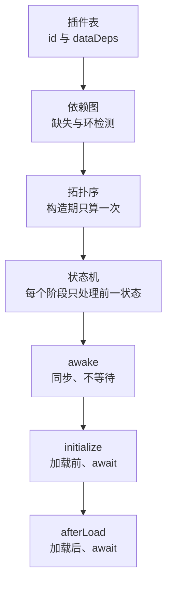

# 插件内部机制

插件看起来只是「在三个时机里写代码」，但实际执行顺序不取决于它在数组里的位置。两个插件互不依赖时，列表顺序只决定平局顺序；一旦声明了 `dataDeps`，顺序就由依赖图决定。依赖写错时，系统也不会抛一个明确的异常，而是把插件及其下游从执行集合里移除。

本篇只讲机制：插件表怎么变成确定顺序、状态怎么推进、三个阶段为什么不能互换、失败时作者会看到什么。怎么写一个插件见[插件系统](../i/plugin-system.md)，本篇不重复插件类写法。

## 系统模型

| 组成   | 负责什么                               |
| ------ | -------------------------------------- |
| 插件表 | 按 id 保存插件与当前状态               |
| 依赖图 | 把 `dataDeps` 展开成「谁必须先于谁」   |
| 拓扑序 | 把依赖图压成一份固定执行顺序           |
| 状态机 | 记录每个插件走到哪个阶段               |
| 三阶段 | 按同一顺序执行装配、加载前与加载后回调 |



插件表在 `CoreState` 构造时建立。依赖图只由插件的 `id` 与 `dataDeps` 构成，不读运行期状态；拓扑序也只算一次，三个阶段复用同一份结果。这样插件顺序在启动前就是确定的，运行期修改 `dataDeps` 不会改变已经算好的顺序。

## 三个阶段

三个阶段共享同一份拓扑序，差别在时机与是否等待：

| 阶段         | 时机         | 是否等待     | 适合做什么                           |
| ------------ | ------------ | ------------ | ------------------------------------ |
| `awake`      | 主对象构造期 | 否，同步返回 | 创建插件自己的对象、注册可存档内容   |
| `initialize` | 加载开始前   | 是           | 异步准备、追加加载配置               |
| `afterLoad`  | 加载完成后   | 是           | 读取加载内容、创建依赖内容的初始状态 |

`awake` 的返回值不会被等待，写 `async awake` 也不会阻塞后续插件；需要等待的事情放到 `initialize`。`initialize` 与 `afterLoad` 都会 `await`，只要有一个不兑现，后面的插件与加载就不会继续。

三个阶段都保证：被依赖的插件先完成同一阶段。插件 B 的 `awake` 开始时，A 的 `awake` 一定已经完成；不构成依赖关系的插件之间，不要假定谁先谁后。

三个阶段收到的依赖是解析后的包装数组，形如 `{ status, plugin }`，顺序与 `dataDeps` 一致。需要对方能力时取 `.plugin`，不要把它当成第二份依赖声明。依赖缺失或成环的插件不会进入执行顺序，所以拿到依赖后可以直接使用，不需要在回调里再判空。

::: warning
`MainDataPlugin` 不是隐式前置，它只是插件列表里的普通插件。标准入口把它放在最前，不等于插件系统承诺它先执行；用到它注册的存档 id、默认装配或初始化结果时，必须在 `dataDeps` 里写 `'main-data-plugin'`。
:::

## 三个阶段为什么不能互换

三个阶段的差别不只是「先后」，而是「这时能看到什么」：

- `awake` 发生在四层构造完成之后、加载开始之前。它能创建对象、注册可存档内容、给已有系统注入默认实现，但读不到核心配置与地图内容；把读取配置的逻辑放进来，只会得到 `null`。
- `initialize` 在加载开始前执行，适合做异步准备与追加加载配置。它可以等待网络或文件，但不能读取尚未加载的内容；这里不兑现，加载不会开始。
- `afterLoad` 在加载完成后执行，核心配置、地图与内容都可读。它适合创建依赖内容的初始状态；但它也在启动路径上，放太多重活会推迟游戏开始。

如果把 `afterLoad` 的逻辑提前到 `awake`，读取配置会失败；如果把 `awake` 的同步装配挪到 `initialize`，依赖它的插件在 `awake` 阶段就拿不到对象。三个时机各自对应一段确定的时间线，不能靠「反正都会执行」来互换。

`awake` 不等待返回值，是这条时间线上最容易踩的坑：写成 `async awake` 不会让后续插件等它。需要等待的事情放进 `initialize`，需要读取加载内容的事情放进 `afterLoad`。

## 一个最小依赖声明

下面这个插件只做一件事：声明自己依赖主插件，然后在 `awake` 里创建自己的管理器。它展示了依赖声明与阶段方法的最小形状。

```ts
import { ICoreState, IDataPluginDefine } from '@user/data-state';

/** 插件自己的管理器；具体逻辑不属于本页 */
class QuestManager {
    constructor(readonly state: ICoreState) {}
}

/** 对外接口，依赖它的插件按这个类型取用 */
export interface IQuestPlugin extends IDataPluginDefine {
    readonly manager: QuestManager;
}

/** 任务插件：显式依赖主插件，避免用到尚未注册的默认装配 */
export class QuestPlugin implements IQuestPlugin {
    readonly id: string = 'quest-plugin';
    // 主插件不是隐式前置，用到它的默认装配就必须写在这里
    readonly dataDeps: readonly string[] = ['main-data-plugin'];

    manager!: QuestManager;

    awake(state: ICoreState): void {
        // 此时四层与主插件的 awake 都已完成，可以安全创建自己的对象
        this.manager = new QuestManager(state);
    }

    async initialize(): Promise<void> {}

    async afterLoad(): Promise<void> {}
}
```

这个类没有构造器，也没有把 `state` 存成公共字段；需要主对象时在 `awake` 里接收。`dataDeps` 只写 id，不写插件对象；三个阶段收到的依赖参数是引擎解析后的包装数组，不是声明时写的东西。

## 依赖参数怎么用

三个阶段收到的依赖数组有三个约束：

- **顺序与 `dataDeps` 一致**：第 `i` 个元素对应 `dataDeps[i]`，不要按插件在列表里的位置索引。
- **元素是包装对象**：形如 `{ status, plugin }`，取能力要读 `.plugin`；`status` 会随阶段推进更新。
- **不要修改数组或往里塞对象**：它只是本次回调的解析结果，不是第二份依赖声明；需要新依赖时改 `dataDeps`，不要在下游临时拼。

启动阶段优先用依赖参数，让引擎保证「同一阶段内依赖先完成」；运行期才用 `getDataPlugin` 按 id 取回。把依赖参数缓存到字段里再长期使用，等价于持有一个会变化的状态包装对象；需要长期引用时缓存 `.plugin`，并在使用前确认插件已经到达你需要的阶段。

依赖参数不需要判空。被阻断的插件不会进入执行顺序，回调根本不会执行；如果回调执行了，说明依赖已经解析成功。对依赖参数写 `?.` 只会掩盖 `dataDeps` 的声明错误，让本应被阻断的插件带着空依赖继续跑。启动阶段唯一需要检查的是「依赖是否已经到达你需要的阶段」，不是「依赖是否存在」。

## 阶段推进的可见性

三个阶段的推进是「整段推进」，不是按依赖链各自跑到底：所有可执行插件的 `awake` 先完成，才开始 `initialize`；所有 `initialize` 兑现后，才开始加载；加载完成后才进入 `afterLoad`。同一阶段内按拓扑序执行，所以依赖先完成；不同依赖链之间可能有交错，但不会出现「A 的 initialize 在 B 的 awake 之前」。

`awake` 不等待返回值，意味着 `async awake` 里第一个 `await` 之后的代码可能与后续插件的 `awake` 或 `initialize` 并发。不要把需要顺序的异步逻辑放在 `awake`；需要等待的事情放 `initialize`，需要读加载内容的事情放 `afterLoad`。

## 状态机

每个插件在注册表里带一个状态，四个状态与推进条件如下：

| 状态          | 含义                | 进入条件          |
| ------------- | ------------------- | ----------------- |
| `NotAwakened` | 还没执行装配期回调  | 注册时的初始状态  |
| `Awakened`    | 已执行 `awake`      | `awake` 正常返回  |
| `Initialized` | 已执行 `initialize` | `initialize` 兑现 |
| `Loaded`      | 三阶段都完成        | `afterLoad` 兑现  |

每个阶段只处理处于前一状态的插件：`awake` 只处理 `NotAwakened`，`initialize` 只处理 `Awakened`，`afterLoad` 只处理 `Initialized`。状态不符会跳过并告警 80。状态只前进不后退，同一个实例不会重新走一遍阶段，也没有运行期重置。

被阻断的插件不会进入执行顺序，因此永远停在 `NotAwakened`。`getDataPlugin` 只返回包装对象与状态，不提供「为什么被阻断」的查询；看到 `NotAwakened` 时，无法仅凭它区分「还没开始」与「被依赖阻断」。排查要回到控制台里的 76 / 77 提示，再顺着依赖链找。

状态是每个插件各自的，不是全局阶段计数器。依赖数组里的 `{ status, plugin }` 是同一个包装对象，它的 `status` 会随阶段推进更新：你在自己 `awake` 里看到的依赖状态是 `Awakened`，在 `afterLoad` 里看到的通常已经是 `Loaded`。不要缓存依赖包装对象再假设状态会停在某个值；需要判断时重新读 `status`。

## 与 CoreState 的分工

`CoreState` 负责四层对象图与构造顺序，插件系统负责在这张图上继续装配。插件不往 `CoreState` 上加新字段，也不修改四层构造；它把自己的对象挂在插件实例上，需要跨插件访问时通过 `getDataPlugin` 或 `dataDeps` 取。

这条分工决定了两件事：

- 插件可以在 `awake` 里访问任意一层，因为四层已经全部构造完成；但它不能假设某个「默认装配」已经存在，除非显式依赖提供它的插件。
- 插件的对象不进入 `CoreState` 的静态类型；依赖方要拿到能力，必须通过插件接口断言，而不是 `state.somePluginField`。这也让插件可以被移除或替换，而不改变数据端主对象的形状。

`CoreState` 的构造器建立插件表与拓扑序，并在最后同步执行 `awake`；`initialize` 与 `afterLoad` 由加载流程驱动。插件系统因此可以独立于具体插件存在，测试时也可以只构造插件表验证排序。

## 失败时作者看到什么

| 情况         | 作者要避免                                 | 控制台看到                    | 结果                                       |
| ------------ | ------------------------------------------ | ----------------------------- | ------------------------------------------ |
| 依赖成环     | 两个插件互相声明依赖，或链路上绕回自己     | 76，列出环上的 id             | 环上插件与下游都不执行，停在 `NotAwakened` |
| 依赖缺失     | id 拼错、对方改名、忘记把插件放进列表      | 77，插件 id + 缺失的依赖 id   | 该插件与下游都不执行                       |
| 重复 id      | 两个插件使用同一个 `id`                    | 78                            | 只保留第一个，后一个被跳过                 |
| 阶段状态不符 | 假设某个阶段可以重跑、手动推进或从中间插入 | 80，插件 id 与期望 / 实际状态 | 该阶段跳过该插件，后续阶段也不会补跑       |

这些失败不会抛出异常，也不会自动重试。设计上，一个插件的依赖写错不应该让整个数据端无法构造；引擎选择把出错的插件与下游排除，让其余插件继续启动。代价是错误被推迟：作者看到的常见现象不是「插件报错」，而是「某个对象不存在」或「某个 id 没有注册」。被阻断的插件不会执行任何阶段，依赖它的下游也不会执行；所以错误往往在下游第一次访问时才发现，而不是在出错的插件本身。

依赖关系在启动前固定，运行期修改 `dataDeps` 不会改变已经算好的顺序；也没有接口在运行时追加插件。新增插件要改列表并重新创建实例，不要指望在 `load()` 之后再插一个。

`getDataPlugin` 返回的 `NotAwakened` 不是「还没轮到」的同义词：它既可能是执行顺序还没走到，也可能是插件被 76 / 77 阻断。插件系统没有提供「阻断原因」的查询接口，所以看到这个状态时，先查控制台里的环或缺失提示，再检查依赖链上的每个 id，而不是在调用点反复判空。

## 取回一个插件

按 id 取回用 `state.getDataPlugin<T>(id)`，返回只读包装或 `null`。启动阶段优先用 `dataDeps` 让引擎保证顺序；运行期才按 id 取回，并且必须判空、检查状态。

```ts
import { ICoreState, PluginStatus } from '@user/data-state';
import { IMyPlugin } from './types';

/** 启动完成后取回插件：判空与状态检查都不能省 */
export function useMyPlugin(state: ICoreState): void {
    const holder = state.getDataPlugin<IMyPlugin>('my-plugin');
    if (!holder) {
        // 没有注册，或 id 拼错
        return;
    }
    if (holder.status !== PluginStatus.Loaded) {
        // 还没走到你要的阶段，此时调用可能读到未装配好的字段
        return;
    }
    holder.plugin.doSomething();
}
```

`getDataPlugin` 只查注册表，不保证插件已经加载完成。需要依赖某个插件的能力时，优先在 `dataDeps` 里声明；按 id 取回更适合可选的、运行中才发生的调用。

如果取回的目的是启动装配，先考虑声明依赖；按 id 取回会把顺序责任转移到调用方，而调用方通常不知道目标插件走到哪一阶段。

## 依赖排序只做一次

排序在构造期完成一次，之后三个阶段都复用同一份结果。作者不需要理解排序过程，只需要在 `dataDeps` 里声明依赖：被依赖的插件会先完成同一阶段。成环或缺失依赖会阻断该插件及其下游，它们不会进入执行顺序。运行期不能追加插件，也不能通过修改 `dataDeps` 改变已经算好的顺序；需要不同的顺序，只能改列表并重新创建数据端。

## 边界与注意

- **依赖在启动前固定**：构造期把 `dataDeps` 抄进依赖表，之后修改数组不会改变顺序。
- **不支持运行期追加插件**：注册表只在构造期建立，没有追加接口；新增插件要改列表并重新创建实例。
- **环或缺失会阻断下游**：不只是出错的插件本身，依赖它的插件也不会执行任何阶段。
- **重复 id 只保留第一个**：构造期告警并跳过后一个，注册表里不会出现两个同 id 实例。
- **依赖主插件要显式声明**：用到 `main-data-plugin` 注册的默认装配、存档 id 或初始化结果时，在 `dataDeps` 里写 `'main-data-plugin'`。
- **`getDataPlugin` 要判空并检查状态**：它只查注册表，不保证插件已进入你需要的阶段；数据端与渲染端的 `dataDeps` / `clientDeps` 也是两套，不要混用。

返回[高级 III 导览](./index.md)。
