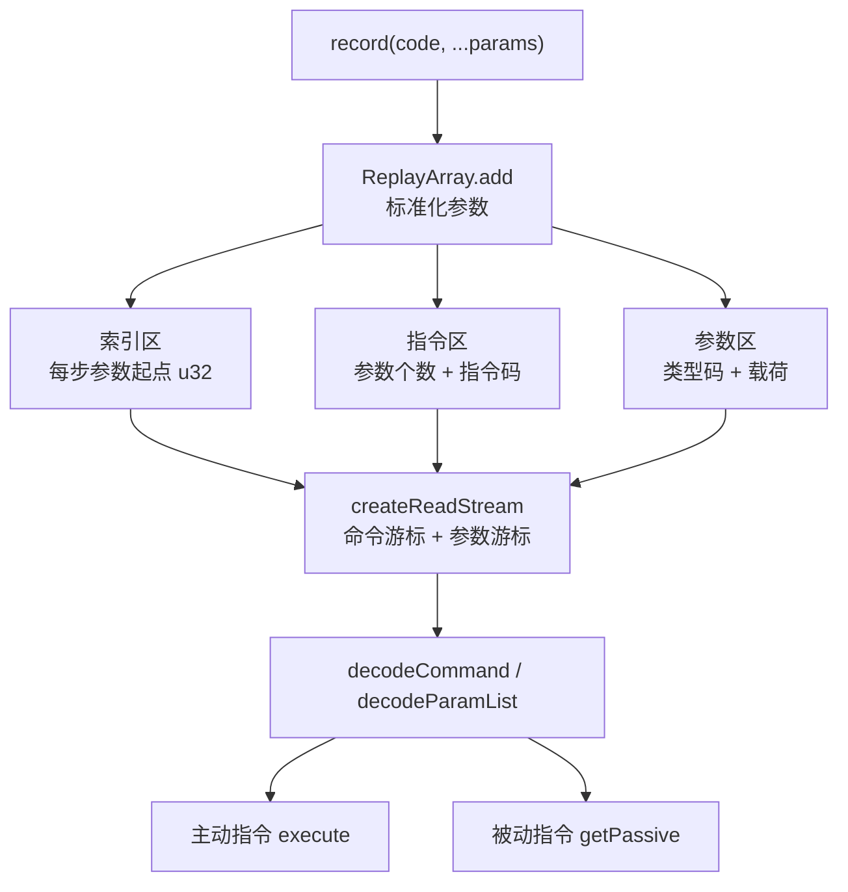

# 录像系统底层

录像不是最终状态的快照，而是一串按顺序重放的输入。录制端记下玩家做了什么，播放端把同样的动作重新交给游戏逻辑，让位置、属性、地图改动与事件结果重新算出来。只要录制的是「入口动作」而不是「派生结果」，同一份录像就能换机器、只跑数据端重放出同一局。

本篇讲录像的存储布局、录制入口、主动与被动指令、播放沙箱与读取流。哪些方法必须进入录像见[录像一致性](../i/replay-consistency.md)；怎么新增一条自定义指令见[自定义录像指令](../ii/custom-replay-command.md)。

## 系统模型

| 对象                | 负责什么                                                     |
| ------------------- | ------------------------------------------------------------ |
| `ReplaySystem`      | 对外入口：注册指令、记录一步、创建沙箱、保存与读回录像缓冲区 |
| `ReplayArray`       | 存储本体：指令区、参数区、索引区，以及顺序读取流             |
| `IReplayCommand`    | 单条指令的执行对象，分主动与被动，可选一个连续步骤的收尾方法 |
| `ReplaySandbox`     | 播放器：按读取流推进，处理主动与被动步，提供播放控制         |
| `IReplayReadStream` | 只读视图：保存当前步号、总步数与是否过期，按指针顺序读取     |

`ReplayArray` 才是录像本身；`ReplaySystem` 持有它和一张「指令码 → 指令对象」的注册表。注册表只负责把指令码解释成可执行对象，所以录像里只存指令码与参数，不存指令对象。同一份录像可以反复播放，也可以只录制不播放。



## 一条录像步是什么

一步由 `code` 与 `params` 组成。`code` 是 `ReplayCode` 里的指令码，或你自己注册的码；`params` 是这一步带的原始参数。参数只支持 `number`、`string`、`boolean` 与 `bigint` 四种原始类型。对象、数组、函数与 `undefined` 无法编码：写入时告警并丢弃该参数，不保留占位，后面的参数会前移。

因此录制入口必须先决定这一步到底带哪些参数，不要把「可能为空」的值混进参数列表。参数类型码是录像格式的一部分，遵循只增不改：新语义必须分配新码，不能复用旧含义。

录像要跨机器、跨会话读取，所以参数必须能被二进制编码；指令对象是运行期行为，不能进录像。这两条决定了 `ReplayArray` 只存原始值，`ReplaySystem` 单独持有注册表。

## IReplayArray：三块区域与两个视图

`ReplayArray` 实现 `IReplayArray`，是录像的存储本体。它对外同时提供「按步号随机读」与「从头顺序读」两种视图，但底层只有三块连续缓冲区：

| 区域   | 内容                                                             | 定位方式                          |
| ------ | ---------------------------------------------------------------- | --------------------------------- |
| 指令区 | 每步固定长度：1 字节参数个数，后接 1 或 2 字节指令码             | 第 `i` 步在 `i * commandSize`     |
| 参数区 | 变长：每个参数由类型码与载荷组成，按写入顺序紧凑排列             | 每步的起始字节由索引区给出        |
| 索引区 | 每步一个 32 位无符号整数，记录该步参数在参数区的起始字节         | 第 `i` 项的值为 `indexArray[i]`   |
| 读取流 | 不复制数据，只保存当前步号、命令游标、参数游标、总步数与过期标记 | 由 `createReadStream(startIndex)` |
| 随机读 | `get(index)` 直接按索引区定位参数，再解码该步                    | 适合编辑器，不适合播放循环        |

指令区的步长由 `commandWidth` 决定：8 位宽时每步 2 字节，16 位宽时每步 3 字节。参数区没有固定步长，所以必须依赖索引区；没有索引区，读取第 `n` 步就要从第 0 步一路解码过来。索引区在整体替换缓冲区或 `rebuildIndexArray()` 时重建；正常写入时增量维护，正常播放不修改它。

写入路径有 `add`、`insert`、`delete`、`set` 四个入口。`add` 追加到末尾；`insert` 允许插到 `[0, length]`，插到 `length` 等同于追加；`delete` 与 `set` 的合法区间是 `[0, length)`。越界不会修改任何缓冲区，只告警 179。四个入口都会先标准化参数，再计算本步参数的总字节数。

索引区的维护方式决定了编辑成本：`insert` 要把插入点之后的指令、参数与索引整体后移；`delete` 要整体前移；`set` 在参数长度变化时按差值平移后续参数，并调整后续索引。成本与后续步数成正比，所以这些方法只适合录像编辑器一类低频操作，不适合放进录制或播放循环。

参数区与指令区都会按需扩容。扩容时新建更大的 `ArrayBuffer`，把旧内容复制过去，再把后续写入指向新缓冲区。指令区与参数区分别扩容，所以录像体积不会因为某一步参数特别长而要求所有步都留出同样空间。

## 参数区：类型码与载荷

参数区的每个参数都以 1 字节类型码开头，随后是类型相关的载荷。类型码是录像格式的一部分，只增不改；10 到 31 目前留空。

| 类型码 | 类型          | 载荷                                         | 总字节 |
| ------ | ------------- | -------------------------------------------- | ------ |
| 0      | `boolean`     | 1 字节，0 或 1                               | 2      |
| 1      | `int8`        | 1 字节有符号整数                             | 2      |
| 2      | `int16`       | 2 字节有符号整数                             | 3      |
| 3      | `int32`       | 4 字节有符号整数                             | 5      |
| 4      | 非负 `int64`  | 幅值拆成低 32 位与高 32 位                   | 9      |
| 5      | 负 `int64`    | 幅值拆成低 32 位与高 32 位，符号由类型码表示 | 9      |
| 6      | `float64`     | 8 字节 IEEE 754 浮点数                       | 9      |
| 7      | 非负 `bigint` | 1 字节幅值长度 `n`，后接 `n` 字节小端幅值    | n + 2  |
| 8      | 负 `bigint`   | 1 字节幅值长度 `n`，后接 `n` 字节小端幅值    | n + 2  |
| 9      | `string`      | 4 字节长度前缀，后接 UTF-8 字节              | n + 5  |
| 32–255 | 短字符串      | 类型码减 32 就是字节长度，后接 UTF-8 字节    | n + 1  |

`number` 会按值域选择最窄的整数类型：`[-128, 127]` 用 `int8`，`[-32768, 32767]` 用 `int16`，`[-2147483648, 2147483647]` 用 `int32`；超出这个范围但仍是整数的值用非负 / 负 `int64`；非整数用 `float64`。这解释了为什么同一步里的 `100` 只占 2 字节，而 `100.5` 要占 9 字节。

字符串有两种编码。UTF-8 字节长度不超过 223 时使用短字符串码：类型码直接等于 `长度 + 32`，所以空字符串是 32，`'abc'` 是 35，后面直接跟 3 个字节。更长的字符串退回类型码 9，带 4 字节长度前缀。短字符串没有长度前缀，因此读取时只能靠类型码反推长度。

`bigint` 与 `int64` 都用「幅值 + 符号码」而不是二进制补码。这样解码时不需要处理符号扩展，代价是负数的载荷仍然是幅值。`bigint` 的幅值长度只写 1 字节，因此能表示的幅值范围由这个长度字段决定；超出可表示范围时该参数会被丢弃并告警，不会截断成另一个值。

## 读取流：指针怎么走

`createReadStream(startIndex)` 不复制录像，只保存两个游标：

- **命令游标**：`startIndex * commandSize`，指向该步在指令区的起点。
- **参数游标**：`indexArray[startIndex]`，指向该步在参数区的起点。

`read()` 先解码命令，得到 `paramCount` 与 `command`；再按 `paramCount` 从参数游标开始逐个解码参数，每解码一个就把参数游标推进该参数的 `byteLength`；最后把命令游标推进一个 `commandSize`，把步号加一。返回的 `IReplayStepHandler` 里同时有 `command`、`params` 与 `index`，`index` 是刚读出的那一步的步号。

读取流不会在每次 `read()` 时重新查索引区，所以顺序播放是线性的。反过来，`get(index)` 每次都从索引区取起点，再重新解码该步参数，适合随机定位，不适合每一步都调用。

索引区是派生数据，不是录像内容。它可以从指令区与参数区重新算出来：遍历每一步，解码参数个数与参数长度，累加得到每步的起始字节。整体替换缓冲区后，索引区必须重建；正常写入时则顺手维护。重建是线性成本，只适合加载、导入或修复，不适合播放循环。

## 读取流的生命周期

读取流从 `createReadStream(startIndex)` 开始，登记到数组的读取流集合里；每次 `read()` 推进游标；写操作把它标记为过期并移出集合；`destroy()` 提前移出集合，适合中途放弃播放。

过期之后不要继续依赖读出的数据：偏移可能已经指向被搬移或覆盖的位置。沙箱会在开始播放与每轮循环前检查过期并停止；直接使用读取流的代码应当同样检查 `expired`，或者干脆保证读写不并发。

任何写操作都会让已有读取流过期：`add`、`insert`、`delete`、`set`、`setCommandWidth` 与整体替换缓冲区都会遍历当前登记的所有读取流，把它们标记为 `expired` 并清出登记表。过期后直接调用 `read()` 会告警 155，但读流本身仍会按旧游标继续返回数据；沙箱会在开始播放或每轮循环前检查 `expired`，一旦为真就告警 156 并停止。**不要边写边读**：过期标记只是让调用方有机会停下，不会替你回滚已经改变的偏移。

## 一次写入的字节布局

以 8 位指令宽度、`record(42, 100)` 为例。`record` 把参数整理成数组后调用 `array.add(42, [100])`；`100` 落在 `int8` 范围内，所以只占 2 字节。

| 位置         | 字节          | 含义                       |
| ------------ | ------------- | -------------------------- |
| 指令区 `[0]` | `01`          | 参数个数 = 1               |
| 指令区 `[1]` | `2A`          | 指令码 = 42                |
| 参数区 `[0]` | `01`          | 类型码 = 1（`int8`）       |
| 参数区 `[1]` | `64`          | 载荷 = 100                 |
| 索引区 `[0]` | `00 00 00 00` | 第 0 步参数起点 = 0（u32） |

读取流从第 0 步开始：命令游标为 0，参数游标为 0；`read()` 读出参数个数 1、指令码 42、参数 100，然后把命令游标推到 2、参数游标推到 2、步号变成 1。下一次 `read()` 发现步号已经等于总步数，返回 `null`。

如果改用 16 位宽度，指令区变成 3 字节一组：`01 00 2A`。参数区与索引区不变。宽度只影响指令码的存储，不影响参数编码；这也是为什么录像可以只切换宽度而不重写参数区。

如果指令码本身超过 255，却仍在 8 位宽度下写入，`setUint8` 只会保留低 8 位，录像里读回的就不是原来的码。缩窄宽度时会对每个超过 255 的码告警 154，但写入时不会逐个检查；所以指令码可能超过 255 时，应在录制开始前就切到 16 位。

## 录制发生在哪里

`record(code, ...params)` 把一步追加到录像末尾，并触发记录钩子。普通业务入口应当先 `record`，再执行真正的逻辑；回放时由对应指令重放同一段逻辑。

```ts
import { ReplayCode } from '@user/data-common';
import { ICoreState } from '@user/data-state';

/** 玩家入口：一步操作先写进录像，再交给游戏逻辑执行 */
export class PlayerInputRecorder {
    constructor(private readonly state: ICoreState) {}

    /** 玩家使用一个道具 */
    useItem(itemId: number): void {
        // 道具 id 是这一步的唯一参数
        this.state.replaySystem.record(ReplayCode.UseItem, itemId);
        // 这里再执行道具效果；回放时读出的参数与录制时一致
        this.state.hero.items.useItem(itemId);
    }
}
```

玩家移动通常不经过业务代码。`HeroMover` 在每一步开始时、判断通行之前，直接把方向写入录像；瞬移写瞬移指令与目标坐标。因此即使这一步最终不能走，回放也会重放同一次尝试，得到同样的状态、同样的告警与同样的事件。把记录放在通行判断之后，失败尝试就会消失，回放与录制时的状态序列不再一致。

事件脚本驱动的移动会临时关闭录制，避免把脚本位移记成玩家输入。这不是「可选优化」：脚本移动是事件的派生结果，回放时事件会重新执行，再记一遍就会多出一步。

`@shouldReplay` 只做录像安全检查，不会自动写录像；哪些方法需要这个标记，见[录像一致性](../i/replay-consistency.md)。

## 主动与被动指令

指令对象分两类：

| 类型                        | 行为                                                   |
| --------------------------- | ------------------------------------------------------ |
| `ReplayCommandType.Active`  | 自己执行这一步，并返回执行结果                         |
| `ReplayCommandType.Passive` | 不执行自己的逻辑，只把参数交出去；外部执行完再回报状态 |

主动步的 `execute` 返回 `ReplayCommandResult`，沙箱据此决定播放是否继续：`Success` 继续，`Failed` 中止，`Ignored` 输出信息后继续。

被动步由沙箱交给外部，外部通过 `getPassive()` 拿到参数，完成自己的操作后调用 `next(status)`；只有 `next` 之后读取流才推进，重复调用 `getPassive()` 会得到同一步。沙箱在执行主动步之前先读下一步，因为被动步总是紧跟在主动步之后，主动步内部需要靠这一步判断下一步是不是被动步。主动步执行完，若下一步是被动步且没有被取走，沙箱会告警 194 并跳过它。

被动步的指令对象仍然要注册，因为沙箱要用它判断类型；但它的 `execute` 不会被调用。它的 `params` 是给外部消费者的，`command` 用来确认「这确实是我预期的那条被动指令」。

## finalize 与连续移动

连续多步的同一条主动指令可以在切换指令或录像结束时收到一次 `finalize`，用于统一收尾。单步指令通常不需要它。沙箱在两种情况调用上一条主动指令的 `finalize`：读到的下一步是另一条主动指令，或读取流已经结束。

内置的 `ReplayMove` 正是靠 `finalize` 合并连续移动：每一步的 `execute` 只调用 `mover.step(dir)` 入队，不立即启动；当下一步不再是同一条移动指令，或读取流结束时，`finalize` 才调用一次 `mover.start()` 并等待整段移动结束。这样连续移动只启动一次移动器，动画连续，回放不会逐步打断。

```ts
import {
    FaceDirection,
    ReplayCommandResult,
    ReplayCommandType
} from '@user/data-common';
import { IStateSystem } from '@user/data-system';
import { BaseReplayCommand } from './commands';

/**
 * 玩家方向移动。每步只入队，连续移动由 finalize 统一启动。
 * 指令对象在注册时创建一次，回放期间复用。
 */
export class ReplayMove extends BaseReplayCommand {
    readonly type: ReplayCommandType = ReplayCommandType.Active;

    protected readonly name: string = 'move';
    protected readonly paramTypes: readonly string[] = [];

    constructor(
        state: IStateSystem,
        private readonly direction: FaceDirection
    ) {
        super(state);
    }

    async wrappedExecute(): Promise<ReplayCommandResult> {
        const mover = this.state.hero.location.mover;
        if (mover.moving) {
            // 上一条移动还没结束，继续入队会打乱本次回放的落点
            return ReplayCommandResult.Failed;
        }
        mover.step(this.direction);
        return ReplayCommandResult.Success;
    }

    async finalize(): Promise<ReplayCommandResult> {
        const controller = this.state.hero.location.mover.start();
        if (!controller) {
            return ReplayCommandResult.Failed;
        }
        await controller.onEnd;
        return ReplayCommandResult.Success;
    }
}
```

`BaseReplayCommand` 已经按 `paramTypes` 校验参数个数与类型；`wrappedExecute` 只处理业务。指令对象在注册时创建一次，之后每次回放复用，所以不要在 `execute` 里累积跨回放的状态；需要跨步数据时，在 `finalize` 末尾清理。

## 播放沙箱

录制端讲完，接下来看播放端如何从同一份缓冲区推进。播放由调用方创建沙箱。`createReplaySandbox` 先调用 `reseter.reset(save)` 把游戏状态恢复到录像起点：传了存档就恢复到该存档，没传就恢复到初始状态。随后创建 `ReplaySandbox`，构造时从 `ReplayArray` 创建读取流，起始索引默认 0。

沙箱自己不重置状态，也不注册指令；它只负责按读取流推进。它不拥有录像数组，也不拥有游戏状态：数组由 `ReplaySystem` 持有，状态由 `reseter` 负责恢复。调用方要在创建沙箱前把两者都准备好，并在播放结束后释放沙箱，避免后续录制写入一个仍在读取的数组。

控制入口都在沙箱上：

- `play()` 开始连续播放，`pause()` 请求暂停，`resume()` 从暂停恢复，`stop()` 终止，`step()` 单步播放，`setSpeed(speed)` 设置倍率，`getReplayed()` 返回读取流已经读出的步数。
- `playing` 表示是否处于播放流程，`pausing` 表示是否暂停，`ended` 表示是否已经播完；三者不是同一个状态。
- `play()` 在已经播放或已经结束时直接返回；`pause()` 返回的 `Promise` 在当前步结束时兑现。

沙箱的推进顺序是：先取下一步（`appendingStep`），再执行当前主动步。主动步执行期间，被动步通过 `getPassive()` 暴露；执行完主动步后，如果下一步还是被动步且没有被取走，沙箱告警并跳过。这样被动步不需要自己知道「什么时候该出现」，只需要在主动步打开界面后读取。

播放期间不要让录制继续。移动器在回放时仍会走同一套步进逻辑，仍会往 `ReplayArray` 写入方向；任何写入都会让当前读取流过期，沙箱在下一轮循环检查到过期后停止。回放不是「只读模式」，它只是把同一套逻辑再跑一遍，所以录制开关必须由播放方负责。

`getReplayed()` 返回的是读取流已经读出的步数，不是「已经执行完成的步数」；沙箱会预先读下一步，所以这个值可能比当前正在执行的步号领先一。需要判断是否播完，用 `ended`，不要用 `getReplayed() === length`。

## 为什么是二进制

旧实现把录像存成文本数组，读取时要顺序解码到目标步，参数也全部退化成文本。换成二进制布局后，只有三个直接好处：

1. 减小存档体积。
2. 提高存档效率。
3. 不需要复杂编码/解码操作。

二进制布局的代价是格式一旦发布就很难改：类型码、指令码与宽度都属于存档格式。新增语义必须追加新码，不能复用旧码；这也是录像页反复强调「只增不改」的原因。

格式演进只能靠追加，不能靠「读的时候猜」。同一段字节如果在新版本里被解释成另一种类型，旧录像不会报错，只会重放出错误的状态；这种错误通常比直接读取失败更难排查。

## 边界与注意

- **参数只支持四种原始类型**：对象、数组、函数与 `undefined` 会被丢弃，后续参数随之前移。
- **单步参数最多 255 个**：超过部分会被截断并告警。
- **`get(index)` 是随机读**：每次都要解码参数，不适合放进播放循环。
- **编辑成本是线性的**：`insert`、`delete`、`set` 都要搬移后续缓冲区与索引；越界不修改并告警。
- **任何写入都会让读取流过期**：播放期间继续录制会让回放停在中途，播放方必须先停录。
- **宽度属于整份录像**：录制前切换；缩窄会截断超出范围的指令码，而写入时不会替你检查。

返回[高级 III 导览](./index.md)。
