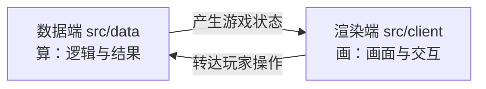

# 数据端与渲染端

样板把整个游戏拆成了**数据端**与**渲染端**两部分，两者各自独立、职责分明。理解这个分工，是读懂后面所有内容的前提。

## 各司其职：算与画

数据端负责「算」，渲染端负责「画」。

- **数据端**处理一切与游戏逻辑和结果有关的运算：勇士移动、怪物战斗、道具使用、地图事件、存档与录像……它决定游戏里「发生了什么」。
- **渲染端**只负责把当前的状态画到屏幕上，并把玩家的操作转达给数据端：它决定游戏「看起来是什么样」。

可以拿一盘棋来类比：

- 数据端像一本**账本**——记录棋子的位置、每一步的走法与胜负判定，真正「下棋」的是它；
- 渲染端像**棋盘**与**摄像机**——把账本上的棋局摆出来给观众看，并接收观众挪动棋子的手。

## 代码分处两地

两端的代码分别放在两个目录：

- 数据端代码在 `src/data`；
- 渲染端代码在 `src/client`。

一个功能通常只在其中一端实现。想要改变游戏的**规则与数值**，去 `src/data`；想要改变游戏的**画面与交互**，去 `src/client`。两端的目录构成详见 [src 导览](./src-tour.md)。

## 好处：录像验证只跑数据端

双端分离带来的最大好处，是**数据端可以脱离浏览器单独运行**。

数据端不依赖任何渲染（画面、动画、DOM）逻辑，因此可以在 `node` 环境中独立跑通一整局游戏。所谓**录像验证**，就是回放一局录好的操作，只在这条「数据端」路径上重算一遍，据此判定这局游戏的成绩是否与录制时一致。

这意味着：

- 验证一局成绩，不需要打开浏览器、不需要渲染画面，速度快且结果稳定；
- 只要录像里记录的操作一致，无论在哪台机器、哪种渲染环境下重放，得到的游戏结果都应完全一致。

数据端代码不依赖任何渲染端内容，两端因此保持各自独立。

## 小结

- 数据端 = 算，在 `src/data`；渲染端 = 画，在 `src/client`。
- 数据端可脱离浏览器单独运行，**录像验证只跑数据端**。
- 改变规则与数值看数据端，改变画面与交互看渲染端。

> 渲染端的结构性内容（渲染端内部如何组织、它与数据端的边界细节等）会在**高级教程**中系统讲解（预留标记：`高级教程 · 渲染端结构`）；待高级教程就位后，此处会替换为链接。

<!-- TODO(advanced): 渲染端结构 -->

想了解两端内部各有哪些内容、哪些需要改，见 [src 导览](./src-tour.md)；想在数据端的关键动作上挂接自己的处理，见 [钩子](./hooks.md)。
