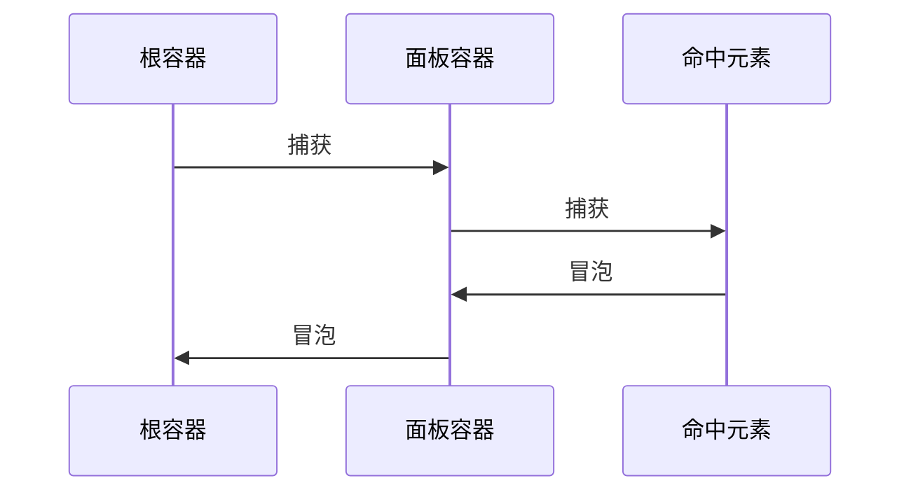

# 事件与交互

元素画出来之后，下一步是接住用户的操作：点击、按下、抬起、移动、悬停、滚轮。事件在容器与子元素之间有两个传递方向：**冒泡**是里面先生效，**捕获**是外面先生效。

一般更符合直觉的是冒泡。点一个按钮，应该先轮到按钮自己处理，而不是父容器先把事件接住；所以 `onClick`、`onDown` 这些默认事件都走冒泡。只有确实需要外层先处理时，才用 `onClickCapture`、`onDownCapture` 这类捕获写法。

## 前置知识

阅读本篇前，建议先读完：

- [容器与坐标](../basics/container-and-coordinates.md)
- [响应式](./reactivity.md)

## 内置事件及用法

TSX 里用 `onXxx` 绑定事件。常用事件如下：

| 冒泡阶段  | 捕获阶段         | 触发时机         |
| --------- | ---------------- | ---------------- |
| `onClick` | `onClickCapture` | 点击             |
| `onDown`  | `onDownCapture`  | 按下             |
| `onUp`    | `onUpCapture`    | 抬起             |
| `onMove`  | `onMoveCapture`  | 指针在元素上移动 |
| `onEnter` | —                | 指针进入元素     |
| `onLeave` | —                | 指针离开元素     |
| `onWheel` | `onWheelCapture` | 在元素上滚动滚轮 |

这些是元素属性，直接写在元素上即可。属性名写错不会报错，也不会触发。

事件回调建议先单独声明成函数，再把函数名传给属性，例如 `const handleClick = (ev) => { ... }`，然后 `onClick={handleClick}`。只有需要额外参数时才内联包一层，例如 `onClick={() => handleClick(param)}`；只用到事件对象时直接传函数，不必再写成 `onClick={ev => handleClick(ev)}`。需要标注类型时，可以从 `@motajs/render` 引入 `IActionEvent` / `IWheelEvent`。

`onClick` 不是单独的按下：按下与抬起都发生在同一个元素上，才会产生点击。按下后把指针移出元素、在元素外抬起，只会触发**另一个元素**的 `onUp`，当前元素不会触发 `onClick`。同一次抬起里，`onUp` 先处理完，然后才处理 `onClick`。

下面是一段完整的 UI 模板，按钮上同时挂了按下、抬起与点击：

```tsx
import { defineComponent, ref } from 'vue';
import { GameUI, SetupComponentOptions } from '@motajs/system';
import { DefaultProps } from '@motajs/render-vue';
import { IGameUIPropsBase } from '@user/client-base';
import { FULL_LOC } from '@/client';

// 这里填写自定义的 UI 参数
interface MyPanelProps extends IGameUIPropsBase, DefaultProps {}

const myPanelProps = {
    props: ['controller', 'instance', 'state']
} satisfies SetupComponentOptions<MyPanelProps>;

const MyPanel = defineComponent<MyPanelProps>(props => {
    // 收集本次交互的日志，只保留最近 6 条，避免文字越界
    const log = ref<string[]>([]);

    const push = (text: string) => {
        // 按触发顺序追加日志
        log.value = [...log.value, text].slice(-6);
    };

    const handleOuterCapture = () => push('外层捕获');
    const handleOuterBubble = () => push('外层冒泡');
    const handleDown = () => push('按下');
    const handleUp = () => push('抬起');
    const handleClick = () => push('点击');

    return () => (
        // 外层捕获先于子元素执行，冒泡时最后执行
        <container
            loc={FULL_LOC}
            onClickCapture={handleOuterCapture}
            onClick={handleOuterBubble}
        >
            {/* 蓝色矩形同时挂按下、抬起与点击 */}
            <g-rect
                loc={[40, 40, 160, 48]}
                fillStyle="#2f6fed"
                onDown={handleDown}
                onUp={handleUp}
                onClick={handleClick}
            />
            {/* 日志按触发顺序拼成一行 */}
            <text
                loc={[40, 110]}
                text={log.value.join(' → ')}
                fillStyle="#ffffff"
            />
        </container>
    );
}, myPanelProps);

export const MyPanelUI = new GameUI('my-panel', MyPanel);
```

在已有 UI 中使用 `props.controller.open(MyPanelUI, {})` 打开后，点击矩形，日志会先出现「按下」「抬起」，再出现点击的捕获与冒泡。

<ClientOnly>
  <RenderDemo :loader="eventsBasicLoader" :width="480" :height="320" />
  <template #fallback>
    渲染示例需要浏览器环境。
  </template>
</ClientOnly>

这个 live 把按下、抬起、点击、进入、离开、移动与滚轮放在一起。

## 事件对象

点击、按下、抬起、移动、滚轮的回调都会收到事件对象。下面按用途分开看。

### target

每个处理元素拿到的 `target` 都是它自己，不是最初命中的元素。捕获从外层向内层走时，外层回调里的 `target` 是外层容器，内层回调里的 `target` 是内层元素；冒泡阶段复用同一份事件，`target` 仍然是该元素自己。所以父级回调里的 `target` 不会指向被点中的子元素；要知道最里面命中的是谁，只能在最内层的回调里记下来。

```tsx
// setup
import type { IActionEvent } from '@motajs/render';

const outerTargetId = ref('');
const buttonTargetId = ref('');

const handleOuterCapture = (ev: IActionEvent) => {
    // 外层捕获先执行，这里的 target 是 panel 自己
    outerTargetId.value = ev.target.id;
};

const handleButtonClick = (ev: IActionEvent) => {
    // 矩形冒泡时，target 才是 button 自己
    buttonTargetId.value = ev.target.id;
};

// 组件内容
<container id="panel" onClickCapture={handleOuterCapture}>
    <g-rect
        id="button"
        loc={[40, 40, 160, 48]}
        fillStyle="#2f6fed"
        onClick={handleButtonClick}
    />
</container>;
```

### 按键：type 与 buttons

`type` 是本次触发对应的按键，取值来自 `MouseType`，比如 `Left`、`Middle`、`Right`、`Back`、`Forward`。`buttons` 是当前还按住的所有键，按位组合。抬起与点击时，`buttons` 不包含刚刚抬起的那个键，所以「点击是否由左键触发」要看 `type`，不能看 `buttons`。移动与滚轮里的 `type` 不可靠，不要用它判断按键。

```tsx
// setup
import type { IActionEvent } from '@motajs/render';
import { MouseType } from '@motajs/render';

const isLeftClick = (ev: { type: MouseType }) => {
    // type 表示这次触发对应的按键
    return ev.type === MouseType.Left;
};

const isHoldingLeft = (ev: { buttons: number }) => {
    // 位运算：buttons 的第 0 位为 1 表示左键仍被按住
    return (ev.buttons & MouseType.Left) !== 0;
};

const handleDown = (ev: IActionEvent) => {
    // 按下时 type 是按下键，buttons 同时包含这个键
    if (isLeftClick(ev) && isHoldingLeft(ev)) {
        // 这里可以开始拖拽
    }
};

const handleClick = (ev: IActionEvent) => {
    // 点击时 type 仍是左键，但 buttons 已经不含刚抬起的左键
    if (isLeftClick(ev)) {
        // 这里可以处理左键点击
    }
};

// 组件内容
<g-rect
    loc={[40, 40, 160, 48]}
    fillStyle="#2f6fed"
    onDown={handleDown}
    onClick={handleClick}
/>;
```

### 标识符与触摸

`touch` 表示这次操作来自触摸还是鼠标。`identifier` 是这次操作的编号：同一次按下、移动、抬起期间保持不变，用来在多指场景里把不同手指的操作串起来。鼠标也会带 `identifier`，但通常在多指触摸时才有意义。按下与抬起如果标识对不上，当前元素就不会产生点击。

```tsx
// setup
import type { IActionEvent } from '@motajs/render';

const lastTouch = ref(0);

const handleDown = (ev: IActionEvent) => {
    // 触摸时记下这次操作的 identifier
    if (ev.touch) lastTouch.value = ev.identifier;
};

const handleUp = (ev: IActionEvent) => {
    // 抬起时 identifier 与按下时相同；对不上就不会产生点击
    if (ev.touch && ev.identifier === lastTouch.value) {
        lastTouch.value = 0;
    }
};

// 组件内容
<g-rect
    loc={[40, 40, 160, 48]}
    fillStyle="#2f6fed"
    onDown={handleDown}
    onUp={handleUp}
/>;
```

### 修饰键

`altKey`、`shiftKey`、`ctrlKey`、`metaKey` 是触发时四个修饰键的状态。`metaKey` 对应 Windows 键或 Mac 的 Command 键。

```tsx
// setup
import type { IActionEvent } from '@motajs/render';

const shortcut = ref('普通点击');

const handleClick = (ev: IActionEvent) => {
    // 按下的修饰键不同，走不同的快捷操作
    if (ev.ctrlKey) shortcut.value = 'Ctrl + 点击';
    else if (ev.shiftKey) shortcut.value = 'Shift + 点击';
    else shortcut.value = '普通点击';
};

// 组件内容
<g-rect loc={[40, 40, 160, 48]} fillStyle="#2f6fed" onClick={handleClick} />;
```

### 坐标

`offsetX` / `offsetY` 是相对当前元素左上角的局部坐标；`absoluteX` / `absoluteY` 是相对整块画布左上角的坐标。事件进入子元素时，会用子元素的变换做逆运算：缩放不会改变局部坐标的范围，旋转会被反算，嵌套的每一层都会重新换算。因此在父级和子级拿到的是不同值，父级的 `offset` 与子级的 `offset` 不能混用。

```tsx
// setup
import type { IActionEvent } from '@motajs/render';

const localOffset = ref('—');
const canvasOffset = ref('—');

const handleMove = (ev: IActionEvent) => {
    // local 坐标以外层容器左上角为原点
    localOffset.value = `${Math.round(ev.offsetX)}, ${Math.round(ev.offsetY)}`;
    // absolute 坐标以整块画布左上角为原点
    canvasOffset.value = `${Math.round(ev.absoluteX)}, ${Math.round(
        ev.absoluteY
    )}`;
};

// 组件内容
<container loc={[40, 40, 200, 120]} onMove={handleMove}>
    <g-rect loc={[24, 24, 120, 64]} fillStyle="#2f6fed" />
</container>;
```

<ClientOnly>
  <RenderDemo :loader="eventsCoordinatesLoader" :width="480" :height="320" />
  <template #fallback>
    渲染示例需要浏览器环境。
  </template>
</ClientOnly>

在内外两层容器中移动或点击，三组坐标会同时更新：`offset` 随元素变化，`absolute` 始终是画布坐标。

### 滚轮

滚轮事件额外带 `wheelX` / `wheelY` / `wheelZ`，分别表示横向、纵向和垂直屏幕方向的滚动量；`wheelType` 表示这些数值的单位，取值来自 `WheelType`：`Pixel` 是像素，`Line` 是行（每行长度随浏览器设置变化，约 1rem），`Page` 是页（一般为一屏高度）。纵向滚动通常读 `wheelY`，但它的单位可能随浏览器设置变化。

```tsx
// setup
import type { IWheelEvent } from '@motajs/render';
import { WheelType } from '@motajs/render';

const handleWheel = (ev: IWheelEvent) => {
    // wheelY 是纵向滚动量，wheelType 决定这个数值的单位
    if (ev.wheelType === WheelType.Pixel) {
        // 这里可以按像素处理 wheelY
    }
};

// 组件内容
<g-rect loc={[40, 40, 240, 100]} fillStyle="#26364d" onWheel={handleWheel} />;
```

### stopPropagation

`stopPropagation()` 用来停止事件继续传播，见后面的 [stopPropagation：停止传播](#stop-propagation)。

## stopPropagation：传播控制 {#stop-propagation}

`stopPropagation()` 只做一件事：停止事件继续传播。

- 在捕获阶段调用：不再向内层元素捕获，同时这条链的冒泡也不会发生。
- 在冒泡阶段调用：不再向外层容器冒泡。
- 它不会阻止同一元素上、同一事件名的其它监听器执行。那些监听器在同一次事件分发里已经排好队，会全部执行完。
- 它不会阻止浏览器默认行为。canvas 上的鼠标、滚轮与触摸处理器本身会调用 `preventDefault`，页面滚动、文本选择等默认行为在指针落到画布上时已经被阻止；`stopPropagation` 只影响这套画布事件系统的传播。

把 `stopPropagation` 放在三层结构的不同位置，日志结果不同：

| 调用位置 | 日志结果                                           |
| -------- | -------------------------------------------------- |
| 按钮捕获 | 根捕获 → 面板捕获 → 按钮捕获                       |
| 按钮冒泡 | 根捕获 → 面板捕获 → 按钮捕获 → 按钮冒泡            |
| 面板捕获 | 根捕获 → 面板捕获                                  |
| 面板冒泡 | 根捕获 → 面板捕获 → 按钮捕获 → 按钮冒泡 → 面板冒泡 |
| 根捕获   | 根捕获                                             |
| 根冒泡   | 完整六步                                           |

最后一行值得注意：在根容器的冒泡回调里调用 `stopPropagation` 时，已经没有更外层的元素可传播，所以日志看起来仍然是完整的六步。它只是让「不再向外」这一步没有实际效果。

<ClientOnly>
  <RenderDemo :loader="eventsPropagateLoader" :width="480" :height="320" />
  <template #fallback>
    渲染示例需要浏览器环境。
  </template>
</ClientOnly>

live 只显示本次点击触发的事件；打开 stop 后，按钮的冒泡会被截断，外层不再收到，关闭 stop 时事件会完整走完捕获与冒泡。

## noevent、cursor 与 actionStroke

这三个属性都影响命中，决定了事件会不会落到元素上。

- `hidden` 的元素不绘制，也不参与命中，事件会直接落到它后面的元素。
- `noevent` 的元素照常绘制，但跳过命中。它不是只跳过自身，而是**整个子树都不参与命中**：容器加了 `noevent`，里面的子元素也收不到事件，事件会下穿到兄弟或下层元素；`cursor` 也同时失效。
- `cursor` 写在元素上，指针悬停时生效，取值与浏览器的鼠标样式一致，例如 `pointer`、`text`、`default`。多个元素同时命中时，最内层写了 `cursor` 的元素生效；元素被 `noevent` 跳过或 `hidden` 隐藏时，`cursor` 不再生效。
- `actionStroke` 只影响描边命中：元素只画描边时（默认描边的图形，或默认填充的图形只写了 `stroke`），命中判定只算描边，内部空白区域会下穿；有填充的内部仍按填充命中，不受它影响。它适合「只有边框看起来可点」的界面；命中宽度跟着 `lineWidth` 走，没有额外的最小热区。基础图形的命中细节见[基础图形](../basics/basic-shapes.md)。

容器即使没有可见背景，也会按自身矩形参与命中；不想挡住下面的元素就用 `noevent`，而不是把背景设成透明。

## 事件的完整触发模型

前面的现象都由同一套流程决定：先确定最上层命中的元素，再从根容器到目标捕获、从目标到根容器冒泡。

### 命中目标 {#命中测试事件先找最上层元素}

从根容器开始逐层检查子元素，找到指针下最上层、且没有被 `hidden` 或 `noevent` 跳过的元素。容器按自身矩形参与命中，图形按实际路径参与命中。

### 捕获与冒泡的方向

捕获从根容器向命中元素传递，父容器先收到；冒泡从命中元素向根容器传递，命中元素自己先收到。



同一次事件里，捕获一定先于冒泡；命中元素自己的捕获先执行，然后才是它自己的冒泡。同级的其它元素不会收到这次事件。

### enter 与 leave：悬停集合的差集

`onEnter` / `onLeave` 不按捕获 / 冒泡传递。根节点维护一份当前悬停集合：每次指针移动时重新收集指针下的元素，再与上一次的集合比较，对离开的元素触发 `leave`、对新进入的元素触发 `enter`，顺序是先 `leave` 后 `enter`。

集合里包含命中链上的所有祖先，所以从父容器移到子元素时，父容器仍在集合里，不会触发 `leave`；从子元素移到同级另一个子元素时，共同父容器也不会触发任何事件。

父容器要感知悬停，就在父容器上挂 `onEnter` / `onLeave`，不要指望子元素的事件冒泡上来。

<ClientOnly>
  <RenderDemo :loader="eventsHoverLoader" :width="480" :height="320" />
  <template #fallback>
    渲染示例需要浏览器环境。
  </template>
</ClientOnly>

外层与内层分别显示进入 / 离开状态。从外层移到内层时，外层不会触发 `leave`；滚轮累计与 `cursor` 也跟随命中结果变化。

<script setup>
import RenderDemo from '../../.vitepress/components/renderDemo.vue';

const eventsBasicLoader = () =>
    import('../../.vitepress/components/demos/ui/events-basic-demo.tsx');
const eventsCoordinatesLoader = () =>
    import('../../.vitepress/components/demos/ui/events-coordinates-demo.tsx');
const eventsPropagateLoader = () =>
    import('../../.vitepress/components/demos/ui/events-propagate-demo.tsx');
const eventsHoverLoader = () =>
    import('../../.vitepress/components/demos/ui/events-hover-demo.tsx');
</script>

## 边界与注意

- 事件属性名写错不会报错，也不会触发。
- 捕获方向是父 → 子，冒泡方向是子 → 父。同级的其它元素不会收到事件。
- `hidden` 的元素既不绘制也不参与命中；需要「还看得见但不能点」时用 `noevent`。
- `noevent` 作用于整个子树，不是只跳过自身。
- `stopPropagation` 只停止传播，不阻止同一元素上同一事件名的其它监听器；浏览器默认行为已由 canvas 的指针处理器调用 `preventDefault` 阻止。
- `enter` / `leave` 不按普通冒泡传递，由根的悬停集合做差集触发；父级要监听就自己挂 `onEnter` / `onLeave`。
- `offsetX` / `offsetY` 是当前元素的局部坐标，经过变换反算；`absoluteX` / `absoluteY` 才是画布坐标。
- `actionStroke` 只在只画描边时生效，有填充的内部仍按填充命中；命中宽度等于 `lineWidth`，没有额外的最小热区。
- `onClick` 只在按下与抬起都落在同一个元素上时产生；指针移出后在别处抬起，只会触发别处的 `onUp`。
