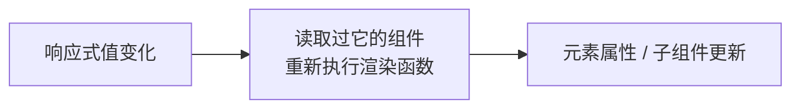

# 响应式

前面几篇的元素都是静态的：写死坐标、写死颜色。真实界面要跟着数据变，比如点一下按钮让计数加一、输入内容后让文字更新。如果每次都手写「改完数据再手动重画」，迟早会漏掉某处更新。

Vue 的响应式解决的就是这件事：数据被读取时记下依赖，数据变化时自动重新执行用到它的渲染函数，渲染器再把变化 patch 到画布上的元素。本篇从零讲清 UI 作者需要的那部分，不假设你写过 Vue。

## 前置知识

阅读本篇前，建议先读完：

- [UI 入门](../basics/ui-basics.md)
- [第一个静态界面](../basics/first-static-ui.md)

## 数据到渲染

响应式值变化后，读取过它的组件会重新执行渲染函数，对应元素的属性或子组件随之更新；没有读取它的组件不会因为这次变化而更新。



示例里的 `onClick` 是交互事件，后面[事件与交互](./events.md)会专门讲；这里只把它当作改变数据的方式。

```tsx
import { defineComponent, ref } from 'vue';
import { GameUI, SetupComponentOptions } from '@motajs/system';
import { DefaultProps } from '@motajs/render-vue';
import { IGameUIPropsBase } from '@user/client-base';
import { FULL_LOC } from '@/client';

// 这里填写自定义的 UI 参数
interface MyPanelProps extends IGameUIPropsBase, DefaultProps {}

const myPanelProps = {
    props: ['controller', 'instance', 'state']
} satisfies SetupComponentOptions<MyPanelProps>;

const MyPanel = defineComponent<MyPanelProps>(props => {
    const count = ref(0);

    return () => (
        <container loc={FULL_LOC}>
            {/* 点击只改数据，界面由响应式自动更新 */}
            <g-rect
                loc={[40, 40, 160, 48]}
                fillStyle="#2f6fed"
                onClick={() => count.value++}
            />
            {/* 渲染函数里读 count.value，Vue 才能记录这处依赖 */}
            <text
                loc={[40, 110]}
                text={`点击次数：${count.value}`}
                fillStyle="#ffffff"
            />
        </container>
    );
}, myPanelProps);

export const MyPanelUI = new GameUI('my-panel', MyPanel);
```

<ClientOnly>
  <RenderDemo :loader="counterLoader" :width="480" :height="320" />
  <template #fallback>
    渲染示例需要浏览器环境。
  </template>
</ClientOnly>

点击按钮只改 `count.value`，下方文字会跟着更新。

## ref：带 value 的盒子

`ref` 把普通值包成一个响应式对象。读和写都要经过 `.value`：

```tsx
// setup
const count = ref(0);

// 组件内容
<container loc={FULL_LOC}>
    <g-rect
        loc={[40, 40, 160, 48]}
        fillStyle="#2f6fed"
        onClick={() => count.value++}
    />
    <text
        loc={[40, 110]}
        text={`点击次数：${count.value}`}
        fillStyle="#ffffff"
    />
</container>;
```

在 TSX 的渲染函数里也要写 `count.value`。原因是 JSX 不是模板：模板里 Vue 会自动帮你解包 `ref`，TSX 里不会。`ref` 本质上是一个带 `value` 属性的盒子，Vue 通过「你读了哪个盒子的 `value`」来记录依赖。

只写 `count` 而不写 `.value`，读到的就是盒子本身，渲染出来的文字会变成 `[object Object]`，点击也不会触发更新。这是最常见的错误。

`ref` 也可以包对象。包对象时，`.value` 指向的还是响应式代理，改内部字段同样会触发更新：

```tsx
// setup
const panel = ref({ open: true, title: '背包' });

// 组件内容
<container loc={FULL_LOC}>
    <text
        loc={[40, 40]}
        text={panel.value.title}
        fillStyle="#ffffff"
        onClick={() => {
            // 改的是响应式代理上的字段，依赖仍然有效
            panel.value.open = !panel.value.open;
            panel.value.title = panel.value.open ? '背包' : '道具';
        }}
    />
</container>;
```

## reactive：一整块对象

`reactive` 适合把一组相关的字段放在一起：

```tsx
// setup
const panel = reactive({
    open: true,
    title: '背包'
});

// 组件内容
<text text={panel.title} fillStyle="#ffffff" />;
```

`reactive` 返回的是代理对象，读写字段时不需要 `.value`。但它有两条限制：

1. 不能整体替换。`panel = reactive({ ... })` 会让变量指向新对象，旧依赖还挂在旧对象上；应改为逐字段赋值，或改用 `ref` 保存整个对象。
2. 解构会丢响应式。`const { open } = panel` 取到的是当时的普通值，后续 `panel.open` 变化不会同步过去；应直接写 `panel.open`，或改用 `toRefs`。

```tsx
// 逐字段修改，原有依赖仍然挂在同一个代理对象上
// 正确：逐字段修改
panel.open = false;
panel.title = '道具';

// 错误：整体替换，原依赖失联
// panel = reactive({ open: false, title: '道具' });
```

`reactive` 创建在哪里也很重要。创建在组件 `setup` 内，每个组件实例各有一份；创建在模块顶层，所有实例共用同一份。界面状态通常应放在 `setup` 内，只有确实要全局共享的数据才放到模块顶层。

<ClientOnly>
  <RenderDemo :loader="reactiveLoader" :width="480" :height="320" />
  <template #fallback>
    渲染示例需要浏览器环境。
  </template>
</ClientOnly>

点击切换后，`open` 与 `title` 两个字段会同时更新。

## computed：派生值

`computed` 从别的响应式数据算出一个新值：

```tsx
// setup
const count = ref(0);
const doubled = computed(() => count.value * 2);
```

它有两个特点：

- 惰性求值：第一次被读取时才计算。
- 会缓存：依赖没变时重复读取直接返回上次结果，不会重复计算。

在 TSX 里读 `computed` 同样要写 `.value`：

```tsx
// 组件内容
<text text={`两倍：${doubled.value}`} fillStyle="#f2b84b" />
```

不要往 `computed` 里写副作用。它只负责算值；需要「变化时做一件事」时用 `watch`。也不要在 `computed` 里改别的响应式数据，那会让「读一个值」变成「改一个值」，依赖关系难以推理。

<ClientOnly>
  <RenderDemo :loader="computedLoader" :width="480" :height="320" />
  <template #fallback>
    渲染示例需要浏览器环境。
  </template>
</ClientOnly>

按钮只改 `count`，`doubled` 由它算出，不需要另外维护。

## 重渲染的触发条件

判断依据只有一条：**这个变化是否碰到渲染函数读过的响应式值**。

会触发重渲染的情况：

- 渲染函数里读了 `count.value`，事件回调里改 `count.value`。
- 渲染函数里读了 `panel.title`，别处改了 `panel.title`。
- 渲染函数里读了 `list.value`，对 `list.value` 做 `push` / `splice` / 整体替换。
- 渲染函数里读了 `doubled.value`，而 `doubled` 依赖的 `count` 变了。

不会触发重渲染的情况：

- 改的是普通对象或普通数组，它们没有被 `ref` / `reactive` 包过。
- 改了响应式对象的副本，比如先 `const copy = list.value` 再替换 `copy` 变量本身。
- 只在事件回调里读、渲染函数里没读过的值变化了。
- 用了 `shallowRef`，只改内部字段而没有替换 `.value`。

Vue 会把这些更新合并到微任务里排队执行。同一个事件回调里连续改三次，通常只重渲染一次；`await` 之后、或下一次用户操作时，才会进入下一轮。需要等画面更新后再做后续动作时，用 `nextTick`：

```tsx
// setup
const count = ref(0);
const message = ref('');

const addThree = async () => {
    count.value++;
    count.value++;
    count.value++;
    // 三次修改在同一轮里合并，nextTick 后渲染已经完成
    await nextTick();
    message.value = `现在是 ${count.value}`;
};

// 组件内容
<container loc={FULL_LOC}>
    <g-rect loc={[40, 40, 160, 48]} fillStyle="#2f6fed" onClick={addThree} />
    <text loc={[40, 110]} text={message.value} fillStyle="#ffffff" />
</container>;
```

`nextTick` 只保证「这一轮更新已经处理完」，不保证画布已经绘制到屏幕上。需要等浏览器真正绘制时，再配合一帧的回调。

## watch：副作用

`watch` 监听一个响应式数据，在它变化后执行回调：

```tsx
// setup
const count = ref(0);
const log = ref('还没有变化');

watch(count, (next, prev) => {
    log.value = `count：${prev} → ${next}`;
});

// 组件内容
<text text={log.value} fillStyle="#ffffff" />;
```

回调拿到新值与旧值。适合用来打印日志、同步到外部、触发一次性的动作。

在组件 `setup` 里创建的 `watch` 会绑定到当前组件，组件卸载时自动停止，不需要手动保存停止函数。只有在组件外创建的 `watch` 才需要自己调用返回的停止函数。

选择原则很简单：只是「根据现有数据算出要显示的内容」，用 `computed`；需要在变化后「做一件事」，用 `watch`。能用 `computed` 表达时不要用 `watch` 再手动赋值，那样多了一份需要维护的状态。

<ClientOnly>
  <RenderDemo :loader="watchLoader" :width="480" :height="320" />
  <template #fallback>
    渲染示例需要浏览器环境。
  </template>
</ClientOnly>

按钮改变 `count` 后，`watch` 把新旧值写进 `log`。

## shallowRef 与 markRaw 的适用场景

这两个是优化手段，判断依据只有两条：

- 大对象、只需要整体替换、不需要深层字段响应式时，用 `shallowRef`。它只追踪 `.value` 的替换，不追踪内部字段。
- 外部实例（例如第三方库创建的对象、画布对象、纹理对象）不需要被 Vue 代理时，用 `markRaw` 标记，避免深层代理带来的开销与意外行为。

纹理与外部对象尤其值得注意：把纹理放进普通 `ref` 会被深层代理，读它时多一层代理开销；用 `markRaw(texture)` 后再放进状态，Vue 就不会继续代理它。只想整体替换纹理时，`shallowRef` 更合适。

不确定是否需要时，先用 `ref` 与 `reactive`。等确认大对象带来性能问题，再换成 `shallowRef` 或 `markRaw`。

## props 与解构

组件收到的 `props` 本身是响应式的。把字段解构出来会得到普通值，父组件更新后子组件不会跟着变；直接读 `props.title`，或在 render 函数里现取局部变量。props 的基本写法见[自定义组件](./custom-components.md#props)。

<script setup>
import RenderDemo from '../../.vitepress/components/renderDemo.vue';

const counterLoader = () =>
    import('../../.vitepress/components/demos/ui/reactivity-counter-demo.tsx');
const reactiveLoader = () =>
    import('../../.vitepress/components/demos/ui/reactivity-reactive-demo.tsx');
const computedLoader = () =>
    import('../../.vitepress/components/demos/ui/reactivity-computed-demo.tsx');
const watchLoader = () =>
    import('../../.vitepress/components/demos/ui/reactivity-watch-demo.tsx');
</script>

## 边界与注意

- `reactive` 不能整体替换。要换整块数据时，用 `ref` 保存对象，或逐字段赋值。
- 解构 `reactive` 对象或 `props` 会丢响应式。直接读字段，必要时用 `toRefs`。
- `ref` 忘记写 `.value` 是最常见的错误：读不到值，也触发不了更新。
- 不要在渲染函数里做副作用。渲染函数只负责根据当前状态算出画面；副作用放进事件回调或 `watch`。
