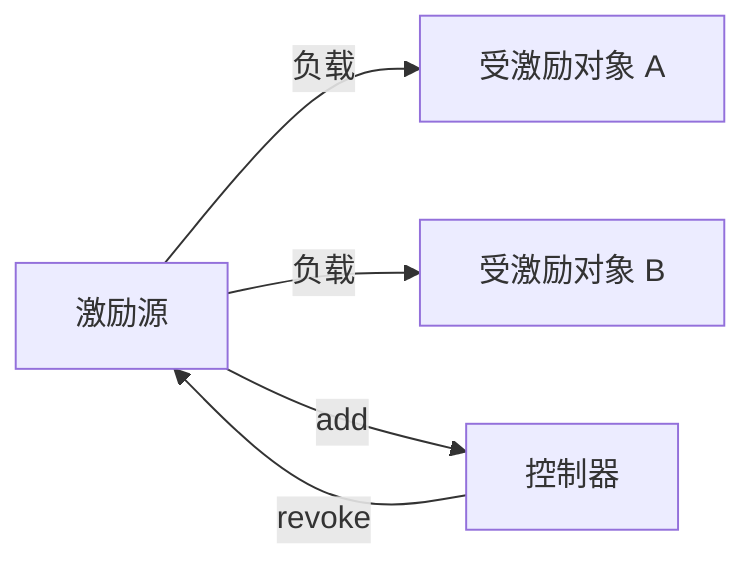

# 动画激励

动画不会自己动：需要有人按节奏推一下。动画激励把这件事拆成两半——激励源决定什么时候推，受激励对象决定被推时做什么。动画执行器与渐变执行器都是受激励对象，所以能挂在同一个激励源上。

本篇按「受激励对象是什么、激励源是什么、四种内置激励源怎么用、组件里怎么接」的顺序讲。变速器与分频器本身也是激励源，会放在内置激励源里一起说明。

## 前置知识

阅读本篇前，建议先读完：

- [动画](../advanced/animation.md)
- [响应式](../advanced/reactivity.md)

## 激励模型

系统里有三个角色：

| 角色                      | 是什么                 | 负责                                   |
| ------------------------- | ---------------------- | -------------------------------------- |
| `IExcitable<T>`           | 受激励对象             | 接收一次负载，执行自己的处理           |
| `IExcitation<T>`          | 激励源                 | 决定什么时候推进，并管理所有受激励对象 |
| `IExcitableController<T>` | 单个受激励对象的控制器 | 解除这次登记，或手动推进这一个对象     |

「激励」就是按节奏推进一次：激励源把当前的负载交给每个登记过的对象。负载的类型由具体激励源决定；动画系统里的激励源都传数字时间，所以执行器接收的是 `number`。

激励源不关心对象是动画、渐变还是普通回调；动画执行器与渐变执行器都是 `IExcitable<number>`，所以能挂在同一个激励源上。



当一个激励源把另一个激励源当作时间来源时，本篇把前者叫 **输入源**，把登记在它上面、接收它推进的对象叫 **接收方**。例如变速器从输入源读取时间，再把换算后的时间交给接收方。

## 受激励对象

`IExcitable<T>` 不需要继承任何类，也没有别的成员；它只要求一个具体方法 `excited(payload: T): void`。激励源每次推进时调用这个方法，`payload` 就是这次传来的负载。

```ts
import { IExcitable } from '@motajs/animate';

// 受激励对象：每次被推进时记下负载
class TimeRecorder implements IExcitable<number> {
    last = 0;

    excited(payload: number): void {
        this.last = payload;
    }
}
```

要让激励源每次推进都通知它，需要把它登记进去。`add` 返回一个控制器；控制器只管理这一个对象，不影响同一个源上的其他接收方：

```ts
import { RafExcitation } from '@motajs/animate';

const source = new RafExcitation();
const recorder = new TimeRecorder();

// 登记后，源每推进一次，recorder 就收到一次时间
const controller = source.add(recorder);

// 只推进 recorder 一个对象，不广播给其他接收方
controller?.excite(source.payload());

// 解除登记；之后源不会再推进这个对象
controller?.revoke();
```

`IExcitableController<T>` 就是 `add` 返回的控制器，包含三个成员：

- `excitable`：被登记的那个对象。
- `revoke()`：把对象从当前激励源移除。
- `excite(payload)`：只推进这一个对象，不广播给其他对象。

### 包装函数 excited

如果手上只有一段函数，不想为它单独写一个类，`excited(func, thisArg?)` 可以把它包成 `IExcitable<T>`：

```ts
import { excited } from '@motajs/animate';

// 把函数包成受激励对象；每次激励时函数收到负载
const recorder = excited<number>(payload => {
    console.log(payload);
});
```

它返回的对象只有一个 `excited` 方法：每次激励源推进时调用 `func(payload)`，不会替调用方保存状态。包装后的对象可以直接交给 `add`、`onExcited` 等接收 `IExcitable<T>` 的地方。

包装只提供 `excited`，不提供 `revoke` 或 `excite`；要解除登记或单独推进，仍然使用 `add` 返回的控制器。需要保存状态、读取上一次负载或提供多个方法时，写一个实现 `IExcitable<T>` 的类更清楚。

`thisArg` 可选，用来固定 `func` 执行时的 `this`；省略时函数按原来的方式调用。

## 激励源接口

自带激励源之外，有时需要替换节奏或自己实现一个。无论哪种，都要满足同一套契约；内置激励源已经实现好，只有自己写源时才需要逐项实现。

| 成员              | 作用                                                  |
| ----------------- | ----------------------------------------------------- |
| `payload()`       | 读取当前负载                                          |
| `excite(payload)` | 把负载广播给当前所有受激励对象                        |
| `add(object)`     | 登记一个受激励对象，返回控制器；无法登记时返回 `null` |
| `remove(object)`  | 移除一个受激励对象，返回是否移除成功                  |
| `destroy()`       | 终止激励源，停止继续推进                              |

`payload()` 回答「现在的时间或值是多少」，`excite()` 回答「把这一刻发给谁」。帧激励源每帧更新当前时间后调用一次 `excite()`；固定间隔激励源按定时器调用；变速器与分频器则在收到输入源的推进后，按自己的规则再推进接收方。

## 内置激励源

内置激励源分两类：帧激励源与固定间隔激励源负责产生时间，变速器与分频器负责加工另一个激励源的时间或次数。下面每个都先说为什么需要，再给一段最小用法，最后说明接收方会收到什么。

### 帧激励源

界面动画通常希望跟着屏幕刷新走；帧激励源就是这条默认节奏，根渲染器默认也用它。

`RafExcitation` 用 `requestAnimationFrame` 驱动，每一帧把当前时间戳作为负载广播出去。它最直接的用法是接到动画执行器上：

```ts
import { Animater, RafExcitation } from '@motajs/animate';

const source = new RafExcitation();
const animater = new Animater();

// 把执行器登记到帧激励源；之后执行器每帧被推进一次
source.add(animater);
```

接收方拿到的负载是 `requestAnimationFrame` 的时间戳，单位毫秒，例如 `1234.5`。它不是从 `0` 开始的动画时间，而是浏览器给这一帧的时间；相邻两帧的差值反映这一帧间隔了多久。

- `payload()` 返回最近一帧的时间戳。
- 构造时立即开始请求下一帧，所以第一次推进发生在下一帧，不是构造的瞬间。
- `destroy()` 取消尚未执行的帧请求。

渲染器的根元素默认使用一个 `RafExcitation`，所以组件里拿到的动画执行器通常不需要自己创建激励源。

下面的 live 显示当前载荷、相邻两帧的时间差与已过的帧数。

<ClientOnly>
  <RenderDemo :loader="rafPayloadLoader" :width="480" :height="320" />
  <template #fallback>
    渲染示例需要浏览器环境。
  </template>
</ClientOnly>

### 固定间隔激励源

有些逻辑只需要稳定节奏，不必跟屏幕刷新同步；固定间隔激励源按定时器推进，节奏由构造时传入的间隔决定。

`IntervalExcitation` 实现 `IIntervalExcitation`，用固定毫秒间隔触发。登记一个接收方后，它会按间隔反复推进：

```ts
import { IntervalExcitation } from '@motajs/animate';

const source = new IntervalExcitation(100);
// 复用前面的 TimeRecorder
const recorder = new TimeRecorder();

// 约每 100ms 推进一次；接收方依次收到 0、100、200……
source.add(recorder);
```

它用内部计数当负载：触发时先把当前计数发出去，再把计数加一个 `interval`。所以接收方依次拿到 `0`、`interval`、`2 × interval`……；`payload()` 返回计数器的当前值，第一次触发后它已经变成 `interval`。

这个计数不跟随真实时间（墙钟时间），也不保证每一次都恰好落在整百毫秒上。需要和真实时间对齐时，使用帧激励源。

### 变速器

需要整体放慢、加速，或让速度平滑变化时，不必改每个动画的时长；把变速器接在一个激励源后面，就能统一改变时间流速。

`ExcitationVariator` 实现 `IExcitationVariator`，本身就是一种 `IExcitation<number>`。它先订阅一个输入源，再把输入时间按当前速度换算成自己的时间，最后用自己的时间推进接收方。

```ts
import { Animater, ExcitationVariator, RafExcitation } from '@motajs/animate';

const input = new RafExcitation();
const variator = new ExcitationVariator();
const animater = new Animater();

// 以帧激励源为输入源；绑定后速度重置为 1
variator.bindExcitation(input);

// 执行器登记在变速器上，收到的是变速器换算后的时间
variator.add(animater);

// 输入时间每前进 10ms，执行器只前进 5ms
variator.setSpeed(0.5);
```

接收方拿到的是变速器时间轴上的时间，不是输入源的原始时间。绑定时它从输入源当前时间起步；之后每次输入推进，它把「输入前进了多少」乘以当前速度，累加到自己的时间上，再发给接收方。`payload()` 返回这个时间。

速度改变的是时间流速，不是动画配置里的时长。一个动画在变速器时间轴上配置为 `400`，速度设为 `0.5` 后，它仍然需要变速器时间轴前进 `400`；只是这段变速器时间现在要用两倍的真实时间才能走完。改变速度不会重算已经过去的时间，只影响之后的推进。

`setSpeed` 必须放在 `bindExcitation` 之后：未绑定时它不会生效。绑定时速度会重置为 `1`，所以先绑定、再设置速度。

下面的 live 显示输出端连续两次时间的差值。切换速度后，相邻两次推进的时间差会随之改变。

<ClientOnly>
  <RenderDemo :loader="variatorLoader" :width="480" :height="320" />
  <template #fallback>
    渲染示例需要浏览器环境。
  </template>
</ClientOnly>

### 变速曲线

直接改速度会让时间流速瞬间跳变；需要慢慢加速或减速时，用 `curveSpeed` 在一段时间内按曲线改变速度。

`curveSpeed(curve, time, mode?)` 让速度在 `time` 毫秒内按曲线变化，返回一个 Promise，在曲线结束时兑现。已经有一条曲线在运行时，新曲线会排在它后面。

```ts
import { linear } from '@motajs/animate';

// 在输入源时间 300ms 内，速度从 1 线性降到 0.5
await variator.curveSpeed(x => 1 - 0.5 * x, 300);
```

曲线的输入是这段时间的完成度，输出就是当前速度。第三个参数 `VariatorCurveMode` 决定曲线进度按哪条时间轴计算：

| 模式                              | 曲线进度按谁走                                 |
| --------------------------------- | ---------------------------------------------- |
| `VariatorCurveMode.SourceRelated` | 按输入源的时间走，速度变慢不会拖慢曲线本身     |
| `VariatorCurveMode.SelfRelated`   | 按变速器自己的时间走，速度变慢时曲线也一起变慢 |

默认是 `SourceRelated`。

下面的 live 用一条从 `1.5` 降到 `0.25` 的变速曲线演示这一点。它显示当前速度、输出端最后两次推进的时间，以及两者的时间差。速度越高，输出端时间推进越快，相邻两次推进的时间差也越大。

<ClientOnly>
  <RenderDemo :loader="curveSpeedLoader" :width="480" :height="320" />
  <template #fallback>
    渲染示例需要浏览器环境。
  </template>
</ClientOnly>

### 分频器

不是每一次激励都需要处理，例如只需要低频刷新的逻辑；分频器把输入源的多次激励压成一次，减少接收方的更新次数。

`ExcitationDivider<T>` 实现 `IExcitationDivider<T>`，也是 `IExcitation<T>`。它接收输入源的每一次推进，但只把其中一部分继续发给接收方。

```ts
import { ExcitationDivider, IntervalExcitation } from '@motajs/animate';

const input = new IntervalExcitation(100);
const divider = new ExcitationDivider<number>();
// 复用前面的 TimeRecorder
const recorder = new TimeRecorder();

// 绑定后分频比为 1，输入推进一次就转发一次
divider.bindExcitation(input);
divider.add(recorder);

// 之后输入每推进 3 次，接收方收到 1 次
divider.setDivider(3);
```

接收方收到的负载仍是输入源传来的那一份，只是有些推进被丢掉了。`payload()` 返回最近一次转发出去的负载；从未绑定输入源时读取它会报错。

分频器改变的是激励次数，不是时间速度。它不能用来让动画整体变慢——那应该使用变速器。`setDivider` 可以在绑定后调用；未绑定时调用不会生效，也不会报错。

`divider` 是当前分频比例，默认 `1`。设置后，下一次输入推进会立即转发一次，之后每隔 `divider` 次输入推进再转发一次。

下面的 live 用固定间隔激励源驱动分频器：左侧是输入源的原始载荷与次数，右侧是接收方实际收到的载荷与次数。改变分频比后，接收方次数按比例减少，但收到的载荷仍是输入源传来的那一份。

<ClientOnly>
  <RenderDemo :loader="dividerLoader" :width="480" :height="320" />
  <template #fallback>
    渲染示例需要浏览器环境。
  </template>
</ClientOnly>

## 组件内的激励接入

渲染端把整块 UI 挂在一棵渲染树上，树的最顶层叫根渲染器；它自带一个激励源。渲染端还提供了两个组件内辅助函数，用来把每帧逻辑挂到根渲染器的激励源上。

### 登记受激励对象 onExcited

已经有一个 `IExcitable<number>`，又希望它跟着根渲染器的激励源每帧推进时，用 `onExcited`。手动 `add` 到根激励源也能做到，但组件卸载时容易漏掉移除，留下泄漏；这个函数把登记与清理放在一起。

`onExcited(excitable: IExcitable<number>): void` 接收一个受激励对象，不接收函数。它只能在组件的 `setup` 或生命周期钩子中调用；在组件外调用不会生效。

```ts
import { onExcited } from '@motajs/render-vue';

// 复用前面的 TimeRecorder
const recorder = new TimeRecorder();

// 只在组件 setup 或生命周期钩子中调用
onExcited(recorder);
```

调用后，根渲染器每帧推进时 `recorder.excited(time)` 会收到当前帧的时间戳。它返回 `void`，没有可操作的控制器；组件卸载时会自动移除登记，根渲染器变化时也会在新根上重新登记。不要在组件外使用它，也不要在卸载后继续依赖这个登记。

### 包装函数 onExcitedFunc

每帧逻辑如果只是一段函数，不想先写一个 `IExcitable` 类，用 `onExcitedFunc`。它把函数包成受激励对象再登记，省掉手工包装。

`onExcitedFunc(func: (time: number) => void): void` 接收一个每帧调用的函数，参数是根渲染器当前帧的时间戳。它同样只能在组件的 `setup` 或生命周期钩子中调用；在组件外调用不会生效。

```ts
import { onExcitedFunc } from '@motajs/render-vue';

let elapsed = 0;

// 只在组件 setup 或生命周期钩子中调用
onExcitedFunc(time => {
    // time 是根渲染器当前帧的时间戳
    elapsed = time;
});
```

它内部用 `excited(func)` 包装后交给 `onExcited`，所以清理行为与 `onExcited` 相同：组件卸载时自动移除登记，根渲染器变化时重新登记。包装后的对象不保存状态；需要读取上一次负载或提供多个方法时，仍然写一个实现 `IExcitable<number>` 的对象，再用 `onExcited` 登记。

## 与两个执行器的关系

`Animater` 与 `Transition` 都实现 `IExcitable<number>`，因此：

- 它们可以绑定任意数字激励源，包括 `RafExcitation`、`IntervalExcitation`、`ExcitationVariator` 与 `ExcitationDivider`。
- 变速器与分频器也是激励源，可以接在执行器前面，分别改变时间流速与激励次数。

高层封装如 `transitioned`、`transitionedColor` 与 `cycledTransition` 也共享同一套根激励源，因此不需要再单独创建时钟。

## 边界与注意

- 变速器与分频器都要先绑定输入源才能工作；变速器未绑定时 `setSpeed` 不生效，分频器从未绑定输入源时读取 `payload()` 会报错。
- 变速器绑定输入源时会把速度重置为 `1`，并把自己的时间对齐到输入源的当前时间；需要别的速度就在绑定之后设置。
- `onExcited` 与 `onExcitedFunc` 只适用于组件内部；组件外要自己创建 `IExcitable` 并手动登记、移除。
- 变速器改变的是时间流速，分频器改变的是激励次数；用分频器让动画变慢会跳过中间帧，不会拉长动画时间。

<script setup>
import RenderDemo from '../../.vitepress/components/renderDemo.vue';

const rafPayloadLoader = () =>
    import('../../.vitepress/components/demos/ui/excitation-raf-payload.tsx');
const variatorLoader = () =>
    import('../../.vitepress/components/demos/ui/excitation-variator.tsx');
const dividerLoader = () =>
    import('../../.vitepress/components/demos/ui/excitation-divider.tsx');
const curveSpeedLoader = () =>
    import('../../.vitepress/components/demos/ui/excitation-curve-speed.tsx');
</script>
