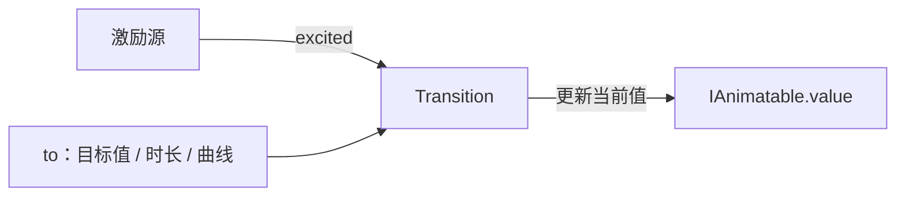

# 渐变执行器

渐变执行器 `Transition` 实现 `ITransition`，负责让一个数值平滑地靠近目标值。它只处理一个数值、一段时长和一条曲线；需要给多个值排先后、控制并行关系时，使用[动画执行器](./animation-runner.md)。

## 模型

一次渐变只有四样东西：

| 组成       | 是什么                                                    |
| ---------- | --------------------------------------------------------- |
| 当前值     | 可写对象上的 `value`，渐变过程中由执行器更新              |
| 目标值     | 这次要靠近的数，由 `to` 的第一个参数给出                  |
| 时长与曲线 | 用多久走完，以及过程中快慢怎么变化                        |
| 激励源     | 按固定节奏推动执行器的来源，由 `useTransition` 或手动接入 |

`IAnimatable` 是动画对象的形状：一个带可写 `value` 的对象，Vue 的 `ref<number>` 也满足这个形状。当前值由执行器改写，调用方只读它。

曲线决定的是「已经走了多远」。它接收时间进度 `progress`（`0` 到 `1`），返回一个数；这个数表示此时刻动画的完成度：为 `0` 时动画处于起点，为 `1` 时刚好执行到目标值，中间按曲线返回的比例推进。

曲线返回值超出 `0` 到 `1` 时，当前值会越过目标值，或回到起始值之外。

调用 `to` 后，执行器记下目标值、时长与曲线。之后每次激励，它就让当前值向目标值靠近一点；到达结尾时，按结尾参考决定最终写什么值。没有激励源，`to` 不会开始。



`ITransition` 本身是一个受激励对象（`IExcitable<number>`）：它接收激励源按节奏传来的数字时间戳，再推进自己的渐变。通过 `bindExcitation` 接入激励源、通过 `unbindExcitation` 解除。组件里通常交给 `useTransition`；不在组件内，或需要接到自定义激励源时，才手动绑定。

下面的 live 用真实的 `Transition` 驱动数值。当前值与目标值同时显示，按钮会重新设定目标，执行器从当前值继续渐变。

<ClientOnly>
  <RenderDemo :loader="transitionLoader" :width="480" :height="320" />
  <template #fallback>
    渲染示例需要浏览器环境。
  </template>
</ClientOnly>

## 执行器

自己 `new` 执行器还要手动找激励源并处理解绑，组件卸载时很容易漏掉清理；`useTransition` 把这些事收在一处。它必须在组件的 `setup` 或生命周期钩子里调用：它会把执行器绑定到根渲染器的激励源，并在组件卸载时解除绑定。

```tsx
// setup
import { defineComponent, ref } from 'vue';
import { useTransition } from '@motajs/render-vue';

const MyPanel = defineComponent(() => {
    const opacity = ref(0);
    // 只能在组件 setup 或生命周期钩子里调用
    const transition = useTransition()!;
    // 之后的 transition.transition(...).to(...) 都通过它执行

    return () => <container loc={[0, 0, 100, 100]} alpha={opacity.value} />;
});
```

`useTransition(tran?, excitation?)` 返回 `ITransition | null`。两个参数都可选：`tran` 是已有的执行器，`excitation` 是显式指定的激励源。省略时，函数会新建一个 `Transition`，并绑定根渲染器的激励源。

不传 `tran` 时，执行器由 `useTransition` 创建，组件卸载时会解除绑定并销毁它；传入 `tran` 时，函数只负责绑定与解绑，执行器仍由调用方持有。根渲染器变化时，两种情况都会重新绑定到新的激励源。

不在组件内，或需要接到自定义激励源时，才自己创建执行器并手动绑定。`RafExcitation` 是一个每帧给出时间戳的激励源，`Transition` 是渐变执行器本身：

```ts
import { RafExcitation, Transition } from '@motajs/animate';

const excitation = new RafExcitation();
const transition = new Transition();

// 绑定后执行器才会收到每一帧的时间戳
transition.bindExcitation(excitation);

// 不再使用时解绑
transition.unbindExcitation();
```

手动创建时，解绑与销毁由调用方负责；`useTransition` 只是替组件内场景处理了这些收尾。

## 对象选择

`to` 只会改「当前选中的对象」，所以开始渐变的下一步是告诉执行器改谁；不先选对象，后面的目标值没有落点。

`transition(animatable)` 选择后续 `to` 作用的数值对象，返回执行器本身，可以继续链式调用。

```ts
const opacity = ref(0);
const transition = useTransition()!;

transition.transition(opacity).to(1, 300);
```

同一个执行器可以依次选择不同对象，各自调用 `to`；每个对象的渐变独立进行，`wait` 也按对象区分。`transition` 只改变「之后调用 `to` 时作用在谁身上」，不会停止之前已经在进行的渐变。

```ts
import { ref } from 'vue';
import { linear, sin } from '@motajs/animate';
import { useTransition } from '@motajs/render-vue';

const leftBar = ref(0);
const rightBar = ref(1);
const transition = useTransition()!;

function playBars() {
    // 选中 leftBar，后面的 to 只作用于它
    transition.transition(leftBar).curve(linear()).to(1, 600);
    // 再选中 rightBar，两条渐变同时推进
    transition.transition(rightBar).curve(sin()).to(0, 600);
}
```

`playBars` 调用后，`leftBar` 与 `rightBar` 各自有一段正在进行的渐变；执行器每次被激励都会把两条都推进一次。它们只共享激励源，不共享目标、时长或曲线。

## 曲线设置

同样一段时间，是匀速走完还是先慢后快，由曲线决定；想要淡入淡出、回弹或强调结尾时，需要在这里换掉默认的线性曲线。

`curve(curve)` 设置后续 `to` 使用的速率曲线，直到下一次设置；不设置时使用线性曲线。曲线决定过程中的快慢，`time` 决定总耗时。

```ts
import { sin } from '@motajs/animate';

transition.transition(opacity).curve(sin()).to(1, 300);
```

一次渐变会使用调用 `to` 时已经设好的曲线；之后再改 `curve`，不会影响已经开始的那一次。需要让不同目标使用不同节奏时，在每次 `to` 前重新设置。各条曲线的形状见[动画曲线](./animation-curves.md)。

## 开始渐变

前面的选择与曲线只是准备，真正让数值开始变化的是 `to`；没有它，执行器不会产生任何一段渐变。

`to(value, time, end?)` 让当前选中的对象从自己的当前值出发，在 `time` 毫秒内走向 `value`。它需要两个前提：已经用 `transition` 选择了对象，并且已经绑定激励源；缺少任意一项时，调用不会开始渐变。使用顺序是：先用 `transition(对象)` 选中要改的数值，再用 `curve(...)` 选好曲线，最后调用 `to(...)` 启动渐变。

同一个对象在渐变途中再次调用 `to`，会从当前值重新出发，把目标改为新的值。之前那次渐变的等待仍会在新目标完成时兑现。

```ts
const opacity = ref(0);

function fadeIn() {
    transition.transition(opacity).to(1, 600);
}

function dim() {
    // 如果 fadeIn 还没结束，会从当前值出发，把目标改成 0.4
    transition.transition(opacity).to(0.4, 300);
}
```

## 结尾参考

曲线走到终点时未必等于目标值，最后该写哪一个需要明确；`EndRelation` 就是在回答这个问题，默认会直接写目标值。

`to` 的第三个参数是 `EndRelation`，决定渐变结束时把值写成什么：

| 结尾参考             | 结束时的值                                          |
| -------------------- | --------------------------------------------------- |
| `EndRelation.Target` | 直接写成传入的目标值，默认使用这一种                |
| `EndRelation.Curve`  | 结束时使用曲线终点值参考，不强制把值写成目标值      |
| `EndRelation.Self`   | 正常结束时与 `Curve` 相同；提前结束时停在打断时的值 |

使用 `Curve` 时，结束值由曲线终点决定，不强制等于目标值：曲线终点回到起点附近，值也会停在起点附近；曲线终点越过目标值，值也会停在越过后的位置。

```ts
import { ref } from 'vue';
import { EndRelation } from '@motajs/animate';

// 曲线在终点只走了一半，所以 Curve 模式会停在半程
const half = (p: number) => p * 0.5;
const value = ref(0);

transition.transition(value).curve(half).to(1, 500, EndRelation.Curve);
```

下面的 live 并排比较 `Target` 与 `Curve`。曲线可以在「半程曲线」与「回程曲线」之间切换；后者到终点会回到起点，所以 `Curve` 那条也会回到起点。

<ClientOnly>
  <RenderDemo :loader="endRelationLoader" :width="480" :height="320" />
  <template #fallback>
    渲染示例需要浏览器环境。
  </template>
</ClientOnly>

## 完成等待

要让两段动画接上，调用方需要知道上一段什么时候结束；`wait` 把这段时间变成一个可等待的信号，避免用定时器猜。

`wait(animatable)` 返回该对象当前渐变的 `Promise`；对象没有活动渐变时立即兑现。它只等待传入的对象，不等待其他对象的渐变。用法顺序是：先调用 `to` 启动一段渐变，再对同一个对象 `await wait(...)`。

```ts
async function fadeTo(value: number): Promise<void> {
    transition.transition(opacity).to(value, 300);
    await transition.wait(opacity);
}
```

`wait` 在渐变途中被调用时，等待的是该对象当前这次渐变；如果中途又调用了 `to`，同一个 `Promise` 会在新目标完成时兑现。把多个 `to` 与 `wait` 串起来，就能写出顺序步骤：

```ts
async function runStroke() {
    // 第一段：正弦曲线，400ms 走到 1
    transition.transition(marker).curve(sin()).to(1, 400);
    await transition.wait(marker);

    // 第二段：线性曲线，900ms 回到 0
    transition.transition(marker).curve(linear()).to(0, 900);
    await transition.wait(marker);
}
```

第一段结束后，`wait` 才让出执行权；第二段从第一段写回的当前值继续。需要计划级等待时使用 `Animater`。

## 释放与销毁

执行器会持有选中的对象和激励源绑定；组件或动画结束时如果一直不清理，它就会继续惦记这些对象。

`revoke()` 释放当前通过 `transition` 选中的对象，避免执行器一直持有它；它不会停止已经开始的渐变。释放后，新的 `to` 需要重新用 `transition` 选择对象。清理顺序是：先 `revoke()` 放掉选中的对象，再按需重新 `transition` 选择；要停止整个执行器时再用 `destroy()`。

`destroy()` 解除激励源绑定并清理执行器；之后这个执行器不能再推进。由 `useTransition` 内部创建的执行器会在组件卸载时自动销毁；传入已有执行器时，组件卸载只解除绑定。

```ts
const transition = useTransition()!;
const opacity = ref(0);

transition.transition(opacity).to(1, 600);

// 释放选中对象：渐变继续，但之后的 to 需要重新 transition 选择
transition.revoke();
transition.transition(opacity).to(0.2, 300);

// 解除激励源绑定：之后不会再推进
transition.destroy();
```

## 与动画执行器的分工

| 项目     | `Transition`                 | `Animater`                          |
| -------- | ---------------------------- | ----------------------------------- |
| 组织单位 | 单个数值的连续渐变           | 多个动画对象与多个计划组            |
| 时序关系 | 只有当前渐变的时长           | `after`、`when`、组前等待、组后等待 |
| 典型用途 | 淡入淡出、悬停反馈、颜色过渡 | 多对象编排、分段动画、并行与延迟    |

需要「一个数慢慢变成另一个数」时用 `Transition`；需要给多个值排先后顺序、设置延迟或并行关系时，用[动画执行器](./animation-runner.md)。

<script setup>
import RenderDemo from '../../.vitepress/components/renderDemo.vue';

const transitionLoader = () =>
    import('../../.vitepress/components/demos/ui/animation-transition.tsx');
const endRelationLoader = () =>
    import('../../.vitepress/components/demos/ui/animation-transition-end-relation.tsx');
</script>
